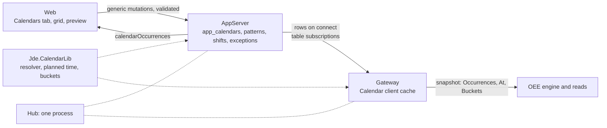

# Calendar spec

2026-10-19, its open questions ruled the same day and the 21 findings of its review ([`calendar-spec-review.md`](../../../reviews/calendar-spec-review.md)) folded in the same day; the plan is [`plan.md`](plan.md), whose review ([`calendar-plan-review.md`](../../../reviews/calendar-plan-review.md)) folded two items here 2026-10-20. Nothing here is built. Its first consumer is the OEE spec ([`../oee/spec.md`](../oee/spec.md)), whose own schedule tables it replaced the same day (*Fit with the OEE spec*).

## Overview

A plant does not run around the clock. It runs shifts: a weekly pattern, or a rotation, of start times and lengths on the plant's wall clock, with breaks, and with holidays, shutdowns and extra Saturdays laid over it. Every figure that compares what a machine did with what it was meant to do needs that pattern, and the first such figure is OEE, whose planned production time is the shifts less their breaks and the closed exceptions ([`../oee/spec.md`](../oee/spec.md) *Calendars*). The OEE draft puts the schedule in the gateway's schema, where only that gateway's machines see it.

This spec makes the shift calendar a thing of its own, held by the AppServer and shared with every gateway that connects to it, as users, groups and the acl are: a site with three gateways enters its pattern once, and a report that spans them agrees about what a shift is. It is three parts. The **tables** join the `app` schema, with the validation their edits need. A **library** turns a calendar's rows into shift occurrences, planned time and the buckets a report is cut into, for any range, in the calendar's zone, with no database in it. A **client** a gateway holds is a cache of every calendar, loaded on connect and kept current by subscription, so the OEE engine answers "what shift is it" from memory. The web gains a Calendars tab on the AppServer's page: the pattern on a grid, the exceptions, and a preview of a resolved week.

Line numbers cite opc-hub2 at `4bf17829`, main with the gateway refactor merged. Refs re-anchored on 2026-10-23, the UA server library's move among them, cite branch `servers-1a-ua-server-library`.

## Requirements

| Area | Requirement | From |
| --- | --- | --- |
| Calendars | A calendar is a named time zone and production-day start with one or more dated **patterns** of shifts and a list of dated **exceptions**. A site may hold several: a plant per zone, a line on another rotation. | this spec, *Open questions* #1 |
| Patterns | A pattern is a cycle of `cycleDays` days, 7 by default, anchored on a date, and its shifts: a name, the cycle days it runs, a start as minutes after the production day's start, a length, and breaks as offsets from the start. A shift may cross midnight and belongs to the day it starts on. A pattern's shifts do not overlap. | *Open questions* #3, #5 |
| Pattern changes | A pattern is in effect from its `effective`, the start of a production day, to the next pattern's. A change of hours from a date is a new pattern, so last month's figures are still computed under last month's shifts; a correction edits the pattern in place and changes past reports at the next read. | *Open questions* #4 |
| Exceptions | A dated range that closes time, a holiday or a shutdown, or opens it, an extra Saturday. Closed beats open. | this spec |
| Times | A shift's times are wall-clock minutes, rules in the calendar's zone. Every stored date or range is a UTC dateTime, a date being the instant its production day starts in the zone, converted in the zone when read. | *Open questions* #10 |
| Resolution | For a range: the shift occurrences in it with their breaks, the closed exceptions cut and the open ones added; the planned spans and their total; the occurrence at an instant and the next boundary; buckets by shift, day, week or month in the calendar's zone, a day beginning at `dayStart` and a week on Monday. A local time resolves on the clock-change night so that a shift there is an hour short or long. | this spec, OEE spec *Reads* |
| Reads | The tables through the generic table QL, four flat reads a client assembles, since the generic select joins no one-to-many child. `calendarOccurrences(calendar, start, end)` answers the resolved occurrences, so the web and any remote tool get one resolver's answer. | this spec |
| Edits | The generic table mutations, validated server-side: the zone resolves, the numbers are in range, breaks fit their shift, a pattern's shifts do not overlap, an exception runs forward, a zone-less time is local in the calendar's zone. `createCalendar` makes the first pattern, `copyCalendarPattern` copies one from a date, a purge takes the children first. | *Open questions* #6 |
| Client | A gateway holds every calendar in memory: loaded when it connects to the AppServer, reloaded on an edit anywhere and on a reconnect. A consumer reads an immutable snapshot and hears which calendars changed. In the hub the same client runs against the in-process QL. | this spec |
| Access | The four tables ship as resources of the `app` schema, gated as tables are; `calendarOccurrences` needs Read on `calendars`. A split gateway reads them as its own user, so a site that enforces them grants it Read. | historian spec *Authorization* |
| Web | The AppServer's page gains a **Calendars** tab and a detail page: Properties, the pattern on a grid with its shifts and breaks, the Exceptions table, a Preview of a resolved week; a help topic. | *Open questions* #7 |
| Consumers | OEE's machines name a calendar by id and take planned time, the current shift and by-shift buckets from the client's snapshot; the OEE spec's own schedule tables go. | OEE spec |
| Deploy | Nothing to configure: the tables join the `app` schema the AppServer and the hub already mount, and a gateway's client needs no settings. | this spec |

## Design

**Placement.** `libs/calendar`, target `Jde.CalendarLib`, laid out as the access library is: the model and resolver at its root, a `server` directory with the QL awaits the AppServer routes ([`accessServer.h:18`](../../include/jde/access/server/accessServer.h#L18) is the model), a `client` directory with the cache a gateway holds ([`accessClient.h`](../../include/jde/access/client/accessClient.h)), and headers under `include/jde/calendar`. `Jde.App.ServerLib` links it for the server half, `Jde.Opc.GatewayLib` for the client half, and the hub, which links both, gets one copy of each. The tables are rows of [`app-meta.jsonnet:25`](../../apps/AppServer/config/app-meta.jsonnet#L25), so they are mounted with the prefix `app_` wherever the `app` schema is, synced on start and introspected with the rest; there is no settings block and nothing in [`App.Server.jsonnet`](../../apps/AppServer/config/App.Server.jsonnet). The library's root has no database and no QL: it is given a calendar as the json the table QL returns and answers questions about time, so its tests are tables of instants.

**Tables.** Four, in the `app` schema. `calendars` has the slug columns, `timeZone`, varchar 64, an IANA name resolved as the historian's is ([`Historian.cpp:41`](../../libs/historian/src/Historian.cpp#L41)), and `dayStart`, uint16 minutes after midnight, 0 by default, where the production day begins: with 360, Monday's day runs from 06:00 Monday to 06:00 Tuesday, and a night shift that starts at 22:00 is Monday's. `calendarPatterns`: `calendarId`, a foreign key, `effective`, dateTime, the instant the production day the pattern starts on begins in the calendar's zone, its local midnight plus `dayStart` as UTC, null on a calendar's first pattern, which is in effect from the beginning of time, and not `from`, an SQL reserved word the DDL would emit unquoted ([`Column.cpp:70`](../../libs/db/src/meta/Column.cpp#L70)), `cycleDays`, uint8, 7 by default, 1 to 31, and `cycleStart`, dateTime, the start of the production day that is day 0 of the cycle, null for a 7-day cycle whose day 0 is Monday, and `created` and `deleted` from the slug set ([`common-meta.libsonnet:52`](../../libs/db/config/common-meta.libsonnet#L52)), so a pattern is deleted and restored as a calendar is; a pattern is in effect from its `effective` to the next pattern's, and the natural key is (calendarId, effective), which a soft-deleted pattern keeps until its purge, as a deleted group keeps its slug. `calendarShifts`: `calendarPatternId`, `name`, `days`, uint, a bitmask whose bit i is cycle day i, 32 bits because the web's numbers are exact only to 53 and a ulong would not survive the round trip, `start`, uint16 minutes after the production day's start, 0 to 1439, `minutes`, uint16, 1 to 1440, and `breaks`, varchar 2048, nullable, a json list of `{start, minutes}` offsets from the shift's start, json in a varchar as a template member's path is ([`opcGateway-meta.jsonnet:49`](../../apps/OpcGateway/config/opcGateway-meta.jsonnet#L49)); natural key (calendarPatternId, name), and no `deleted`: a shift is a line of its pattern and leaves by purge, as a group's node does ([`opcGateway-meta.jsonnet:73`](../../apps/OpcGateway/config/opcGateway-meta.jsonnet#L73)). `calendarExceptions`: `calendarId`, `name`, `start` and `end`, dateTime instants entered as local times in the calendar's zone (*Validation*), `open`, a bit: false closes the range, true opens it as planned time with no shift, and `created` and `deleted`, so a holiday deleted by mistake comes back. Every stored time is a UTC dateTime, as the historian's timestamps are and as the MySQL session is pinned ([`field.h:21`](../../libs/db/drivers/mysql/src/field.h#L21)): an exception's bounds are instants, and a date is the instant its production day starts in the calendar's zone, read back with the calendar's `DayOf`, since the common types have no date ([`common-meta.libsonnet:9`](../../libs/db/config/common-meta.libsonnet#L9)) and a date held as midnight UTC reads as the day before in any zone west of it. The shift columns are wall-clock minutes, not instants: 06:00 in New York is 10:00Z in summer and 11:00Z in winter, so a shift stored in UTC would drift an hour at each clock change, which is the one thing a shift calendar must not do (*Open questions* #10).

**The cycle.** A shift's day is a day of its pattern's cycle. For the default, a 7-day cycle with no `cycleStart`, day 0 is Monday, so `days` is the weekday mask the grid draws, 1 Monday to 64 Sunday. A rotation sets `cycleDays` to its length and `cycleStart` to a date that was its day 0: a 2-2-3 pattern is 14 days, four-on-four-off is 8, and the crews' 28-day rotations fit under 32. A production day's cycle day is the number of days from `cycleStart`'s production day to it, counted in local dates rather than 24-hour steps so that a clock change does not shift a rotation, modulo `cycleDays`, taken positive for a day before the anchor, so the pattern repeats from the anchor in both directions. The grid shows seven columns named by weekday for the default and `cycleDays` columns named Day 1 to Day n otherwise, with the weekday each falls on for the chosen date beneath, the same component either way (*Open questions* #3).

**Resolution.** The library's `Calendar` holds a calendar's rows and answers for a half-open range, in instants. Its day arithmetic is the historian's ([`Clock.h:26`](../../include/jde/historian/Clock.h#L26)) with `dayStart` added: a day's start is its local midnight plus `dayStart`, resolved with `choose::earliest` as `DayStart` is ([`Clock.cpp:89`](../../libs/historian/src/Clock.cpp#L89)), and the production day of an instant is the latest day whose start is not after it, so the two rules agree by construction on a clock-change night, where subtracting `dayStart` from the instant would file the hour after the day's start on the day before. A shift's occurrence on a day starts at local midnight plus `dayStart` plus `start` and ends at that plus `minutes`, each a local time resolved to an instant on its own, so the shift on the night the clocks change is an hour long or short, as the crew's night was; a local time that does not exist resolves to the instant the clocks jumped to, and one that exists twice to its first. A break is two such local times. `Occurrences(start, end)` walks the days a range touches, from the day before its first, since a shift that started yesterday may still be running, picks the pattern in effect on each day, the latest whose `effective` is null or not after the day's start, the lowest id should two rows ever tie, and its shifts whose `days` bit is set for the day's cycle day, and cuts: a closed exception removes its span from every occurrence and break it overlaps, splitting one it falls inside, and an open exception adds an occurrence for whatever of its span neither a shift nor a closed exception covers. Each occurrence is `{shift, name, day, start, end, breaks[{start, end}]}`, `shift` the row's id and `name` the shift's, or null and the exception's name for an open exception, `day` the production day; an occurrence that overlaps the range comes back whole, so a chart can draw it. `Planned(start, end)` is the occurrences less their breaks, merged and clipped to the range, with the total of what lies inside it. `At(t)` is the occurrence containing `t`, or none, and `Next(t)` the next instant at which anything changes, so a consumer sets one timer. `Buckets(start, end, by)` cuts a range at shift occurrences, production days, Monday-start weeks of production days or calendar months of them, each `{start, end, label}`, the label the occurrence's name or the day, week or month, the first and last clipped to the range, and an ISO 8601 duration from `PT1M` cuts from `start`; with `shift`, time outside an occurrence falls in no bucket. A consumer that wants a figure for a shift takes the bucket's bounds and sums its own rows between them, which is how the OEE spec's *Reads* already work.

**Validation.** The edits are the generic table mutations, so the web's forms and `createCalendar(…)` on `/graphql` are what everyone writes, but a `CalendarMAwait` in the library's server half claims the four tables' mutations by table name, create, update, delete, restore and purge on `calendars`, `calendarPatterns` and `calendarExceptions` and create, update and purge on `calendarShifts`, as `HistGroupMAwait` claims the groups' ([`HistGroupQLAwait.cpp:22`](../../apps/OpcGateway/src/ql/HistGroupQLAwait.cpp#L22)), and joins `App::Server::CustomMutation` after the access library's arm ([`AppServerQL.cpp:40`](../../apps/AppServer/src/ql/AppServerQL.cpp#L40), [`:41`](../../apps/AppServer/src/ql/AppServerQL.cpp#L41)), the free function `AppServerQL` ([`:62`](../../apps/AppServer/src/ql/AppServerQL.cpp#L62)) and `HubQL` ([`HubQL.cpp:20`](../../apps/OpcHub/src/ql/HubQL.cpp#L20)) both call, so the hub validates as the standalone AppServer does. The await authorizes first, with the table's rights for the mutation's type as `HistGroupMAwait` does ([`HistGroupQLAwait.cpp:223`](../../apps/OpcGateway/src/ql/HistGroupQLAwait.cpp#L223)), so a validation message never precedes a refusal. It refuses, as `BadRequest`: a `timeZone` the zone database does not know; a `dayStart` of 1440 or more; `cycleDays` outside 1 to 31, a cycle other than seven days without a `cycleStart`, or a `cycleDays` lowered under a shift's higher bit; a `days` bit at or beyond `cycleDays`; a `start` of 1440 or more, `minutes` outside 1 to 1440; breaks that leave the shift or overlap each other; two shifts of a pattern whose occurrences would overlap, checked over the cycle with its wrap, since the shift at an instant must have one answer (*Open questions* #5); an exception whose `end` is not after its `start`; a second pattern with a null `effective` on a calendar, by a create or a restore, since a unique index lets NULLs repeat and the natural key refuses only a duplicate date; and the deletion of a calendar's only pattern; a pattern on a soft-deleted pattern's date the natural key refuses, and the message says to purge the old one first. A time with `Z` or an offset is an instant; one without is a local time in the calendar's zone, which the await resolves with `choose::earliest`, since the server otherwise reads a zone-less ISO string as UTC ([`chrono.cpp:80`](../../libs/fwk/src/chrono.cpp#L80)), so the web sends local, zone-less, with no zone library, and a raw `/graphql` client gets the same rule. An `effective` or `cycleStart` that is not a production day's start is moved back to the start of the production day it falls in, so every client stores the same instant. It adds three side effects: a calendar's create makes its first pattern, `effective` null, seven days, so a new calendar is ready for its shifts, the way a group's create resolves its members; a change of `timeZone` or `dayStart` re-anchors every pattern's `effective` and `cycleStart` and every exception's bounds, the local time each named under the old settings re-encoded under the new, so what an admin entered stays put; and a purge takes a row's children first, a pattern's shifts before it and a calendar's patterns, their shifts and its exceptions before the calendar, as `HistGroupMAwait::before` does ([`HistGroupQLAwait.cpp:89`](../../apps/OpcGateway/src/ql/HistGroupQLAwait.cpp#L89)), since the generic purge is one delete and the foreign keys are enforced. It also answers one mutation of its own, `copyCalendarPattern( id, effective )`, which creates a pattern and its shifts in order and deletes the new pattern if a shift fails, so the calendar is never left between states (*Web*). After its checks the await runs the stock `MutationAwait`, as `HistGroupMAwait` does ([`HistGroupQLAwait.cpp:258`](../../apps/OpcGateway/src/ql/HistGroupQLAwait.cpp#L258)), so the row writes, the ids, the `deleted` marks and the subscription fan-out are the generic mutation's; the validation has no rights of its own.

**Reads.** The generic table queries serve the tables, flat: `calendars(deleted:null){ id name slug timeZone dayStart } calendarPatterns(deleted:null){ id calendarId effective cycleDays cycleStart } calendarShifts{ id calendarPatternId name days start minutes breaks } calendarExceptions(deleted:null){ id calendarId name start end open }`, four reads in one request, the filter on the three tables that have `deleted`, is what the client loads and assembles, and the web's detail page reads the same shape, as the historian's pages read a group's members ([`hist-admin-service.ts:41`](../../web/opc/control/src/lib/services/hist-admin-service.ts#L41)): the generic select joins a child only through a foreign key on the parent ([`SelectAwait.cpp:205`](../../libs/ql/src/ops/SelectAwait.cpp#L205)), so a nested `calendars{ patterns{ shifts } }` cannot be served, and it adds no implicit `deleted is null` ([`FilterQL.cpp:312`](../../libs/ql/src/types/FilterQL.cpp#L312)), so each read asks for the live rows, as the server's own read for `calendarOccurrences` does. One custom query, `calendarOccurrences(calendar:"plant", start:"2026-10-19T00:00:00Z", end:"2026-10-26T00:00:00Z"){ shift name day start end breaks{ start end } }`, by slug or by `id`, answers `Occurrences` from the server's own rows, claimed in `App::Server::CustomQuery` beside the access library's arm ([`AppServerQL.cpp:26`](../../apps/AppServer/src/ql/AppServerQL.cpp#L26)), which `AppServerQL` and `HubQL` both call; a range longer than a year is refused. It needs Read on `calendars`.

**The client.** `Calendar::Client::Calendars` is a process-wide cache a gateway fills from its app client. In `Gateway::Connect` ([`gatewayStartup.cpp:64`](../../apps/OpcGateway/src/gatewayStartup.cpp#L64)), after the access snapshot ([`:66`](../../apps/OpcGateway/src/gatewayStartup.cpp#L66)) and before `HistHost` starts ([`:70`](../../apps/OpcGateway/src/gatewayStartup.cpp#L70)), it runs the four reads above through `IApp::Query` ([`IApp.h:34`](../../include/jde/app/IApp.h#L34)) and holds each calendar as an immutable `sp<const Calendar>` by id and by slug. It subscribes, through the client's `QLServer()` ([`IAppClient.h:37`](../../include/jde/app/client/IAppClient.h#L37)), to the created, updated, deleted, restored and purged events of each of the four tables, the subscription text the access listener's events use ([`EventsSubscribeAwait.cpp:10`](../../libs/access/src/awaits/EventsSubscribeAwait.cpp#L10)), which every stock mutation publishes on its resume ([`IMutationAwait.h:35`](../../libs/ql/src/ops/IMutationAwait.h#L35)). Any event reloads every calendar, with a trailing debounce of 250 ms that folds the creates of one form submit, rather than patching rows: four tables of a few dozen rows, edited by hand, and a whole reload is one query and no bookkeeping. A socket client's subscriptions die with its socket and come back by themselves: one made through `QLServer()` is remembered on its ack ([`AppClientSocketSession.cpp:256`](../../libs/app/client/AppClientSocketSession.cpp#L256)) and re-issued by `Subscriptions::Replay` ([`clientSubscriptions.h:25`](../../include/jde/app/client/clientSubscriptions.h#L25)) on the new session. The rows do not, and nothing above `libs/app` can run on that reconnect today, so `IAppClient` gains a seam, a virtual `OnReconnected()` with an empty default that `Client::Connect` calls where it reloads the access snapshot ([`appClient.cpp:45`](../../libs/app/client/appClient.cpp#L45)), and `GatewayAppClient` overrides it to reload the calendars, since edits made while the gateway was away have to be fetched anyway. In the hub the client is the same code: `HubAppClient::QLServer()` ([`HubAppClient.h:13`](../../apps/OpcHub/src/HubAppClient.h#L13)) is the `HubQL`, the query runs in-process and the subscriptions sit in the `LocalSubscriptions` map the AppServer's own listener uses. A consumer calls `Calendars::Find(id)` for a snapshot, null for a calendar that is gone, and `Calendars::Listen(fn)` for the ids a reload changed, compared row for row, so OEE's live shift sums reset only for a calendar that changed. A split gateway reads as the user its session has ([`IAppClient.h:36`](../../include/jde/app/client/IAppClient.h#L36)); the hub reads in-process as System.

**Authorization.** The four tables ship as resources of the `app` schema as every table does, which an admin enforces on the Resources page; their generic reads and edits take Read, Create, Update, Delete and Purge, and `calendarOccurrences` Read on `calendars`. Unenforced, they pass anyone, which is how a first run enters its shifts. A site that enforces `calendars` or its children grants Read to each split gateway's user, or that gateway's client loads nothing and logs an Error; the AppServer's [`README.md`](../../apps/AppServer/README.md) says so. The hub's in-process client reads as System and needs no grant.

**Web.** The AppServer's page ([`app-server-detail.html:6`](../../web/framework/control/src/lib/pages/apps/app-server-detail/app-server-detail.html#L6)) gains a **Calendars** tab beside Logs, Log Settings and Web Sessions: a `ql-list` over `calendars` resolved when the tab opens, as the gateway's Templates and Groups tabs are ([`gateway-hist-list.ts`](../../web/opc/control/src/lib/pages/gateway-detail/hist-admin/gateway-hist-list.ts)), with a detail route `apps/appServers/<instance>/calendars/<slug>`, its loader in [`framework-pages.ts`](../../web/framework/control/src/lib/pages/framework-pages.ts), and the bare `calendars` url redirecting to the page as the historian's lists do ([`app.routes.ts:118`](../../web/opc/site/app/app.routes.ts#L118)). The detail page's tabs: **Properties**, the name, slug and description, the zone from the browser's list of IANA names, `Intl.supportedValuesOf`, with the server's own preselected, which `status{}` carries as a `timeZone` field added to `IApp::Status()` ([`IApp.h:25`](../../include/jde/app/IApp.h#L25)) (*Open questions* #8), and the day start; **Pattern**, a date picker, today by default, selecting the pattern in effect, the grid, a column per cycle day and the hours down, a bar per shift with its breaks cut out, a bar opening the shift's form and a drag on empty space, or Add, creating one, a *Change from…* action that calls `copyCalendarPattern` (*Validation*) and shows the copy, since a pattern is in effect the instant its row lands and a copy made row by row would leave it without shifts for a moment and half-copied after a failure, and the list of patterns with each `effective` as a date in the zone, Delete and Purge on each, a shift's removal from the grid a purge; **Exceptions**, a table with Add, Delete and Purge, a name, a start and end entered in the calendar's zone with whole days offered, and closed or open; **Preview**, a week picker and the week resolved by `calendarOccurrences`, the occurrences as bars with the exceptions applied, so a clock-change night and a holiday are seen before a report depends on them. A refusal from the validation shows as the form's error, as the group forms show theirs. Delete and Purge confirm with a line that calendars are shared and that a machine on a deleted calendar is planned around the clock until it is re-pointed, since the AppServer has no cross-schema check to make; the help topic says the same. A help topic, `calendars.md` beside [`apps.md`](../../web/framework/control/src/assets/help/apps.md), explains the production day, the cycle and pattern changes. Elsewhere, the OEE machine form on a gateway's page picks a calendar from this list through the AppServer's GraphQL, the service the Access pages use, and links to its page.

**Fit with the OEE spec.** Applied 2026-10-19, once the questions below were ruled: [`../oee/spec.md`](../oee/spec.md) changed in these places and no others. Its Schedules requirement row and *Schedules* design paragraph became *Calendars* and refer here. `oee_schedules`, `oee_shifts` and `oee_schedule_exceptions` are gone, and `oee_machines.oee_schedule_id` became `calendar_id`, a value rather than a foreign key, since the calendar is another schema's row and, in a split deployment, another process's; the machine form validates it by lookup, and a machine whose calendar `Calendars::Find` no longer answers is planned around the clock and its status says so. *Figures* and *Reads* take planned time, the `shift` label and the `by` buckets from the client's snapshot; `day_start` and the clock-change rule live here. The Schedules tab left the gateway's page, so its piece 2 lost three tables and piece 5 a tab and a size, and the calendar cases of its *Tests* moved to this library's suite. Its *Open questions* #4, breaks, stays its own: the calendar reports breaks on each occurrence, and what they mean to a figure is the consumer's.

**Tests.** The library's suite: the resolver across both clock changes in `America/New_York`, a night shift over midnight under a 06:00 `dayStart` landing on the day it started, a 14-day cycle from an anchor, a closed exception splitting a shift and an open one adding a Saturday, breaks cut and counted, `Buckets` by shift, day, week and month across a month boundary and a clock-change night, a second pattern from a date and the occurrences on either side of it, `At` and `Next` across a boundary, an instant between local midnight and `dayStart` on each clock-change day and the second pass of a repeated hour under a `dayStart` inside it, a range that starts inside a shift, an `effective` inside a day moved to the day's start, a zone-less local time resolved in the zone beside an offset time taken as it is, a zone change re-anchoring the dates and the exceptions, and each validation refusal. The AppServer's suite: the tables sync, `createCalendar` makes its pattern, a refusal comes back `BadRequest`, `calendarOccurrences` agrees with the library, and a listener on the subscriptions hears a shift's update. The gateway's suite, which embeds an AppServer and a gateway: the client holds the seeded calendar after connect, follows an edit within a few seconds, and after its socket is dropped and reconnected holds an edit made while it was away; the hub's test embeds the in-process variant. The web's model tests cover the grid's layout and the mask.

**Later.** Recurring exceptions, every 25 December. Named holiday sets by region. iCal import and export of a pattern. Crews: which team works which occurrence of a rotation, for OEE by crew. A site default calendar, so a new machine needs no pick. Calendar-driven collection, a group that historizes during shifts only. A `_Calendar` object on the gateway's endpoint once the servers spec is built ([`../servers/spec.md`](../servers/spec.md)). Overlapping handover shifts, which need a rule for the shift at an instant. A usage count of a calendar across the gateways, for the delete confirmation.

**Out of scope.** Workforce scheduling and rosters, time and attendance, labour rules and payroll, room and equipment booking, and the enterprise calendars a planning system keeps: this calendar says when production is planned, not who is on it.

## Pieces

Sizes are the GitHub project's Size field. The library and the host are what OEE needs; the client follows, and the web closes it.

| # | Piece | Size | Notes |
| --- | --- | --- | --- |
| 1 | The library | M | `libs/calendar`: the model from the table json, the resolver, `Planned`, `At`, `Next`, `Buckets`, the suite |
| 2 | The AppServer host | M | the four tables, `CalendarMAwait` on the shared `App::Server::CustomMutation` with its refusals, the local-time rule, the first-pattern side effect, the re-anchoring, the purge order and `copyCalendarPattern`, `calendarOccurrences`, `timeZone` on `status`, the resources, the README line |
| 3 | The client | S | the cache, the four flat reads on connect, the subscriptions and the debounced reload, the `OnReconnected` seam on `IAppClient` and its reload, `Find` and `Listen`, wired into `Gateway::Connect` and the hub |
| 4 | Web | L | the Calendars tab, the detail page, the grid, pattern changes, the exceptions, the preview, the help topic |

## Open questions

All ten ruled 2026-10-19, each as recommended; #10 was widened the same day, at the user's question, from the exceptions to every stored time.

1. **Home.** The AppServer's schema, one library with a server half and a client half, every gateway a reader. Recommended: a site enters its shifts once, a report across gateways agrees, and the hub, which is what ships, has the rows in-process anyway. The alternative is the OEE draft's: the tables in the gateway's schema, a copy per gateway, nothing to cache. Ruled 2026-10-19: as recommended.
2. **Shape.** A pattern of shifts on a cycle plus dated exceptions, resolved on demand. Recommended: it is what a plant writes on the wall, and a year is a few dozen rows. The alternative stores every shift occurrence as a row, a timetable an import could fill, which a pattern expresses in less and a preview can still show; iCal import is *Later* over this shape. Ruled 2026-10-19: as recommended.
3. **Cycles.** `cycleDays` and `cycleStart` on the pattern from the first cut, the weekly grid the default. Recommended: a rotation is a modulo in the resolver and columns on the same grid, and adding it later changes what `days` means. The alternative is weekly only, with rotations later. Ruled 2026-10-19: as recommended.
4. **Pattern changes.** Dated patterns: a change of hours is a new pattern from a date, a correction edits the one in effect. Recommended: a report for last month must not move because this month's hours changed, which the OEE spec's read-time rule would otherwise make it do. The alternatives: edit in place and accept the rewrite; or `from` and `until` on each shift, which needs a new name for a shift whose hours change and a grid that shows several versions of one. Ruled 2026-10-19: as recommended.
5. **Overlap.** A pattern's shifts may not overlap, and the mutation refuses one that would. Recommended: by-shift buckets partition time, the live tile shows one shift, and a handover is drawn at one boundary. The alternative allows it and gives the earlier shift the overlap. Ruled 2026-10-19: as recommended.
6. **Validation.** Server-side, in `CalendarMAwait`, with the web's forms checking first. Recommended: `/graphql` is open to any client, and a bad zone or an overlap would reach every gateway's cache. The alternative is web-only checks. Ruled 2026-10-19: as recommended.
7. **Where in the web.** A tab on the AppServer's page with detail routes under it, as the historian's admin is on the gateway's. Recommended: the hub's pages are per application and the AppServer is one per site. The alternative is a top-level Calendars section with the Access idiom's cards and sidenav, which gives the calendars a navbar entry of their own. Ruled 2026-10-19: as recommended.
8. **Default zone.** A new calendar's zone defaults to the AppServer's own, `std::chrono::current_zone()`, offered in the form. Recommended: a plant runs on its wall clock, which is the server's. The alternative is UTC, the historian's default, which is a filing choice there and would be wrong on every grid here. Ruled 2026-10-19: as recommended.
9. **Deleted calendars.** A soft-deleted calendar leaves the client's cache, and a consumer that names it finds nothing. Recommended: that is what delete means everywhere else, and the OEE spec already says what a machine without a calendar is. The alternative keeps a deleted calendar resolvable until its purge. Ruled 2026-10-19: as recommended.
10. **Stored times.** Every stored time a UTC dateTime: an exception's bounds as instants entered as local times in the zone, a pattern's `effective` and `cycleStart` as the instant its production day starts in the zone, and the shift columns as wall-clock minutes, rules rather than instants. Recommended: one convention with the rest of the product, one zone doing every conversion, and a shutdown keeps its half day. The alternatives: ISO text for the dates, which this draft first had because the common types have no date; local dates for the exceptions, which cannot say a half day; or UTC minutes for the shifts, which drift an hour at each clock change in any zone that has one. Ruled 2026-10-19: as recommended, widened from the exceptions alone at the user's question.