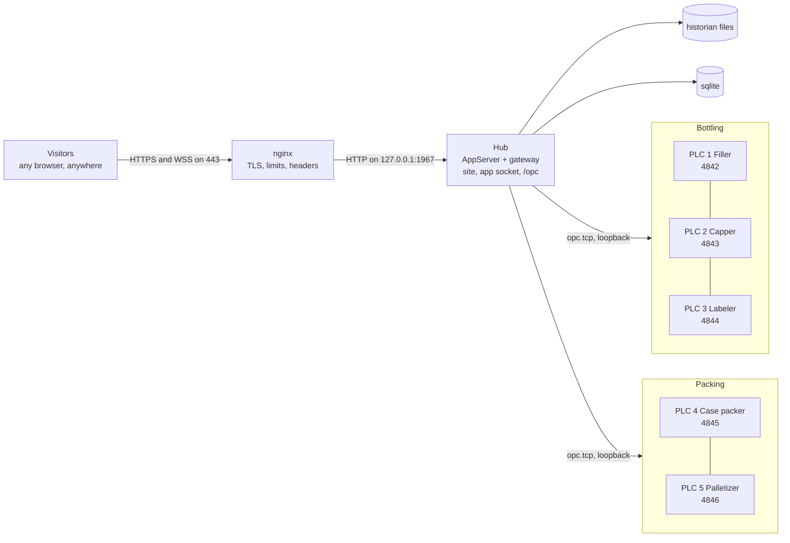

# Demo site spec

2026-10-21, drafted from a three-line ask: a demo site with two lines and five PLCs, reachable from anywhere, with a page that maps the factory floor and outlines each machine by its state, with its OEE. Nothing here is built. Open questions #1 to #11 were ruled 2026-10-21, each as recommended; #12, the name and the host, is still the owner's to answer. Its review's thirteen findings ([`demo-spec-review.md`](../../../reviews/demo-spec-review.md)) were ruled fix as recommended and folded in the same day, one of them into the OEE spec's *Live* as well. Its plan is [`plan.md`](plan.md) (2026-10-21), whose review ([`demo-plan-review.md`](../../../reviews/demo-plan-review.md)) was ruled fix as recommended and folded the same day, here where it touched the spec. Its issues are [#476](https://github.com/Jde-cpp/opc-hub/issues/476), the parent, and #477 to #487, one per plan phase.

## Overview

The product is easiest to judge running. The demo is one small plant, live, at a public name. It is a site with two lines, Bottling and Packing, and five machines, each behind a PLC of its own that speaks OPC UA. The hub's gateway connects to the five as it would to any server, the historian keeps their signals, and the OEE engine turns them into stops and figures. Anyone with a browser, anywhere, opens the site without an account, onto a map of the plant's floor. Each machine is drawn where it stands, outlined in the colour of its state, with its OEE for the shift inside it, and each line is drawn around its machines with the line's own figures.

Most of it is planned elsewhere, so the demo comes after those plans:

- The PLC is the emulator's server transport ([`../servers/plan.md`](../servers/plan.md) *Phase 6*, [#387](https://github.com/Jde-cpp/opc-hub/issues/387)).
- The counts, rejects and stops are its production mode ([`../oee/plan.md`](../oee/plan.md) *Phase 7*, [#407](https://github.com/Jde-cpp/opc-hub/issues/407)).
- The machines, lines, reasons, figures and live feed are the OEE spec's ([`../oee/spec.md`](../oee/spec.md)).
- The shifts are the calendar spec's ([`../calendar/spec.md`](../calendar/spec.md)).

This spec adds four things:

- **The floor map:** a product page, with its tables and its editor, that every site with OEE lines gets.
- **Guest sessions:** an install setting, off by default, under which a session nobody signed in to acts as a named user.
- **The public origin:** the site reaches the hub on the port it was served from, behind a TLS front.
- **The demo itself:** the machines' nodeset, the five PLCs' settings, the deployment, the seed that builds the plant's rows, and the operations that keep it running.

The hub has little today for a public site:

- **One port.** It serves the site and both sockets on 1967, TLS or plain on that one port ([`ServerImpl.cpp:85`](../../libs/web/server/ServerImpl.cpp#L85)).
- **Its own certificate.** It uses a self-signed certificate it manages, or a pair it is given ([`install/args.libsonnet:48`](../../apps/OpcHub/config/args/install/args.libsonnet#L48)).
- **A fixed port in the page.** The page calls the hub on 1967 whatever port it came from ([`environments/environment.ts:6`](../../web/opc/site/environments/environment.ts#L6)).
- **No limits.** Nothing limits requests or connections.
- **No guest.** Every resource ships unenforced, so a table's reads and edits pass anyone ([`ResourceLoadAwait.cpp:96`](../../libs/access/src/awaits/ResourceLoadAwait.cpp#L96)), the history edits apart, which refuse until enforced. Once a resource is enforced, an anonymous session is refused it ([`Authorize.cpp:156`](../../libs/access/src/Authorize.cpp#L156)).
- **No rights on sign-in.** A user who signs in with Google is enrolled with no rights at all ([`Authorize.cpp:494`](../../libs/access/src/Authorize.cpp#L494)).

The design closes each of these for the demo without changing what an install that sets nothing gets.

Line numbers cite opc-hub2 at `af6ea641`, main with the web and OpcServer refactors merged, as the Open Protocol spec does. Refs re-anchored on 2026-10-23, the UA server library's move among them, cite branch `servers-1a-ua-server-library`.

## Requirements

| Area | Requirement | From |
| --- | --- | --- |
| Plant | One site and two lines. Bottling has a Filler, a Capper and a Labeler; Packing has a Case packer and a Palletizer. | the ask |
| PLCs | Five OPC UA servers, one per machine, each with its own endpoint, certificate and applicationUri. The gateway has one connection to each. | the ask, *Open questions* #1 |
| Signals | Each machine has a run status, a total count, a reject count, a reason code and a speed. Every session can read them and none can write them. | this spec, *Open questions* #2 |
| Production | Counts at each machine's cycle and rejects. Stops of every OEE kind: unplanned with a code, planned, excluded, small and uncoded. Slow periods. Random stops, not on a fixed period. | OEE spec *Emulator* |
| OEE | Five machines over five historian groups, the two lines and the site, one reasons list, and a shift calendar every day. | OEE spec, calendar spec, *Open questions* #9 |
| Floor map | A page for every line that has a floor. Each machine is an outline coloured by its state, with its OEE, availability, performance, quality and state inside. Each line is an outline with its figures. The page is live, links through to the OEE pages, works on a phone, and needs no add-on. | the ask, *Open questions* #4, #5 |
| Floor editing | An editor places a line's machines and draws fixtures. A floor exports to json and imports from it. | this spec |
| Reach | The site is at a public name over HTTPS on 443, with its sockets, from anywhere. It needs no VPN and no client install. | the ask, *Open questions* #6 |
| Visitors | No sign-in. A visitor reads the plant and changes nothing. A visitor's reads of users, sessions and logs are refused. | this spec, *Open questions* #3 |
| Limits | Request and connection limits per address in front of the hub. The hub's own read and body limits still apply; its session count is bounded by `http.timeout` times the rate the front allows, not by the front. | this spec |
| Opening | The name is published after a week's soak. Before the box first deploys, every open security advisory a caller can reach without a login is closed, since the name is public from its first certificate. | this spec |
| Operations | Units restart on failure. A seed builds the plant from an empty database. Old history is removed on a schedule. A smoke test runs after every deploy, and an outside check watches the site. | this spec, *Open questions* #7, #8 |

## Design



**The plant.** There is one site, `plant`, at the Site level. It holds two lines, `bottling` and `packing`, at the Line level (OEE spec *Lines*). Each machine is in one line and sits behind its own PLC on its own port:

| PLC | Port | Machine | Line | Ideal cycle | Rejects | Stops and slow periods |
| --- | --- | --- | --- | --- | --- | --- |
| 1 | 4842 | Filler | Bottling | 1 s a bottle | 1 % | Jam: random, about every 40 minutes, for 2 to 6 minutes. Small stops: about every 10 minutes, for 20 to 90 s. Changeover: at each shift's start, for 20 minutes. |
| 2 | 4843 | Capper | Bottling | 1 s a bottle | 0.5 % | Fault: random, about every 2 hours, for 5 to 15 minutes. A slow half hour each shift at 80 % speed. |
| 3 | 4844 | Labeler | Bottling | 1 s a bottle | 3 % | Jam: random, about every hour, for 2 to 5 minutes. A stop with no code about every 3 hours. |
| 4 | 4845 | Case packer | Packing | 24 s a case of 24 | 0.2 % | Starved: random, about every 90 minutes, for 5 to 20 minutes. |
| 5 | 4846 | Palletizer | Packing | 60 s a layer | 0 | Cleaning: at the day shift's start, for 30 minutes. No orders: an hour a day. |

The reasons are the gateway's single list (OEE spec *Reasons and codings*):

- **Unplanned:** Jam 1, Starved 2 and Fault 3.
- **Planned:** Changeover 10 and Cleaning 11.
- **Excluded:** No orders 20.

A stop whose code is 0 is uncoded. The demo leaves it uncoded, since visitors code nothing, so the Uncoded badge is always somewhere on the floor. The soak tunes the numbers in the table so that each machine reads an OEE between about 60 and 85 percent and the two lines differ.

**The PLCs.** Each PLC is a `Jde.Opc.PlcEmulator` process on `-transport=server` (servers plan *Phase 6*). In that mode it runs the PLC server alone, on the server library's security, logging its sessions in through the hub, with no PubSub writer and no session on an OpcServer. There is one process per PLC (*Open questions* #1). Each has an overlay of the emulator's settings ([`Opc.PlcEmulator.jsonnet:48`](../../apps/OpcServer/emulator/config/Opc.PlcEmulator.jsonnet#L48)) under `apps/OpcServer/emulator/config/demo/`, over an installed config of its own, `Opc.PlcEmulator.Install.jsonnet`, which reads no ext var, since the dev config's are bound only under `-tests`, and which sets:

- `plc.port`, 4842 to 4846, and `plc.bind`, loopback, since only the gateway on the same box dials them. 4842 is the emulator's port once servers plan 0.1 moves it ([#378](https://github.com/Jde-cpp/opc-hub/issues/378)).
- `applicationUri`, `urn:jde:demo:plc<N>`, and the channel certificate's SAN with it.
- Its own `ssl.productName`, `PlcEmulator.plc<N>` on the login's `ssl` block under `http` and `PlcEmulator.plc<N>.opc` on the channel's under `emulator`, and a `commonName` beside each, `plc<N>` and `plc<N>.opc`: `productName` chooses the directory ([`CryptoSettings.cpp:44`](../../libs/fwk/src/crypto/CryptoSettings.cpp#L44)) and the CN defaults to the process's name ([`:14`](../../libs/fwk/src/crypto/CryptoSettings.cpp#L14)), so each PLC has its own login and channel certificates, in two directories, made once by `-createCert`, and its own hub user, enrolled from the CN at its first login.
- `plc.nodeset`, the demo's nodeset.
- One device, `Machine`, with its tags.

`Opc.Hub.Demo.jsonnet` lists the five login directories in `access.trustedCertDirs`, the AppServer's enrollment anchors, which the install sets to the OpcServer's alone ([`install/args.libsonnet:31`](../../apps/OpcHub/config/args/install/args.libsonnet#L31)), and the five channel directories in `gateway.trustedCertDirs`, no directory in both, so the hub enrolls each PLC's user and the collector trusts each PLC's channel; each PLC trusts the gateway's through its own `trustedCertDirs`. A PLC that cannot log in validates no session, the collector's included, so the certificates are made before the PLC units start (*Seed and operations*). The OpcServer, the bundled first connection, is not run: the demo's servers are its five PLCs, and the OpcServer's unit, which ships disabled ([`README.md:95`](../../apps/OpcHub/setup/linux/README.md#L95)), stays so, and the seed purges its connection row.

**The machines' signals.** `demo.NodeSet2.xml` sits beside the pumps' nodeset ([`pumps.NodeSet2.xml:44`](../../apps/OpcServer/config/nodesets/pumps.NodeSet2.xml#L44)). It declares a `MachineType` with these variables:

- `status`, a Boolean, true while the machine runs.
- `totalCount` and `rejectCount`, UInt32.
- `reasonCode`, Int32.
- `speed`, a Double in units a minute, with an `EURange`.

It also declares one `Machine` object of that type under Objects, its five variables declared under it since NodeSet2 does not instantiate a type ([`pumps.NodeSet2.xml:7`](../../apps/OpcServer/config/nodesets/pumps.NodeSet2.xml#L7)), which every PLC loads. So a node's id is the same on all five PLCs, and one template resolves on each.

Every variable has `AccessLevel` 1, CurrentRead alone. The emulator writes its own nodes inside the server, which `AccessLevel` does not stop. No session can write one, a visitor's through the node browser included, whatever the server's access callback would allow.

The pumps keep the OEE spec's role as the rig for the suite and the dev box (its *Open questions* #11); this nodeset is the demo's (*Open questions* #2).

**Production.** The OEE plan's `production` mode drives `totalCount` and `rejectCount` from `status`. Its device-level `stops` list, `{every, for, code}`, holds `status` off and sets `reasonCode` ([`../oee/plan.md`](../oee/plan.md) *Phase 7*). A demo that repeats the same stop every 40 minutes looks scripted, so this spec adds two stop shapes and a slow-period list:

- **`{mean, min, max, code}`:** a random stop. Its start follows an exponential gap whose mean is `mean`, and its length is uniform between `min` and `max`. Each device gets a random engine of its own, a `std::mt19937_64` seeded from a new device key, `seed`, else from the start time, so the suite can fix it; the emulator's `Math::BitGen()` is seeded from the OS per thread ([`mathUtils.h:21`](../../include/jde/fwk/utils/mathUtils.h#L21)) and cannot be, and a seeded `absl::BitGen` is salted per process, so it repeats within one run only.
- **`{at, for, code}`:** a stop at a time of day, in the zone a new emulator key, `zone`, names, an IANA name, the calendar's, for a changeover or a cleaning at a shift's start.
- **`slow`:** a list with the same three shapes, each entry with a `factor` that stretches the cycle. It is a performance loss with no stop.

`speed` lags as the existing `follow` mode lags ([`Signals.cpp:73`](../../apps/OpcServer/emulator/Signals.cpp#L73)), whose target is `ratedRpm` or 0 by the device's command; here the target is the production mode's current rate, the cycle under the `slow` factor, or 0 in a stop. The production mode writes `reasonCode` 0 when a stop ends and the stop's code when one begins, since the engine takes a stop's code from the value held at its start or the first non-zero value before its end (OEE spec *Stops*), and a code left standing would label the next uncoded or small stop with it; a stop with code 0 so leaves `reasonCode` 0, an uncoded stop. Each machine's settings are in its overlay, so the soak tunes the figures without a build.

**The plant's rows.** The seed (*Seed and operations*) makes these through the hub's GraphQL:

- First, `owner` for the seed's own certificate user, enrolled by its first login: an enrolled user has no role ([`Authorize.cpp:494`](../../libs/access/src/Authorize.cpp#L494)) and the hub leaves the first grant to the first user ([`README.md:175`](../../apps/OpcHub/README.md#L175)), so without it the last step below would lock the seed out with everyone else. Every later step runs as that user, and so does the admin.
- Five `server_connections`, `plc1` to `plc5`.
- One template over `Machine`'s five variables, and a group from it for each connection, `filler` to `palletizer`. The counters' thresholds store every change, as the OEE spec asks of a count member (*Machines*).
- The reasons.
- An AppServer calendar, `plant`, in the plant's zone, `America/New_York` in the shipped seed. It has three eight-hour shifts from 06:00 every day, each with a 30-minute break (*Open questions* #9).
- The five machines. Each has its group; its signals, State `status`, Total `totalCount`, Reject `rejectCount` and Reason `reasonCode`; its ideal cycle; `small_stop` of two minutes; the default interval; and the calendar.
- The site and its two lines, each on the `plant` calendar: a line without one keeps the UTC day for its shift (OEE spec *Lines*), and the floor's header would show that day as the shift.
- The floor (*The floor*).
- The guest user and its role (*Guests*), and a `demo-plc` role with Read on `access.users` for the five PLC users: each PLC resolves the collector's certificate by a `users` query run as its own user ([`UAAccess.cpp:222`](../../libs/opc/server/src/UAAccess.cpp#L222)), which an enforced table refuses without it. The users exist from each PLC's first login, so the seed waits for them.
- Last, every resource enforced.

The gateway runs with its `hist` and `oee` blocks from an overlay, `Opc.Hub.Demo.jsonnet`, which imports the installed settings. The overlay, with an args dir of its own, `args/demo`, also sets the loopback address, `access.guest`, `http.trustedProxies` and an `http.timeout` of an hour (*The public origin*), and the five PLCs' certificate directories in `access.trustedCertDirs` and `gateway.trustedCertDirs` (*The PLCs*).

**The floor.** A floor belongs to a line (*Open questions* #4). It is stored in two tables.

`oee_floors`:

- `oee_line_id`, a foreign key with a unique index, so a line has at most one floor.
- `width` and `height`, in metres.
- `grid`, in metres: the editor's snap, half a metre by default.

`oee_floor_shapes`:

- `oee_floor_id`.
- `kind`: Machine, Line, Zone, Wall, Aisle or Label.
- `oee_machine_id` for a Machine shape, or `member_line_id` for a Line shape. The other four kinds, the fixtures, set neither.
- `points`, a json list of `[x, y]` in metres from the floor's top-left.
- `label`, a fixture's text, or a name that overrides the machine's or line's on the map.
- `sort`, the drawing order within its kind.

`OeeMAwait` claims the two tables' mutations, as it claims the lines' (OEE spec *Reads*), and enforces these rules:

- A Machine shape names a machine the floor's line reaches. A Line shape names a line the floor's line reaches, other than itself. Each appears at most once on a floor.
- Machine, Line and Zone shapes are closed polygons of three or more points. Wall and Aisle are open polylines of two or more points. A Label is one point. Every point is on or inside the floor.
- Purging a machine or a line takes its shapes. Purging the floor's own line takes the floor.
- A deleted machine keeps its shape, which the map leaves out until the machine is restored or purged.

The tables are read through the generic table queries and gated as tables are. The figures on the map come from the OEE feed, gated per machine (*Live*). The demo's floor is a 40 by 20 metre hall: Bottling along the north wall, Packing along the south, an aisle between them, the dock at the east end. A start of its export:

```json
{ "width": 40, "height": 20, "grid": 0.5, "shapes": [
	{ "kind": "Wall", "points": [[0,0],[40,0],[40,20],[0,20],[0,0]] },
	{ "kind": "Aisle", "points": [[0,10],[40,10]] },
	{ "kind": "Machine", "machine": "filler", "points": [[3,3],[9,3],[9,7],[3,7]] },
	{ "kind": "Zone", "label": "Conveyor", "points": [[9,4.5],[13,4.5],[13,5.5],[9,5.5]] },
	{ "kind": "Machine", "machine": "capper", "points": [[13,3],[17,3],[17,7],[13,7]] },
	{ "kind": "Label", "label": "Dock", "points": [[38,15]] }
]}
```

**Drawing.** The page is `apps/gateways/<instance>/lines/<slug>/floor`, beside the line's OEE page, with its loader in [`opc-pages.ts:3`](../../web/opc/control/src/lib/pages/opc-pages.ts#L3). The line's OEE page and its dashboard tile link to the floor when the line has one.

The map is an SVG whose viewBox is the floor in metres, fitted to the page. Wheel and pinch zoom, drag pans, and a Fit button resets the view. It draws, bottom to top: zones as a light fill with their label, aisles as dashed floor markings, walls as thick lines, the line shapes, the machine shapes, and the labels.

A line with no shape of its own is drawn as the box around its machines' shapes, half a grid out. A floor needs line shapes only where those boxes would overlap.

Each machine shape is drawn in three parts:

- **Outline:** the colour of its state, at a fixed screen width whatever the zoom, over a neutral fill.
- **Figures:** its name, its OEE for the shift in large type, and its availability, performance and quality in small type.
- **State line:** for example Running 1 h 12 m, Jam 4 m, Uncoded 2 m, Not planned, or No data.

A shape too small at the current zoom to hold all of it keeps the name and the OEE.

Each line shape is a dashed outline whose colour follows the line's machines: all running, some stopped, or all stopped. It carries the line's name, its OEE and a count, such as 2 of 3 running.

Above the map is a header with:

- the floor's line, with its name and level;
- the current shift and the time left in it, from the floor's line's status, or "no calendar" where the line has none;
- the plant's local time and zone, the floor's line's calendar's, read with the floor, or UTC for a line with none, so a visitor in another zone reads the shift right;
- the line's figures;
- a legend.

| State | From `OeeStatus` | Outline | State line |
| --- | --- | --- | --- |
| Running | running | the running colour, solid | Running, and since when |
| Stopped | stopped, with the stop's resolved reason | the reason's category colour, or the uncoded colour, solid | the reason or Uncoded, and since when |
| Short stop | stopped, the stop's `small` still true | the small-stop colour, solid | Stopped, and since when; the colour turns to the reason's once the stop passes the threshold |
| Unknown | unknown | grey, dashed | No data, and since when |
| Not planned | `planned` false | neutral, solid | Not planned |
| No access | the subscription was refused | neutral, dotted | No access |

`planned` is read first, Not planned outranking every row but No access, then the state. The colours are the Gantt chart's (OEE spec *The Gantt chart*): one set of tokens, light and dark, so the floor and the chart agree. The state is also carried by the text and the stroke's dash, never by colour alone.

Hovering, focusing or tapping a machine opens a side panel. It shows the shift's figures with the loss split, the stop in progress with its reason and start, and the time of the last count. It links to the machine's OEE page, its group's trend, and its PLC's `Machine` node in the browser. On a line, the panel shows the line's figures and links to its OEE page.

Shapes are focusable in drawing order. Each has an accessible name that states the machine, its state and its OEE.

Below 600 px wide, the page offers a list view: the dashboard's tiles for the same machines and lines, in the floor's order.

The map is SVG the page draws itself, so it loads no Highcharts. The help topic is `floor.md`, beside `gateways.md`.

**Live.** The page subscribes over the gateway's socket, as the dashboard does (OEE plan *Phase 6c*):

- `OeeSubscribe{machine}` for each Machine shape.
- `{line}` for each Line shape and each boxed line.
- `{line}` for the floor's own line.

It draws from `OeeStatus` alone and runs no read on a timer. For that the push carries two fields the OEE spec's *Live* first lacked, folded into it and into its plan's Phase 5 ([#403](https://github.com/Jde-cpp/opc-hub/issues/403)) with this spec: `planned`, whether the instant is inside the machine's planned time, since a shift's break is not planned and the shift fields alone cannot say so, and `small` on the stop in progress, as `oeeStops`' rows carry it, since `small_stop` is a machine column the page would otherwise have to read. The page ticks the "since" text each second. On the demo's floor that is eight subscriptions a visitor.

A machine's push costs nothing, since the engine keeps the shift's sums (OEE spec *Live*). A line's push is a read over its machines' rows, and the OEE plan reads it once per subscription (*Phase 8*). A hundred visitors on the floor would then read each line's rows a hundred times for every change. This spec asks *Phase 8* ([#408](https://github.com/Jde-cpp/opc-hub/issues/408)) to compute a line's status once per change and send it to every subscription of that line, a change to fold into that plan.

A subscription refused because Read on a machine's group is withheld draws that shape No access. A line's subscription is refused when any machine it reaches is refused (OEE spec *Open questions* #14).

**Editing.** A user with Update on `oee_floor_shapes` sees an Edit button; Save's creates and purges need Create and Purge on it, and a new floor Create on `oee_floors`, and without them Save is greyed with the reason. Edit mode gives:

- the floor's size and grid;
- a side list of the machines and lines the floor's line reaches that have no shape yet. Dragging one onto the floor places a rectangle of a default size;
- a palette of the four fixtures;
- select, move, resize by handles, and rotate by 90°;
- add or move a vertex, for a shape that is not a rectangle;
- delete;
- snap to the grid.

Save writes the changed rows as one batch of generic mutations, and Cancel drops them. With two editors at once, the last save wins for each row.

Export writes the floor and its shapes as the json above, naming machines and lines by slug. Import reads the same json into an empty floor; the seed builds the demo's floor this way.

**Guests.** `access:{ guest:: null }` is a new hidden option. It names a user by slug, the natural key, since a login name is unique only with its provider ([`access-meta.jsonnet:44`](../../libs/access/config/access-meta.jsonnet#L44)). While it is set, a session minted for a caller with no login takes that user. A slug that names no user yet is a Warning and no guest until a user of that slug is created or restored, which the access listener hears, so the seed may create the guest after the hub has started. Every HTTP caller is given a session today ([`AppServer/src/HttpRequestAwait.cpp:32`](../../apps/AppServer/src/HttpRequestAwait.cpp#L32)), and this setting gives the anonymous ones a user.

Everything that follows a session is then the guest's, with no special case of its own: the rights, the app socket and `/opc` bound to the session, and the issued token the gateway presents to a PLC for the node browser. A sign-in replaces the guest, as it replaces an anonymous session today. Two readers of "has a user", `/serverSettings`' `active` ([`ServerImpl.cpp:441`](../../libs/web/server/ServerImpl.cpp#L441)) and `/opcGateways`' full answer ([`HttpRequestAwait.cpp:32`](../../apps/AppServer/src/HttpRequestAwait.cpp#L32)), now say yes for a guest, so the site's header shows a guest as Guest, with a sign-in link only where a client id is served (*The public origin*).

The guest's rights are its roles'. The seed puts it in a `visitor` role made for the demo, not the shipped `viewer`. `viewer` reads the access schema's users and the app's and gateway's sessions ([`release.roles:2`](../../libs/access/config/release.roles#L2)), which on a public site would expose names, addresses and other visitors' IP addresses. `visitor` reads what the pages read with every resource enforced: the gateway's `serverConnections`, which every web-session connect and `/opc` subscribe checks ([`ConnectAwait.cpp:92`](../../apps/OpcGateway/src/async/ConnectAwait.cpp#L92)), `histTemplates`, `histGroups` and their nodes with their history, the OEE tables and the floor's, the app schema's `connections`, which the route's instance lookup reads ([`app-service.ts:59`](../../web/framework/control/src/lib/services/app/app-service.ts#L59)), and the calendar tables, and nothing else; the list is what the suite's guest case needs to walk the floor, the OEE pages, a group's trend and the browser, and it grows only there. The shipped `viewer` lacks the historian's four tables, `histTemplates`, `histTemplateNodes`, `histGroups` and `histGroupNodes` ([`release.roles`](../../libs/access/config/release.roles)), a gap of its own to close.

With every resource enforced, nothing a guest can call writes:

- The seed un-deletes each resource's row, which is what enforcing means ([`Authorize.cpp:92`](../../libs/access/src/Authorize.cpp#L92)).
- The history edits need a grant on an enforced resource ([#237](https://github.com/Jde-cpp/opc-hub/issues/237)).
- `codeOee`, which passes while its resource is unenforced (OEE spec *Open questions* #7), meets an enforced table.

The hub's Google client id ([`install/args.libsonnet:43`](../../apps/OpcHub/config/args/install/args.libsonnet#L43)) is one registered for the origin `http://localhost:1967` alone, so a sign-in works through an SSH tunnel to the loopback hub and nowhere else, and the public page hides its button under `config.json`'s `login` (*The public origin*); the certificate login is the app client's, not a browser's. The admin signs in that way, a Google user the seed's `grant <email>` makes `owner` after its first sign-in, while the seed itself logs in as a certificate user of its own, `demo-seed` (*Seed and operations*), and the floor's Edit button is theirs. An install that leaves `guest` unset is unchanged.

**The public origin.** Two changes to the site, both useful to any install behind a front.

The first: the site reads `config.json` beside `index.html` before its services start, and falls back to the build's environment when the file is absent. It takes the file only from a 200 with a JSON content type and a body that parses; anything else is absent, with one console line: a 404 from the hub's static site ([`StaticSite.cpp:58`](../../libs/web/server/StaticSite.cpp#L58)), or the page that `nginx-opchub.conf`'s `try_files` answers for a missing file ([`nginx-opchub.conf:13`](../../apps/OpcHub/setup/linux/nginx-opchub.conf#L13)), to which that file gains `location = /config.json { try_files $uri =404; }`. It has four keys:

- `applicationServer.port`, where null means the page's own port. It applies to every instance the hub's registry advertises on an empty or loopback host, which is the hub's own process, not to the AppServer alone: `/opcGateways` names the gateway as `localhost` on the listener's port ([`hubStartup.cpp:50`](../../apps/OpcHub/src/hubStartup.cpp#L50)), and the page rewrites the host to its own and, today, keeps the port ([`app-service-types.ts:22`](../../web/framework/control/src/lib/services/app/app-service-types.ts#L22)), so the floor's `/opc` would otherwise dial 1967 whatever port the page came from; `resolveInstance` takes the page's port as it takes the page's host, and an instance on another host, a split gateway, keeps its own.
- `home`, a route the empty path redirects to in place of the cards.
- `banner`, a line shown above every page.
- `login`, false hides the sign-in and names the guest as a guest.

The build ships no such file, so every install works as it does today, including the nginx site on 8071 and the Windows installer's Web UI, whose `web.config` is for an optional IIS front, which call the hub on 1967. The hub's static site serves the file with `no-cache`, as it serves pages and unhashed files ([`StaticSite.cpp:71`](../../libs/web/server/StaticSite.cpp#L71)); The demo's file is nginx's alone, at `/etc/jde-cpp/demo/config.json`, and nginx sets no `Cache-Control` of its own, so `nginx-demo.conf` sets the same; the tunnel's page, straight from the hub, has no file, falls back to the build's environment and keeps its sign-in. The demo's file:

```json
{ "applicationServer":{ "port": null }, "home": "/apps/gateways/<instance>/lines/plant/floor", "banner": "Live demo: a plant of five emulated PLCs, read-only.", "login": false }
```

The second: nginx in front. The hub binds loopback over plain HTTP, `listenAddress` 127.0.0.1, as [`install-user/args.libsonnet:10`](../../apps/OpcHub/config/args/install-user/args.libsonnet#L10) does. nginx listens on 443 and:

- terminates TLS with a Let's Encrypt certificate that certbot issues first over an 80-only site and then renews, over HTTP/2, and redirects port 80;
- proxies every path to the hub, passing `Host` through, which `allowOrigin: sameHost` needs ([`HttpRequest.cpp:37`](../../libs/web/server/HttpRequest.cpp#L37)), and `X-Forwarded-For`, which the hub reads from a peer named in `http.trustedProxies`, a new hidden option, `trustedProxies:: []`, that the demo overlay sets to `127.0.0.1`: a session is tied to the client's address ([`Sessions.cpp:124`](../../libs/web/server/Sessions.cpp#L124)) and the sessions pages and the log show it, and behind a front that reads the peer every visitor would be the front;
- honours the WebSocket upgrade on `/` and `/opc`, the app and gateway sockets ([`OpcHub/src/WebServer.cpp:18`](../../apps/OpcHub/src/WebServer.cpp#L18)), with `proxy_read_timeout` and `proxy_send_timeout` above 300 s: the hub's sockets run Boost.Beast's suggested server timeout ([`Streams.cpp:53`](../../libs/web/server/Streams.cpp#L53)), idle 300 s with a ping at 150 s, and nginx's default of 60 s would drop an idle socket;
- adds what the hub lacks: `limit_req` per address on HTTP and `limit_conn` per address on the sockets, both answering 429, HSTS, `X-Frame-Options`, gzip of the site's text, and a Content-Security-Policy, which the hub does not send and the site carries no nonces for: `default-src 'self'; script-src 'self' 'unsafe-inline' https://accounts.google.com https://apis.google.com; style-src 'self' 'unsafe-inline'; img-src 'self' data:; font-src 'self' data:; connect-src 'self' wss://<name>; frame-ancestors 'none'`, the inline allowances for Angular's component styles and the build's inlined critical CSS and its media-swap script, Google's origins for the sign-in scripts `index.html` loads on every page ([`index.html:17`](../../web/opc/site/index.html#L17)). It runs as `Content-Security-Policy-Report-Only` through the soak and is enforced at the opening; nonces through `ngCspNonce` are *Later*. The site loads the Google scripts only when the server reports a client id, so the demo's policy drops Google's origins and a visitor's page makes no third-party request (*Privacy*).

The hub's `readLimit` and `bodyLimit` still bound each request. A session is minted for every request without the header ([`ServerImpl.cpp:406`](../../libs/web/server/ServerImpl.cpp#L406)) and kept for `http.timeout`, `P1D` as shipped ([`App.Server.jsonnet:17`](../../apps/AppServer/config/App.Server.jsonnet#L17)), so the session count is bounded by that timeout times the rate `limit_req` allows, the one limit the front cannot add; the demo overlay sets `timeout` to an hour. The nginx site is `nginx-demo.conf`, beside the package's `nginx-opchub.conf` (*Open questions* #6).

**Hosting.** The demo runs on one VM:

- 2 vCPU, 4 GB of memory and 40 GB of disk.
- Ubuntu 26.04: the .deb is built on 24.04, the oldest release it claims ([`setup/linux/README.md:19`](../../apps/OpcHub/setup/linux/README.md#L19)), with libxml2 and ICU bundled so that build installs on 26.04 ([`:48`](../../apps/OpcHub/setup/linux/README.md#L48)).
- A static IPv4 and IPv6 address, and a DNS name (*Open questions* #12).
- A firewall that opens 80 and 443, allows SSH by key from the admin's addresses, and nothing else. The hub's 1967 and the PLCs' 4842 to 4846 stay on loopback.
- The hub's executor pool as it is: `workers.executor.threads`, 4 ([`Opc.Hub.jsonnet:81`](../../apps/OpcHub/config/Opc.Hub.jsonnet#L81)), runs the listener ([`execution.cpp:14`](../../libs/fwk/src/process/execution.cpp#L14)); `http.threads` ([`App.Server.jsonnet:16`](../../apps/AppServer/config/App.Server.jsonnet#L16)) is read by nothing, a dead key to remove.

The site is served from one region. A visitor far away pays the round trip once, on the socket's first exchange, and nothing on each update, since the updates are pushed as they happen. A site this size needs no CDN.

**Seed and operations.** The release .deb installs the hub ([`jde-opchub.service:24`](../../apps/OpcHub/setup/linux/jde-opchub.service#L24)). The emulator is not a release target ([`linux-release.yml:81`](../../.github/workflows/linux-release.yml#L81)), so the release workflow gains a second artefact, `jde-opc-demo-<version>.tar.gz`, built from `apps/OpcHub/setup/demo/`. It holds:

- `Jde.Opc.PlcEmulator`, the demo nodeset and the five overlays.
- A template unit, `jde-plc@.service`. It runs `-settings=…/plc%i.jsonnet` as `jde-cpp` with `Restart=always`, after the hub, since each PLC logs in to it.
- A drop-in that points the hub's unit at `Opc.Hub.Demo.jsonnet`.
- The nginx site, `seed.sh`, `reset.sh`, `smoke.sh`, the retention timer, and the runbook, `README.md`.

The .deb does not carry it, so a customer install never has the demo. Nor does the box carry the Highcharts add-on, which no installer packages ([#302](https://github.com/Jde-cpp/opc-hub/issues/302)): the OEE pages the panel links to are their figures and tables (OEE spec *Web*) and the trend its table, and charting them is a decision for the opening, with the licence a public site needs for the add-on.

`seed.sh` runs against the loopback hub as its admin, a certificate user of its own, `demo-seed`, logging in as the emulator's `-grant` does ([`emulator/README.md`](../../apps/OpcServer/emulator/README.md) *First run*). It is idempotent by slug, so re-running it after a partial run finishes the job. It makes the PLCs' certificates before their units start, under the units' `StateDirectory`; the hub's first start is the package's, and its enrollment anchors are rescanned on a failed verification, so each PLC's first login enrolls its user. It creates each machine with `from` set to now (OEE spec *The engine*), and it enforces the resources last.

The operations:

- **Deploy:** by hand at a release, following the runbook (*Open questions* #7).
- **Reset:** until the first release, no database or historian file has to survive a change, so an upgrade may need `reset.sh`. It stops the units, removes the database and the historian's directory, starts the units and runs the seed. History starts again (*Open questions* #8).
- **Retention:** the historian never deletes (historian spec *Retention*). A daily timer removes the day directories under `hist.path` older than 90 days; the `<yyyy>/<m>/<d>` scheme makes each one a directory delete. The OEE rows, 7,200 interval rows a day at the minute for five machines plus the stops, are kept.
- **Watching:** an outside check fetches the site and opens a socket every five minutes, and alerts the admin on failure. The hub logs Warning and above to the journal.
- **Smoke:** `smoke.sh` runs against the public name after every deploy. It checks that TLS is valid and that `config.json`'s `home` is the floor. It checks that a guest's socket subscribes each machine and reads its state from the ack, and hears an `OeeStatus` within `live` and a margin on the Filler, which counts every second, since a push comes only when something changed and a machine in a break or a stop is not waited on. It checks that a guest's reads of users, sessions and logs are refused, and that a guest's `codeOee` and `createHistory` are refused; and, through the tunnel as the owner, that `users` reads and the floor offers Edit.
- **Opening:** the name is published only after a week's soak on the box, with the figures tuned in the overlays. Every open security advisory a caller can reach without a login must be closed before the box first deploys, since a Let's Encrypt certificate puts the name in Certificate Transparency at issue: the demo is the product's first public listener.
- **Privacy:** the site uses no analytics, loads no third-party script, since the Google sign-in scripts load only where a client id is served, and stores nothing on the visitor's device beyond its session. nginx's access logs are kept for 14 days.

**Tests.**

- **The gateway suite**, for the floor's rules. A shape for a machine the line does not reach is refused, as are a second shape for one machine and a point outside the floor. A machine's purge takes its shapes, and a line's purge takes its floor.
- **The AppServer suite**, for guests. With `guest` unset, an anonymous session stays anonymous. With it set, the session is the guest, its rights are its roles', and a sign-in replaces it. The web library's suite, for the front: a peer in `trustedProxies` is read by `X-Forwarded-For`, one outside it is not.
- **The emulator suite**, for production. Over a fixed seed, random stops' gaps and lengths stay within their bounds. An `at` stop starts at its time in its zone. A `slow` period stretches the cycle, and `speed` lags toward the slowed rate. A coded stop then an uncoded one leaves `reasonCode` 0 for the second.
- **The web's model tests**, for the map. The state table is checked against sequences of `OeeStatus`, and the boxed line, a shape's text by its size, the header without a calendar and the list view are covered.
- **The site's config.** Absent, or answered by a page in its place, the site calls 1967 and the home is the cards. Present, the site calls the page's port and redirects home, and `/opcGateways` answering `localhost:1967` under a page at `https://demo` resolves to `demo:443`.
- **The deploy's smoke**, as above.

**Later.**

- Coupled machines, so a downstream machine is starved when its feeder stops (*Open questions* #11).
- A backfill tool (*Open questions* #8).
- Guests who code stops, in a sandbox reset nightly (*Open questions* #3).
- An uploaded background image (*Open questions* #5).
- Replaying the floor over a past shift from `oeeTimeline`.
- The gateway's UA endpoint made public (*Open questions* #10).
- The Open Protocol emulator's tightening station as a sixth station ([`../open-protocol/spec.md`](../open-protocol/spec.md) *Emulator*).
- One floor across gateways, on the hub.
- Several floors for one line, one per storey.
- Colours set by an OEE target, which the OEE spec lists under its *Later*.
- Nonces through `ngCspNonce`, in place of the policy's `'unsafe-inline'`.

**Out of scope.** More than one region, an SLA, accounts for visitors, and anything that sells: pricing, sign-up or a contact form.

## Pieces

Sizes are the GitHub project's Size field. Piece 1 comes after #407 and #387. Pieces 2 to 4 come after the OEE plan's lines, #408 and #409. Pieces 5 and 6 can be built any time. Piece 7 comes last.

| # | Piece | Size | Notes |
| --- | --- | --- | --- |
| 1 | Demo machines | S | `demo.NodeSet2.xml`; the five overlays with their CNs; random, timed and slow stops in the production mode, `zone`, `seed`, `speed`'s target and `reasonCode` cleared |
| 2 | Floor tables | M | `oee_floors`, `oee_floor_shapes` and their sqlite twins; `OeeMAwait`'s rules and the purges |
| 3 | Floor page | L | the map, the states, the live subscriptions, the panel, the list view and the help topic; the line-status fan-out folded into #408 |
| 4 | Floor editor | M | placing machines, drawing fixtures, the handles, and export and import |
| 5 | Guest sessions | S | `access.guest` by slug, the session's user, the header's Guest, and the suite's cases |
| 6 | Public origin | M | the site's `config.json` (port for every in-process instance, home, banner, login) with its JSON-only fallback, `http.trustedProxies`, the Google scripts loaded only with a client id, and `nginx-demo.conf` with its policy |
| 7 | Deployment | M | in three PRs, the box, the plant's seed and the operations: the demo artefact in the release workflow, the units and drop-in, `Opc.Hub.Demo.jsonnet` with its trust lists, the seed with its owner grant first, reset, retention, smoke, the runbook and the soak |

## Open questions

1. **What a PLC is.** Recommended: five emulator processes on `-transport=server`, one machine each, on loopback 4842 to 4846. That gives five endpoints, five certificates and five connections, which is what a plant with five PLCs looks like to the gateway, and each process is small. The alternatives are:
    - one emulator process serving five PLC servers, which means one process and a change to the emulator so it holds several servers; or
    - five OpcServers fed by today's emulator, which is available before #387 but runs five more AppServer clients, each with its own database and history.

   Ruled 2026-10-21: as recommended.
2. **The plant.** Recommended: a packaging plant on a demo nodeset. A floor map of pumps reads as a pump station, not a factory, and the nodeset is one file of five variables that the emulator drives by configuration. The alternative is the five pumps, the OEE spec's rig (its #11), with two lines named over them. That needs no nodeset, but pumps have no natural cycle or rejects. Ruled 2026-10-21: as recommended.
3. **Visitors.** Recommended: anonymous sessions act as a read-only `guest` in a `visitor` role, with no sign-in, so a visitor from anywhere is on the floor in one click. The alternatives are:
    - Google sign-in with a role granted at enrollment, which gives an identity per visitor but adds a step and needs a Google client for the demo's origin; or
    - guests who may act, coding stops or stopping a machine, in a sandbox reset nightly. That shows more, but one visitor's actions become every visitor's.

   Ruled 2026-10-21: as recommended.
4. **Where a floor belongs.** Recommended: on a line of any level, one floor per line. The line already names the machines and gates the figures, and a site's floor or an area's is its line's. The alternative is a floor as an entity of its own on the gateway, listing any machines. It is freer, but it needs a reach rule and a rights rule of its own. Ruled 2026-10-21: as recommended.
5. **Shapes.** Recommended: polygons stored, rectangles drawn, and fixtures drawn rather than an image. A floor is mostly rectangles, and the map stays crisp at every zoom and in both themes. The alternative is an uploaded background image, such as a CAD export, with shapes placed over it. It is more faithful, but the product has no file store for the web yet. Ruled 2026-10-21: as recommended.
6. **TLS and the front.** Recommended: nginx with a Let's Encrypt certificate, in front of a hub on loopback. nginx gives the limits and headers the hub lacks, and a certificate renews without a restart. The alternative is the hub on 443 with a certbot-managed pair, as [`install/args.libsonnet:49`](../../apps/OpcHub/config/args/install/args.libsonnet#L49) allows. It has one process fewer, but the hub restarts on every renewal and has no limits. Ruled 2026-10-21: as recommended.
7. **What the demo runs.** Recommended: tagged releases, deployed by hand from the runbook. The alternative is main, deployed nightly by a workflow. That is fresher, but every incompatible change resets the history. Ruled 2026-10-21: as recommended.
8. **History on day one.** Recommended: none; the site opens after a week's soak, and a reset starts it again. The alternative is a backfill tool that writes a week of generated records into the groups' files before the engine starts. That is new code against the historian's files, for a site that resets rarely. Ruled 2026-10-21: as recommended.
9. **The calendar.** Recommended: three shifts around the clock, every day, since a visitor arrives at any hour of any day in some zone. The alternative is a five-day week. That is more realistic, but a weekend visitor would see nothing planned. Ruled 2026-10-21: as recommended.
10. **The gateway's UA endpoint, public.** Recommended: later. The servers spec's endpoint ([`../servers/spec.md`](../servers/spec.md)) allows None for discovery only, so a public UA client would need an account. The alternative publishes 4841 with an anonymous read-only policy, so any UA client in the world could browse the plant. It is a strong showcase, and a second public listener. Ruled 2026-10-21: as recommended.
11. **Coupled machines.** Recommended: independent machines in the first cut. The alternative starves a downstream machine when its feeder stops. That is more realistic, but the PLC processes would have to share state, either as one process or through a link between them. Ruled 2026-10-21: as recommended.
12. **The name and the host.** The domain the site is published under, and who hosts the VM. These are the owner's to choose; nothing here depends on either.