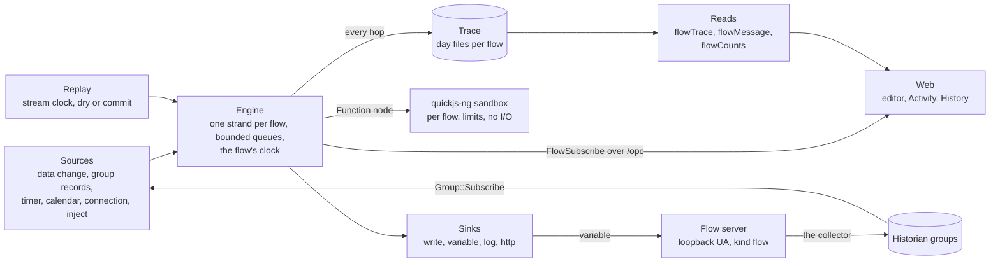

# Flows spec

2026-10-21, its open questions #1 to #5 and #13 ruled the same day, the rest unruled, and the review's fifteen findings ([`flows-spec-review.md`](../../../reviews/flows-spec-review.md)) applied the same day, as were the plan review's ([`flows-plan-review.md`](../../../reviews/flows-plan-review.md)) that reached here; the plan is [`plan.md`](plan.md). Nothing here is built. Event-driven programming on the gateway: a **flow** is a graph of nodes on a canvas, wired so that a message from a source, a data change, a group's records, a timer, passes through processing nodes to sinks, a write, a derived variable, a log line, an HTTP request. The shape is Node-RED's, which is how a plant integrator already thinks about it, and two things come with it that Node-RED does not give a plant: every message's path is recorded, so the canvas shows what a flow is doing now and what it did at any past time, and a flow runs over the historian's records as readily as over live values, so it is checked against last week before it is let loose on the line.

## Overview

Node-RED is the flow-based programming tool of the industrial edge. A flow is nodes on a canvas joined by wires; a message, a JavaScript object with a `payload`, a `topic` and a `_msgid` "which can be used to trace its progress through a flow" ([messages](https://nodered.org/docs/user-guide/messages)), enters at an inject, an input or a timer node and is handed along the wires, cloned where an output has several; a Function node runs the user's JavaScript on it and returns a message, an array per output or nothing ([writing functions](https://nodered.org/docs/user-guide/writing-functions)); switch, change, filter, delay, trigger, split, join and template do the common work without code; context is shared at node, flow and global scope, in memory unless a file store is configured, which writes every 30 seconds ([context](https://nodered.org/docs/user-guide/context)); an error is caught by a Catch node on the same tab, with the source and a loop count, nine loops and the message is dropped ([handling errors](https://nodered.org/docs/user-guide/handling-errors)); a subflow packages nodes as a node with one input ([subflows](https://nodered.org/docs/user-guide/editor/workspace/subflows)); a deploy restarts everything, the modified flows or the modified nodes; and the runtime offers hooks on the message path, `onSend`, `preRoute`, `preDeliver`, `postDeliver`, `onReceive`, `postReceive` and `onComplete`, each given the message, the source node and port and the destination ([messaging hooks](https://nodered.org/docs/api/hooks/messaging)). At the plant it bridges: OPC UA read by `node-red-contrib-opcua`, the node id in `msg.topic` as `ns=3;s=Counter;datatype=Int32`, with read, write, subscribe, monitor with a deadband, browse and events ([the package](https://flows.nodered.org/node/node-red-contrib-opcua), 0.2.355, some seven thousand downloads a week), combined, scaled and published to MQTT, a dashboard or a cloud ([OPC UA to MQTT](https://flowfuse.com/blog/2024/08/opc-ua-to-mqtt-with-node-red/)); Siemens ships it on Industrial Edge with S7, OPC UA and MQTT connectors ([Industrial Edge](https://www.siemens.com/en-us/products/industrial-edge/management-license/)); and every vendor's guidance says the same thing, that it carries monitoring, forwarding and integration and not the control logic, which stays in the PLC ([control.com](https://control.com/technical-articles/node-red-and-a-low-code-approach-to-automation/)). What it lacks is what a plant asks for next. It keeps no record of what ran: the Debug sidebar shows the hundred most recent messages of the nodes that have a debug attached ([debug sidebar](https://nodered.org/docs/user-guide/editor/sidebar/debug)), a tracer or a flight recorder is an add-on, and the debugger plugin pauses and steps live messages, nothing past ([node-red-debugger](https://github.com/node-red/node-red-debugger)). It keeps no versions, a git project being the way to have them. It runs as one process user, so a flow may write any tag the process may. It cannot run a flow over history, having none. And its one event loop is every flow's.

The gateway has what those take. A subscription to any node of any connection, with the sampling, queue and deadband parameters the clients spec's watch list adds ([`../clients/spec.md`](../clients/spec.md) *Watch list*), delivered to a listener through `IDataChange` ([`MonitoringNodes.h:18`](../../apps/OpcGateway/src/types/MonitoringNodes.h#L18)), with the connection's loss and return ([`:26`](../../apps/OpcGateway/src/types/MonitoringNodes.h#L26)). A historian group whose records replay gap-free from any time and then stream as they are stored, modifications included, through `Group::Subscribe` ([`historian/Group.h:413`](../../include/jde/historian/Group.h#L413); the historian spec's *Subscriptions*, [`libs/historian/docs/spec.md`](../../libs/historian/docs/spec.md)), which is what makes the OEE engine resumable ([`../oee/spec.md`](../oee/spec.md) *The engine*), and a clock the historian abstracts so a test drives it by hand ([`Clock.h:9`](../../include/jde/historian/Clock.h#L9), [`ManualClock.h:10`](../../libs/historian/tests/ManualClock.h#L10)). A write held for the server's answer ([`WriteAwait.h:10`](../../apps/OpcGateway/src/async/WriteAwait.h#L10)), a method call coming with the clients spec ([#318](https://github.com/Jde-cpp/opc-hub/issues/318)), event subscriptions coming with it too. Rights by group row through `HistHost::Gate` ([`HistHost.h:53`](../../apps/OpcGateway/src/hist/HistHost.h#L53)), and the ruling that a write to a PLC needs Update on an enforced row of a group that holds the node ([`../plcs/spec.md`](../plcs/spec.md) *Writes*, [#237](https://github.com/Jde-cpp/opc-hub/issues/237)). A records layer, `Jde::IO::Records`, day files with an appender, a reader, a merge and a daily roll ([`Appender.h:9`](../../include/jde/fwk/io/records/Appender.h#L9), [`Reader.h:23`](../../include/jde/fwk/io/records/Reader.h#L23), [`Days.h:16`](../../include/jde/fwk/io/records/Days.h#L16)), which the log and the historian both write ([#308](https://github.com/Jde-cpp/opc-hub/issues/308)). The `/opc` socket, whose messages carry a group's snapshot and stream to a browser ([`types/proto/Opc.FromClient.proto:21`](../../apps/OpcGateway/src/types/proto/Opc.FromClient.proto#L21), [`types/proto/Opc.FromServer.proto:60`](../../apps/OpcGateway/src/types/proto/Opc.FromServer.proto#L60); [`gateway-service.ts:503`](../../web/opc/control/src/lib/services/gateway-service.ts#L503)), the QL with its custom queries and mutations ([`GatewayQL.cpp:35`](../../apps/OpcGateway/src/ql/GatewayQL.cpp#L35), [`:38`](../../apps/OpcGateway/src/ql/GatewayQL.cpp#L38)), the table-side-effect await that `HistGroupMAwait` models ([`HistGroupQLAwait.h:13`](../../apps/OpcGateway/src/ql/HistGroupQLAwait.h#L13)), and the pages, with their lazy loaders ([`opc-pages.ts:2`](../../web/opc/control/src/lib/pages/opc-pages.ts#L2)) and a group's Access tab ([`hist-group-access.ts:60`](../../web/opc/control/src/lib/pages/gateway-detail/hist-admin/hist-group-access.ts#L60)). And the PLCs spec's shape for a source that is not a server: an embedded UA server on loopback the gateway's own client dials ([`../plcs/spec.md`](../plcs/spec.md) *The driver server*), which is how a flow's derived variable becomes a node like any other.

This spec puts the two together. A flow is a row holding its graph, versioned at each deploy; an engine runs each enabled flow on a strand of its own, its nodes a fixed set modelled on Node-RED's, its Function node JavaScript in a sandbox; its sources are the gateway's subscriptions, the historian's groups, timers and the calendar, its sinks writes, derived variables on a flow server, the log and HTTP; every hop of every message is a trace record in day files beside the historian's, at a level a site sets; a canvas subscription animates the flow live and a set of reads draws it as it was at any time, with the path a message took and the values at each step; and a replay runs a flow over its sources' records from one time to another on the stream's clock, dry or committed. Part 9 alarms and conditions are not here: events as a source and a condition as a sink arrive with the clients and servers specs, and the OEE spec's targets and alerts ([`../oee/spec.md`](../oee/spec.md) *Later*) are flows over its live feed once both are built.

Line numbers cite opc-hub2 at `fc413ed1`. open62541 refs are v1.5.9, the version the build links; quickjs-ng refs are v0.17.0, the version this spec pins; Node-RED refs are its 4.1 documentation.

## Requirements

| Area | Requirement | From |
| --- | --- | --- |
| Flows | A flow is a row of the gateway's schema holding a graph, nodes with typed properties and wires per output port, named and enabled or not. Every deploy stores a version with its author and a comment, and restarts that flow alone from it; an enabled flow starts with the gateway from its current version. | this spec, *Open questions* #1, #12 |
| Messages | A message is a json object with an id, a parent id when it was cloned, its time, `topic` and `payload`, and, from a data change, the node, its status and both timestamps. A node with several wires on one output sends one message and clones for the rest. Node-RED's conventions, so a body written for it ports. | this spec, *Open questions* #9 |
| Sources | A data change on a node of any connection, with the watch list's parameters; a historian group's records from any time, gap-free, modifications included; a timer; the calendar's shift and break boundaries; a connection's loss and return; an inject from the editor; a link from another flow. | this spec, *Sources* |
| Nodes | switch, change, filter, range, delay, trigger, window, split, join, template, function, debug, catch, status, complete, link in, link out and comment, each with Node-RED's meaning where it has one. | this spec, *Nodes* |
| Sinks | A write to a node of any connection, held for the server's answer; a derived variable; a log line; an HTTP request to an allowed host. A method call and a condition follow the clients and servers specs. | this spec, *Sinks* |
| Function | JavaScript with Node-RED's Function API, in a sandbox per flow with memory, stack and time limits, no I/O and no imports, whose clock is the flow's; written as code, or as Blockly blocks that generate it, with the blocks a message passed in its trace. | this spec, *The Function node*, *Open questions* #2, #13 |
| Context | Node, flow and global scopes, persisted as rows and loaded at a flow's start; a replay runs on a scratch copy. | this spec, *Context* |
| Errors | A node's error reaches a Catch node with its source and a loop count, nine loops and the message is dropped; a node's status reaches a Status node; a message a node finishes reaches a Complete node; what nothing catches is logged and counted. | this spec, *Errors and status* |
| Rights | Flows ship as a resource, a flow its own row by guid: Read to see it, its trace and its activity, Update to edit, deploy, enable and inject, Delete and Purge. A flow runs under the collector's credential and may do what its deployer may: a write needs Update on an enforced group row holding the node, a source Read on the group holding it where one does, a link to another flow Update on that flow; re-checked when the acl or a group changes. | this spec, *Rights*, *Open questions* #3, access posture ruling #237 |
| Trace | Every hop is a record in day files per flow, one per node a message passes, with a minute's counts per node, at a level per flow, off, counts, errors or hops, a message's json kept where a node changed it and cut past a limit, with retention by days and a size cap. | this spec, *Trace*, *Open questions* #4, #10 |
| Live | `FlowSubscribe` over `/opc`: each node's status and counters, then at most every `live` the count and last message per wire, the status changes, errors and drops; or every hop, for the debug panel. | this spec, *Live* |
| History | Reads of the trace by range, node, message and kind; a message's lineage, its parents and children and the path each took; counts per node and wire by bucket; the versions, so the canvas draws the one in force at a time; a play of a range at speed. | this spec, *History* |
| Replay | A flow run over its sources' history from one time to another on the stream's clock, dry, the sinks captured into the trace, or committed, derived variables upserted into history; a run is a row with its trace apart. | this spec, *Replay*, *Open questions* #6 |
| Derived variables | A `variable` node is a UA variable on a flow server the gateway runs on loopback, one `server_connections` row of kind `flow`, so it is browsed, grouped, historized, trended, served and used by OEE as any node is, read-only to clients. | this spec, *Derived variables*, *Open questions* #5 |
| Web | A Flows tab on the gateway's page and a flow's page: the editor canvas with its palette and property forms, Activity, the canvas live with a debug panel, History, the canvas over a range with a scrubber, counts, the message list and lineage, Versions, Context, Access; a help topic. | this spec, *Web*, *Open questions* #7 |
| Tests | The library's suite drives each node and the engine with a manual clock and scripted messages; the gateway's runs flows over the embedded OpcServer's pumps. | this spec, *Tests* |
| Deploy | Runs in the gateway, standalone or inside the hub, beside the historian, which the group source and the replay need. A `flows` block; no block, no flows. quickjs-ng joins the superbuild, static, both platforms. | this spec |

## Design



**Placement.** The engine is a library, `libs/flows`, target `Jde.Opc.FlowLib`: the graph model from a flow's json, the node types over an interface for what a source delivers and a sink takes, the engine with its queues and clock, the Function node's sandbox and the trace writer, with no gateway in it, so its suite runs scripted messages through a flow under a manual clock as the historian's does. `Jde.Opc.GatewayLib` links it, and `apps/OpcGateway/src/flows` hosts it: the tables join the gateway's schema ([`opcGateway-meta.jsonnet:53`](../../apps/OpcGateway/config/opcGateway-meta.jsonnet#L53) is the model), the reads and mutations join `Gateway::CustomQuery` and `CustomMutation` ([`GatewayQL.cpp:35`](../../apps/OpcGateway/src/ql/GatewayQL.cpp#L35), [`:38`](../../apps/OpcGateway/src/ql/GatewayQL.cpp#L38)), which `GatewayQL` and `HubQL` both call ([`HubQL.cpp:17`](../../apps/OpcHub/src/ql/HubQL.cpp#L17)), the live feed is a message of `/opc`, and a `FlowHost` beside `HistHost` starts after it ([`gatewayStartup.cpp:85`](../../apps/OpcGateway/src/gatewayStartup.cpp#L85)), since a group source subscribes to a group the historian must have loaded, and after the flow server (*Derived variables*), and stops before both, its shutdown hook registered ahead of theirs ([`:82`](../../apps/OpcGateway/src/gatewayStartup.cpp#L82)). Its settings are a `flows` block of [`Opc.Gateway.jsonnet`](../../apps/OpcGateway/config/Opc.Gateway.jsonnet) beside `hist` ([`:57`](../../apps/OpcGateway/config/Opc.Gateway.jsonnet#L57)), which the hub takes as it takes the gateway's other blocks:

```jsonnet
flows:{
	path: logsDir + "/flows/opc-gateway", //the trace day files, a directory per flow, beside hist's
	delay:: "PT1M", //how long a hop record waits in the buffer before its flush, the historian's rule
	trace:: "hops", //the level a flow takes when its row names none: off, counts, errors or hops
	retention:: "P30D", maxSize:: "10GiB", //trace days older than this, or past this size over every flow, oldest first, go at the daily roll
	valueLimit:: 4096, readLimit:: 10000, //bytes of a message's json a hop record keeps, past it the record is cut and says so; and the most records one trace read returns, a page, the historian's rule, here since the hist block may be absent
	queue:: 1000, //messages a node's input holds; past it the oldest is dropped and counted
	live:: "PT0.2S", //how often at most a subscribed canvas hears a flow's activity
	function:{ memory:: "16MiB", stack:: "256KiB", timeout:: "PT0.1S" }, //a Function node's sandbox: the runtime's memory, its stack, which must sit under the executor thread's own, 1 MB on Windows, and how long one call may run
	http:{ allow:: [] }, //the hosts an http request node may reach, names or patterns, checked at each request and each redirect; empty, none
	server:{ port:: 4860 } //the flow server's loopback port, the derived variables; the tests take 4960
}
```

No block, no flows, and the gateway is what it is today. A group source and a replay need the historian: a gateway whose `hist` block is absent, or whose lock another process holds, runs its flows without them, and a flow that has one logs an Error and stays stopped with its status saying so.

**Flows.** `flows` has the slug columns, `enabled`, a bit, `trace`, nullable, the level of *Trace* when the row overrides the block's, and `version`, the current version's number. `flow_versions`: `flow_id`, `version`, counting from one, `graph`, the json below, `deployed`, `identity_id`, `user_name`, the deployer's name as it was then, the historian's identity rule, and `comment`, nullable; unique on flow and version. The graph is `{ nodes: [ { id, type, name, x, y, props: { … }, wires: [ [ ids ] ] } ] }`: a node's `id` is a string the editor generates once and keeps, so a trace written under one version reads under the next; `type` is one of *Sources*, *Nodes* and *Sinks*; `props` are the type's properties; and `wires` has one list per output port of the ids the port feeds, Node-RED's own shape ([flow format](https://nodered.org/docs/api/admin/types)), so an export of one reads as the other's modulo the node types, which is what the *Later* importer leans on. `deployFlow( flow, graph, comment )` validates the graph, every wire's target a node of the graph, every property of its type, every source and sink's rights (*Rights*), and the Function node's code compiled, and refuses with the first fault and its node, so the editor marks it; it then writes the version, sets `version`, and restarts the flow from it, alone: the running flow's nodes stop, their in-flight messages dropped and counted on the old version's trace, and the new graph starts, a group source resuming from its mark (*Sources*), a data change source subscribing afresh, which is Node-RED's *modified flows* deploy with nothing else restarted. `enabled` toggled is `updateFlow`, the generic mutation, whose live side `FlowMAwait` routes to the host as `HistGroupMAwait` routes a group's ([`HistGroupQLAwait.cpp:101`](../../apps/OpcGateway/src/ql/HistGroupQLAwait.cpp#L101), [`:116`](../../apps/OpcGateway/src/ql/HistGroupQLAwait.cpp#L116)): a flow stops, or starts from its current version. A flow's deletion stops it and keeps its rows and files; its purge takes its versions, its runs, its context rows and its trace directory, as a group's purge takes its files, and its access row through the AppServer as a group's purge does. At startup the host starts every enabled flow from its current version, after the historian has loaded and the flow server is listening, and a group source resumes from its mark, at-least-once (*Sources*), while a data change source starts live, as the collector does.

**Messages.** A message is a json object the engine owns: `_id`, a 64-bit integer unique within the gateway, the run's start time in its high bits and a counter in the low, so ids never repeat across restarts; `_parent`, the id of the message this one was cloned or split from, absent at a source; `_time`, when the source made it, the flow's clock; `topic`, a string, the source's node id or path for a data change and the timer's name for a tick; `payload`, the value, a data change's as a json value of its type, a number, a string, a boolean, an array or an object as `Value::ToJson` writes them ([`uatypes/Value.cpp:26`](../../libs/opc/shared/src/uatypes/Value.cpp#L26)), but for a 64-bit integer, which `ToJson` renders as the socket's `Long` object ([`uatypes/Value.h:30`](../../include/jde/opc/uatypes/Value.h#L30)) and the message carries as an integer, so the stock nodes compare and compute on it; the `Long` is the browser's shape alone, which the live push and the trace's reads render on the way out, as the pages read it today; and from a data change `node`, the connection slug and node id, `status`, the status code, `sourceTime` and `serverTime`. Anything else is the flow's own. A node that sends on an output with several wires sends the message itself down the first and a clone down each other, each clone with a new `_id` and the original's as `_parent`, Node-RED's rule, so a node downstream may mutate what it holds; the Function node's `node.send` clones the same way unless told not to, and `RED.util.cloneMessage` is there for a body that ports. A message is processed in order: each node has an input queue, the flow's strand drains the queues in arrival order, one message through one node at a time, and a node that waits, a write for the server's answer, an HTTP request, a delay, parks the message and resumes on the strand, so a flow never runs two nodes at once and a Function body sees node and flow context no one else is writing; the global store is every flow's (*Context*). A queue past `queue` drops its oldest, counted on the node's status and traced as a drop (*Trace*); Node-RED bounds nothing and grows until the heap goes. Flows are independent of one another and run in parallel on the executor; a `link` between two flows crosses strands by posting.

**Sources.** `opc in`: a connection slug and a node, by id or by browse path, with the watch list's parameters, sampling interval, queue size, discard policy and a data-change filter ([`../clients/spec.md`](../clients/spec.md) *Watch list*; [`MonitoringParameters.h:8`](../../apps/OpcGateway/src/uatypes/MonitoringParameters.h#L8)), subscribed through the connection's collector client, the host an `IDataChange` listener per flow ([`MonitoringNodes.h:18`](../../apps/OpcGateway/src/types/MonitoringNodes.h#L18)) answering its nodes' parameters through `ItemParameters` ([`:38`](../../apps/OpcGateway/src/types/MonitoringNodes.h#L38)), so a flow and the collector share one item per node under the strictest-wins merge, and under the first listener's parameters, the collector's on a grouped node, until the clients plan's 6a lands the merge, and the flow's items are parked and restored through a loss as any listener's are; each delivery is a message, the loss a message with `status` `Bad_NoCommunication` and the node's status set, which a Status node catches, the return the first value after. `group in`: a historian group and members, the node's `from`, `now`, a time, or `resume`, its mark, and `modifications`, whether a `Modification` record is a message of its own; the host subscribes as the OEE engine does, one `ISubscriber` per node ([`historian/Group.h:214`](../../include/jde/historian/Group.h#L214)), the snapshot's bounds first, then the records in source-time order, then every record as it is stored, late ones included, paged at `readLimit` as the socket's are, each record a message with its node, value, status and times, `topic` the member's path; `OnRecords` runs on the historian's path and only enqueues to the flow's strand ([`src/Group.cpp:631`](../../libs/historian/src/Group.cpp#L631)), and the node's mark, the source time of the last record whose message the flow finished, is a node-scope key of its context (*Context*), so a restart or a redeploy resumes from it less `lateness`, a duration in the node's `props`, the group's heartbeat gap by default, dropping what it delivered before by node and source time, since a late record, one a lagging server delivers with a source time before the mark, stored while the flow was stopped, is in no snapshot taken from the mark ([`historian/Group.h:413`](../../include/jde/historian/Group.h#L413)) and the OEE engine's reopening of an interval ([`../oee/spec.md`](../oee/spec.md) *The engine*) has no counterpart in a flow; a late record older than the lookback is lost to a restarted flow, as every record is to Node-RED, and a sink fires again for a record delivered before a crash and finished after the mark's last write, at-least-once, which `_id`, stable per record, lets a sink that cares dedupe; the stream is the clock while the snapshot replays (*Replay*), and live the wall clock. `timer`: `every`, an ISO 8601 duration aligned to the hour, or `at`, local times on named weekdays in an IANA zone, the calendar's zone by default; a tick's `payload` is its time. `calendar`: a calendar of the calendar spec by slug and which boundaries, shift start, shift end, break start, break end, from the client's snapshot through `Next(t)` ([`../calendar/spec.md`](../calendar/spec.md) *Resolution*), the occurrence on the message. `connection`: a slug's loss and return, from `UAClient`'s state callback ([`UAClient.h:120`](../../apps/OpcGateway/src/UAClient.h#L120)), the seam the servers spec's `_Connection` reads, since the listener's two calls ([`MonitoringNodes.h:26`](../../apps/OpcGateway/src/types/MonitoringNodes.h#L26)) come only for the nodes a listener monitors, with `Connected` and `Since` as `_Connection` carries them. `inject`: a button on the canvas, `injectFlow( flow, node, message )` under Update on the flow, Node-RED's manual inject; the node's `props` hold the message it sends, which the mutation may override. `link in`: the other end of another flow's `link out` (*Nodes*), named. Events as a source, `event in` over the clients spec's event items ([`../clients/spec.md`](../clients/spec.md) *Events*), and the OEE feed are *Later*.

**Nodes.** Each is Node-RED's where it has one, with the properties its form takes, and runs on the flow's clock. `switch`: rules over a property, `payload` by default, equals, not equals, less, greater, between, contains, matches a regex, is true, false, null or empty, is of a type, and otherwise; the message to the first matching rule's output or to every one, as set. `change`: set, delete, move or rename properties, a value a literal, another property, a context key or an expression over the message, Node-RED's JSONata left to the Function node. `filter`: report by exception, block unless the property changed, or changed by more than a band, absolute or percent of the last value, per `topic` or for all, Node-RED's rbe. `range`: scale a number from one range to another, clamped or wrapped. `delay`: hold each message for a duration, or rate-limit to n per period, queueing or dropping the rest, Node-RED's two modes, on the flow's clock. `trigger`: send a value when a message arrives and another after a wait unless reset, with the wait extended by each message, which is the watchdog a plant wants most, `no value for 30 s`. `window`: a tumbling or sliding window by duration or count over a property, emitting count, sum, min, max, mean, first, last and delta at the window's end, per `topic`, on the flow's clock; the historian's aggregates over a group are the read-side version of this ([`../oee/spec.md`](../oee/spec.md) cites [`Aggregate.cpp`](../../libs/historian/src/Aggregate.cpp)), and a flow that wants them reads history instead. `split` and `join`: an array or object into a sequence with `parts`, and back, by count, by `topic` or on a timeout. `template`: text from the message's properties, `{{payload}}` as Node-RED's mustache, for a log line or an HTTP body. `function`: *The Function node*. `debug`: marks a point whose messages the debug panel shows, and nothing else, since every hop is traced; a level sends them to the log too. `catch`, `status` and `complete`: *Errors and status*. `link out` and `link in`: a named pair within a flow or across flows of one gateway, the cross-flow message cloned onto the other strand; a cross-flow link is an input the receiving flow's deploy never checked, so it takes the inject's rule, Update on the receiving flow for the sender's deployer (*Rights*); `link call`, Node-RED's call-and-return, is *Later*. `comment`: text on the canvas. Subflows are *Later* (*Open questions* #11); a flow that wants a piece twice has `link`.

**Sinks.** `opc out`: a connection and a node, the value from `payload` or a named property, converted toward the node's DataType as `updateVariable` converts ([`VariableQLAwait.cpp:19`](../../apps/OpcGateway/src/ql/VariableQLAwait.cpp#L19)), written through `WriteAwait` ([`WriteAwait.h:10`](../../apps/OpcGateway/src/async/WriteAwait.h#L10)) on the connection's collector client, the message parked until the server answers, the status on the message out of the node's one output and an error on a Bad answer; the write is logged at Information with the flow, the node and the answer, the servers spec's audit line, since it is a flow driving a PLC under the gateway's credential. `variable`: *Derived variables*. `log`: a line at a level, the message's text from a template, under a `Flow` tag with the flow's slug. `http request`: a method, a url and a body from the message, through `ClientHttpAwait` ([`ClientHttpAwait.h:17`](../../include/jde/web/client/http/ClientHttpAwait.h#L17)), the response as the message out; the host of the url the message carries is checked against `http.allow` at each request, a refusal an error the Catch node sees, and a redirect, which the await follows by default ([`ClientHttpAwait.cpp:147`](../../libs/web/client/http/ClientHttpAwait.cpp#L147)), is followed only to a host the list allows, each hop checked, else the request fails with the 3xx as its answer; a literal url in the node's `props` is checked at deploy too, the early warning, but the gate is the send, since a `change` node or a body sets `msg.url` to anything (*Open questions* #8); the way to a webhook, a chat room, or an email through a relay, since the product has no mail client. `method`: the clients spec's `call` ([#318](https://github.com/Jde-cpp/opc-hub/issues/318)), with arguments from the message, once it lands. `condition`: raise, change and clear a condition on the gateway's endpoint, the servers spec's own-condition machinery ([`../servers/spec.md`](../servers/spec.md) *Later*), once it lands. MQTT publish and email are *Later*.

**The Function node.** JavaScript, since a Function body is what every Node-RED flow has at its centre and what an integrator will paste in, run by quickjs-ng ([github](https://github.com/quickjs-ng/quickjs)), the maintained fork of Bellard's QuickJS, C, MIT, ES2023 and later, a few hundred kilobytes, embedded as libplctag is ([`../plcs/spec.md`](../plcs/spec.md) *The library*): an `ExternalProject_Add` beside open62541's ([`build/CMakeLists.txt:477`](../../build/CMakeLists.txt#L477)), `quickjsTag` among the pins ([`:67`](../../build/CMakeLists.txt#L67)), static, the tools off, its notice in [`third-party-notices.sh`](../../build/third-party-notices.sh) ([`third-party-notices.sh:125`](../../build/third-party-notices.sh#L125)), linked by `Jde.Opc.FlowLib`. One `JSRuntime` per flow, so a runaway body costs its own flow and no other, with `JS_SetMemoryLimit` at `function.memory`, `JS_SetMaxStackSize` at `function.stack`, under the executor thread's own stack, with `JS_UpdateStackTop` at each entry since the flow's strand runs on any of its threads, `JS_SetGCThreshold` at a share of the limit, and `JS_SetInterruptHandler`, which the engine polls for a call past `function.timeout` or a flow stopping, and which ends the call with an error the Catch node sees; no module loader is set, so `import` resolves nothing, and neither the `std` nor the `os` module is loaded, so a body has no file, socket, process or clock but what the engine gives it (*Open questions* #2). One `JSContext` per Function node, made at deploy with the body compiled once as a function of `msg`, and the node's On Start and On Stop tabs run at deploy and at stop as Node-RED's do. The API is Node-RED's, so a body ports as it is: `msg` in, `return msg`, an array with one entry per output, an entry itself an array for several, or `null` for nothing; `node.send( msg, clone )` for sends from inside and `node.done()` after an asynchronous one; `node.error( err, msg )`, `node.warn`, `node.log`, `node.status( { fill, shape, text } )`; `context`, `flow` and `global` with `get`, `set` and `keys`, synchronous, since the stores are in memory (*Context*); `env.get( name )`, the gateway's environment and the flow's own properties; `RED.util.cloneMessage`; `setTimeout`, `setInterval` and `Date`, its `now` and its no-argument constructor, each on the flow's clock, with `performance` left out of the context, so a body that waits a second waits a stream second in a replay and a replay is deterministic but for `Math.random`, which stays seeded from the wall clock; `JSON`, `Math`, `BigInt` and the rest of the language. A message crosses as values, the gateway's json to the engine's objects and back, not as text, a 64-bit integer as a `BigInt` (*Messages*), and a `Long` on the web as today. The body's microtasks drain after each call through `JS_ExecutePendingJob`, so an `async` body that awaits only its own promises completes within the call, and one that awaits a timer resumes on the flow's strand at the clock's time with `node.send`; there is no other asynchrony to await. `functionExternalModules` has no counterpart: a body that needs a library has `link` to a flow that does the work with the nodes, or a *Later* node. A body is written as code or built as blocks: Blockly ([developers.google.com/blockly](https://developers.google.com/blockly)), Google's block editor, Apache 2.0, framework-agnostic, generates JavaScript from a workspace of snap-together blocks, which is how Node-RED's own community gave its Function node a block editor ([node-red-contrib-blockly](https://flows.nodered.org/node/node-red-contrib-blockly)); here the node's `props` hold `blocks`, the workspace as Blockly's own json, beside `code`, the JavaScript the generator wrote from it, and the engine runs `code` whichever way it was made, so nothing in the sandbox knows the difference. The toolbox is Blockly's stock logic, maths, text, lists and variables plus the flow's own blocks: get and set a property of the message, `payload` and `topic` first, get and set a context key at each scope, `send`, `status`, `error`, `warn` and `log`, `env`, and `return`. Blockly cannot turn code back into blocks, so a body edited as text afterwards keeps its code and loses its blocks, which the form says before it lets go. The generator also emits a call per block, `__block( id )`, as Blockly's own step debugger does, which the sandbox records into the message's hop at the `hops` level (*Trace*), so the history shows which branch fired inside the node (*Open questions* #13).

**Context.** Three scopes as Node-RED's: `node`, the node's own, `flow`, the flow's, and `global`, the gateway's. In memory while a flow runs, and persisted as rows of `flow_context`: `flow_id`, null for global, `node_id`, null for flow scope, `key` and `value`, json text, written through on a trailing one-second debounce from the flow's strand, and loaded at the flow's start, so a counter survives a restart, where Node-RED's survives only with a file store ([context](https://nodered.org/docs/user-guide/context)). The global store is shared by flows on parallel strands and by the Context tab, so it is read and written under a mutex, `get` a copy and `set` an exchange, which keeps the API synchronous; a read-modify-write across flows is not atomic, as it is not in Node-RED. A `group in` node's mark is a node-scope key the engine writes on the same debounce, advanced as a record's message reaches `complete` or is dropped, not as it is delivered (*Sources*), so a record a `queue` drops after delivery is counted and gone, never resumed. The Context tab of the flow's page reads the rows through the generic table query and edits a value; a value edited reaches the running flow at its next `get`. A replay runs on a scratch copy and writes none back (*Replay*).

**Errors and status.** A node that fails a message, a write refused, a conversion that cannot be made, a Function body that threw or timed out, raises an error with the message: a `catch` node on the flow receives it with `error{ message, source{ id, type, name, count } }`, Node-RED's shape, `count` the times this message has been caught, and at nine the message is dropped and the error logged, the loop guard; a `catch` set to specific nodes catches theirs, and one set to *uncaught* those no other catches; what no `catch` takes is logged at Error with the flow and the node, counted on the node's status, and the message ends. A node's status, `{ fill, shape, text }`, is set by the engine, a source's connection, a sink's last answer, a queue's drops, and by a Function body's `node.status`; a `status` node receives each change with its source. A `complete` node receives each message a chosen node finishes, whether it sent anything on. Every error and status change is a trace record (*Trace*) and a live push (*Live*), so the canvas shows a red node before anyone opens the log.

**Rights.** `flows` ships as a resource of the gateway's schema as every table does, and a flow's own row by guid is its resource where an admin has made one, else the table's, the historian's rule ([`HistHost.h:53`](../../apps/OpcGateway/src/hist/HistHost.h#L53)): Read to list a flow, read its versions, its trace and its runs and subscribe to its activity; Update to edit, deploy, enable, disable, inject and replay; Delete and Purge their own; and the Access tab a group has ([`hist-group-access.ts:60`](../../web/opc/control/src/lib/pages/gateway-detail/hist-admin/hist-group-access.ts#L60)). What a flow may *do* is the deployer's, and the gate is the deploy: a flow's UA operations go under the connection's collector credential, the gateway's own ([`HistHost.h:56`](../../apps/OpcGateway/src/hist/HistHost.h#L56)), as the servers spec's write-through does, so the hub user whose rights count is the one who deployed, and `deployFlow` checks each node of the graph against the deployer through `Authorize::CheckEnforced` for a sink and `Check` for a source ([`Authorize.h:30`](../../include/jde/access/Authorize.h#L30), [`:24`](../../include/jde/access/Authorize.h#L24)), the gates that resolve a group's guid criteria today, so nothing waits on the `Rights` overload the servers plan adds: an `opc out` needs Update on an enforced access row of a group that holds the node, and a node no group holds, or whose row is unenforced or grants no Update, refuses the deploy with the message #237 gave history edits, the PLCs spec's rule for a write ([`../plcs/spec.md`](../plcs/spec.md) *Writes*); an `opc in` or a `group in` needs Read on the group that holds the node where one does, and an ungrouped `opc in` is admitted by the server's answer, not the hub's rows, since a page reads a node under the user's own session, where the server applies its per-node acl ([`OpcAuthorize.cpp:62`](../../apps/OpcServer/src/access/OpcAuthorize.cpp#L62)), while a flow reads under the collector's, which is its own ([`OpcServerSession.h:43`](../../apps/OpcGateway/src/auth/OpcServerSession.h#L43)): `deployFlow` reads the node once under the deployer's own session, the read the page would make, and refuses on a Bad answer, and the re-check repeats the read on an access event that touches the server's schema; a `link out` whose name a `link in` of another flow holds needs Update on the receiving flow, the inject's right, since a link is an input that flow's own deploy never checked, a link to a flow its deployer may not inject into is a link to nothing, and a sender whose deployer loses it stops delivering, with the error on the sender's node; a `method` and a `condition` sink take their own rules when they come. The version row carries the deployer, and the host re-checks each running flow against its deployer on any change to what its nodes' admission rests on, from two sources: the access events every authorizer hears ([`AccessListener.cpp:14`](../../libs/access/src/AccessListener.cpp#L14)), a grant withdrawn, a row deleted or re-created, which is what enforced means; and the group changes, which no access event carries, a template member removed, a group's template changed, a node re-resolved elsewhere or the group purged, from `HistGroupMAwait`'s after side ([`HistGroupQLAwait.cpp:116`](../../apps/OpcGateway/src/ql/HistGroupQLAwait.cpp#L116)) and the resolve ([`HistHost.h:64`](../../apps/OpcGateway/src/hist/HistHost.h#L64)), since an `opc out` admitted by a group that no longer holds the node would otherwise keep writing with no enforced row behind it, the state #237 forbids: a grant withdrawn stops the flow with an Error and a status saying which node, and a deployer who no longer exists has no rights, so the flow stops too, until someone with the rights deploys it again. A Function body cannot reach anything the sinks and the links do not, so they are the whole of it. `http.allow` is an admin's setting, not a right, and `log` needs nothing. The flow server's variables are read-only to every session (*Derived variables*).

**Trace.** The engine's message path has Node-RED's hooks, and the trace is a hook on all of them, folded to one record per node per message: a hop record is made at `receive`, takes the output ports and the json at `send`, and is closed at `complete`, with records of their own for an error, a status change, a drop, and a message's birth and its clone. A record, `FlowRecord` of `Flow.Records.proto`, is `time`, the flow's clock, `msg_id`, `parent_id`, `run_id`, zero live and a replay's otherwise, `node_id`, `ports`, the output ports it sent on, `kind`, `json`, the message's json where a node changed the message, absent where it passed through unchanged, cut at `valueLimit` and flagged, `error`, `status`, and `blocks`, the ids of the blocks a block-built Function body passed with the message, in order, absent for a typed body (*The Function node*). A second kind, `counts`, is one record per node per minute: `time`, `node_id`, `sent` and `received` per port, `drops` and `errors`, the minute's figures. The records are `Jde::IO::Records` day files under `flows/<slug>/`, a `Traits` specialisation as the historian's ([`io/Records.h:67`](../../libs/historian/src/io/Records.h#L67)), appended through the same `Appender` with `delay`'s buffered flush ([`Appender.h:9`](../../include/jde/fwk/io/records/Appender.h#L9)) and rolled by the same `Days` ([`Days.h:16`](../../include/jde/fwk/io/records/Days.h#L16)), so a flow's trace survives a crash to within `delay` as a group's values do, and reads merge days through the same `Reader` ([`Reader.h:23`](../../include/jde/fwk/io/records/Reader.h#L23)). The level, the row's `trace` else the block's: `off`, nothing written and only the live counters kept; `counts`, the minute records alone; `errors`, the minute records, and the hops of a message kept in memory while it is in flight and written only when the message ends in an error, so a quiet flow writes its counts and a failing one its whole path; `hops`, everything, the minute records too, so `flowCounts` has one source at every level but `off`; `hops` is the default. The cost is the arithmetic a site should see: a hop record is some fifty bytes without json, one per node a message passes and one at its birth, so a flow passing a hundred messages a second through five nodes writes six hundred records a second, thirty kilobytes a second, two and a half gigabytes a day, which `retention` and `maxSize`, thirty days and ten gibibytes over every flow by default, bound at the daily roll, oldest day first across the flows; a site with such a flow sets it to `counts` or `errors`, and the help says so. Nothing in the trace is a secret: a password a body puts in a message is in the trace, and the help says that too.

**Live.** `FlowSubscribe{ flow, hops }` is a message of `/opc` beside `HistSubscribe` ([`types/proto/Opc.FromClient.proto:21`](../../apps/OpcGateway/src/types/proto/Opc.FromClient.proto#L21)), after the socket's session is bound, Read on the flow, and `FlowUnsubscribe` takes it back by its `request_id` as the historian's pair do. The ack carries the flow's version, each node's status and the counters of each port since the flow started; from then, at most every `live`, when anything changed, the socket pushes `FlowActivity`: per wire the count since the last push and the last message's id, time and json, cut as the trace cuts it, each node's status change, and the errors and drops; with `hops` true, every hop record as it is made, batched at the same cadence, for the debug panel, which is the Debug sidebar with the whole flow attached. The engine keeps the counters and the last message per wire for it, so a push costs no read. A deploy ends the subscription with the new version's ack, so the canvas redraws; dropping the socket drops it; a flow stopped ends it with an exception under its id.

**History.** Three custom queries over the files, each Read on the flow, paged at the `flows` block's `readLimit`, the historian's rule ([`Opc.Gateway.jsonnet:62`](../../apps/OpcGateway/config/Opc.Gateway.jsonnet#L62)), with the opaque continuation the history reads carry. `flowTrace( flow, start, end, node, msg, kind, run, limit, continuation )` answers the records in a range, oldest first or newest, narrowed to a node, a message, a kind or a run. `flowMessage( flow, id )` answers a message's lineage: its own records in order, the path, its parent's up to the source and its children's, so the canvas highlights the path a message took and shows its json at each node where it changed. `flowCounts( flow, start, end, by )` answers per node and per wire the messages, errors and drops in each bucket of `by`, a duration of a minute or more, from the minute records at every level, so a day's canvas shows which wire carried what. The versions, the runs and the context are rows, read through the generic table query as any table's are, `flow_versions` giving the canvas the version in force at the time it shows, a redeploy mid-range a marker on the scrubber, and `flow_runs` the replays (*Replay*). The canvas's History mode (*Web*) is these over a range: the counts on the wires, the scrubber over time, the message list, the lineage; and Play steps the hop records of the range through the canvas at a chosen speed, one, ten or a hundred times, the live animation driven from the files, which is what a plant asks for the morning after.

**Replay.** `replayFlow( flow, from, to, mode )`, Update on the flow, runs the flow's current version over its sources' history from `from` to `to`: each `group in` subscribes from `from` as it does and ends at `to`, an `opc in` whose node a group holds takes that group's records in place of a subscription, and an `opc in` on an ungrouped node refuses the replay by name, since there is nothing to replay; a `timer` and a `calendar` tick at their times within the range; a `link in`, a `connection` and an `inject` are silent in a run, so nothing live reaches the stream's clock. The flow's clock is the stream's: the sources' records are merged by source time into one stream, the clock stands at each record's time as it is delivered and advances through the timers between, so a `delay` of a minute, a `trigger`'s watchdog, a `window`'s close and a body's `setTimeout` fire at stream times, in the order they would have live, and the same records give the same trace twice, which is what makes the run a test. The run is a row of `flow_runs`: `flow_id`, `version`, `from`, `to`, `mode`, `started`, `finished`, `identity_id`, `user_name`, `status`, and its trace records carry its id, so the canvas shows a run as a range of its own with the live trace untouched. `dry`: every sink is captured, an `opc out`'s value, a `variable`'s, a `log`'s line and an `http request`'s body each a trace record of kind `captured`, and the context a scratch copy; what the flow would have done, over the range, in the canvas. `commit`: the same with one difference, a `variable` sink writes its values into history, with their stream times, through the edit of the group that holds the variable ([`historian/Group.h:405`](../../include/jde/historian/Group.h#L405)), `upsertHistory`'s path, Update, which inserts or replaces, since the live collector has stored the variable over any range the flow ran through and an insert would refuse every such time with `Bad_EntryExists` ([`libs/historian/docs/spec.md`](../../libs/historian/docs/spec.md) *Edits*): a committed run replaces what the collector stored over the range, each replacement a `Modification` the modified read shows, so the derived history after a run is the run's, under the deployer's Update on that group, which is how a derived variable is backfilled over a year of a source's records or recomputed after a body fix, and every other sink stays captured, since a write to a PLC with last week's value is never right. One run at a time per flow, on a strand of its own beside the live flow's, with its own sandbox runtime and its own context copy; a run past `readLimit` records of its sources a page is paged as a subscription's snapshot is, and `cancelFlowRun( id )` ends one.

**Derived variables.** A `variable` node names a variable, `name`, `dataType`, a built-in or an array of one, `description`, and optional `EngineeringUnits` and `EURange`, and each message that reaches it writes the variable: the value converted toward the type, the status from the message's or Good, the source time the message's `sourceTime` or `_time`, the server time now. The variables of every flow live on the flow server: one embedded open62541 server on `Jde.Opc.UAServer`, the library the servers spec extracts from the OpcServer ([`../servers/spec.md`](../servers/spec.md) *The server library*; [#380](https://github.com/Jde-cpp/opc-hub/issues/380), [#381](https://github.com/Jde-cpp/opc-hub/issues/381)), bound to loopback on `server.port`, with the PLCs spec's trust of two and its own-certificate rule for the collector ([`../plcs/spec.md`](../plcs/spec.md) *The driver server*), which this spec takes as they are, one `server_connections` row the host creates and keeps, kind `flow`, slug `flows`, `url` `opc.tcp://127.0.0.1:<port>`, in the one namespace `urn:jde:<slug>:flows`, which the endpoint keeps as it is by the PLCs ruling, under Objects a folder per flow by slug and its variables under it, each a BaseDataVariable with AccessLevel CurrentRead alone, a `_Flow` object per folder with `Version`, `Enabled`, `Messages` and `Errors`, and the row's `testConnection` reading the folders. A value is a stored value pushed with `UA_Server_writeDataValue` rather than a callback source, since the flow is the source and no write is ever held, and the server notifies its subscribers at once; a folder appears at a flow's first deploy with a `variable` node, its variables added and removed as deploys add and remove the nodes, a variable keeping its id across versions by its name. From there nothing is new: the gateway's own client dials the row as it dials a driver row, the search index crawls it, a template member names `flows/<flow>/<name>` as it names any path, the collector subscribes to it under the group's thresholds and the historian stores it with the flow's timestamps, a member with two writers, the collector at each live push and a committed replay over its range (*Replay*), the History tab trends it, the servers spec's endpoint serves it, and an OEE machine takes it as a signal, which is how a State a PLC never had, computed from three tags, drives OEE. A write to it from any client refuses, since a variable is its flow's. Until the servers plan's phase 1 lands the node is refused at deploy with a message that says so, and the rest of the flows ship without it (*Open questions* #5).

**Web.** The gateway's page ([`gateway-detail.html:20`](../../web/opc/control/src/lib/pages/gateway-detail/gateway-detail.html#L20) is the Groups tab) gains a **Flows** tab, a list that resolves itself as Templates and Groups do ([`gateway-hist-list.ts:23`](../../web/opc/control/src/lib/pages/gateway-detail/hist-admin/gateway-hist-list.ts#L23)), with a detail route `apps/gateways/<instance>/flows/<slug>` beside the groups' ([`opc/site/app/app.routes.ts:130`](../../web/opc/site/app/app.routes.ts#L130)), its loader in [`opc-pages.ts`](../../web/opc/control/src/lib/pages/opc-pages.ts) ([`:2`](../../web/opc/control/src/lib/pages/opc-pages.ts#L2)). The flow's page has six tabs. **Editor**: the canvas, a palette by category, sources, nodes and sinks, dragged on; a node's properties in a side form typed by its node type, the Function node's with a code editor or the block editor, Blockly loaded lazily with the form as the add-on loader loads Highcharts, since it is a megabyte and more with its blocks and generator, bundled rather than fetched since the licence allows it, and the generated code shown read-only beside the blocks; wires dragged between ports; undo and redo; Deploy with a comment, which runs `deployFlow` and marks the node a refusal names; Enable and Disable; Inject on an inject node. The canvas is an Angular node-editor library rather than a hand-built one: `@foblex/flow` ([github](https://github.com/Foblex/f-flow)), MIT, nodes as Angular components, connections with markers and editable routing, zoom, minimap, a managed state with undo and redo, and virtualization for large graphs, on Angular 17.3 and later; `ngx-vflow` ([github](https://github.com/artem-mangilev/ngx-vflow)), MIT too, is the other, closer to the React Flow idiom with handles and validated edges (*Open questions* #7). MIT, so it is bundled as a dependency rather than loaded as an add-on as Highcharts is ([`highcharts-loader.ts:12`](../../web/opc/control/src/lib/pages/node-detail/node-history/highcharts-loader.ts#L12)). **Activity**: the same canvas, read-only, under `FlowSubscribe`: a wire's thickness or a dot moving along it by its count per second, the last message on hover, a node's status as a badge under it in its colour with its text, a red node for an error, the drops as a counter; and the debug panel beside it, the hops as they come with `hops` on, filtered by node, paused and cleared, each hop expanding to its json, the Debug sidebar with the flow attached. **History**: the canvas over a range picked as the History tab picks one, with `flowCounts` on the wires and the versions choosing the graph drawn, a scrubber along the range with the deploys marked, a message list from `flowTrace` by node, kind or run, a message selected highlighting its path from `flowMessage` with its json at each node where it changed and, on a block-built Function node, the blocks it passed lit in the node's workspace, and Play through the range's hops at a chosen speed. **Versions**: the versions with their deployers, comments and a diff of two graphs; a Replay action with `from`, `to` and the mode, the run listed with its status and opened in History. **Context**: the rows of the three scopes, editable. **Access**: the group's tab as it is ([`hist-group-access.ts:60`](../../web/opc/control/src/lib/pages/gateway-detail/hist-admin/hist-group-access.ts#L60)), on the flow's row. A help topic, `flows.md` beside [`gateways.md`](../../web/opc/control/src/assets/help/gateways.md), explains the message, the nodes, the Function API, the trace levels and their cost, the rights, the resume's at-least-once rule, and what a replay does and does not write.

**Emulator and the demo.** Nothing changes in the emulator: the pumps ([`Opc.PlcEmulator.jsonnet:71`](../../apps/OpcServer/emulator/config/Opc.PlcEmulator.jsonnet#L71)) give a flow its inputs. The help's worked example is the flow the demo ships as a sample to import: pump1's `motorRpm` through a `window` of a minute's mean into a `variable` `pump1/rpmMean`, a `trigger` watchdog on the same source that logs *no value for 30 s*, a `switch` over the mean above a limit into a `log` line and an `http request` to a webhook, and a `calendar` shift-start tick that resets a `window`; grouped, the derived mean trends under the History tab beside the raw value.

**Tests.** The library's suite, `Jde.Opc.Flow.Tests` beside the historian's ([`ManualClock.h:10`](../../libs/historian/tests/ManualClock.h#L10) is the clock it reuses): each node type over scripted messages, the clone rule, the queue bound, the catch count and the loop guard, the status and complete nodes, the window and trigger under a manual clock, the Function node's API, a body that times out, one that exhausts memory, one that imports, a BigInt round trip and an Int64 data change compared by `switch` and scaled by `range`, the allow list's match of a host against names and patterns, a flow whose source the host refuses to make staying stopped with its status, `setTimeout` and `new Date()` on the flow's clock, the trace records at each level, the minute records and their cut, and a replay of a scripted stream giving the same trace twice. The gateway's suite, `Jde.Opc.Tests`, over the embedded OpcServer's pumps: a flow deployed, `opc in` on `motorRpm` through a Function body into a `variable`, the flow server's node browsed, the collector storing it in a group and a read agreeing with the body; an `opc out` refused at deploy on an ungrouped node, then on an unenforced row, then admitted with Update, and a value written reaching the OpcServer; an ungrouped `opc in` refused where the OpcServer denies the deployer the node and admitted where it does not; a `link out` to another flow refused without Update on it; a `group in` from a time replaying the group's records in order and resuming from its mark after a redeploy, a late record within the lookback delivered once and none twice; `FlowSubscribe` pushing counts and a status change; `flowTrace`, `flowMessage`'s lineage of a cloned message, and `flowCounts` against counts kept by the test; a dry replay over a day of records capturing the writes, and a committed one backfilling the derived variable over a range the collector already stored, read back through `history` with the replaced values as modifications; a grant withdrawn stopping the flow, and a node dropped from its group stopping it too; the context surviving a restart; an `http request` to the suite's own web server refused with `http.allow` empty, admitted with `127.0.0.1` and refused on a redirect to a host outside the list, a `connection` node on a flow with no `opc in` seeing a loss and its return, and a flow with a `group in` naming a group the gateway does not host refusing to start by name. The web's vitest specs cover the graph's validation, the property forms and the History tab's scrubber.

**Later.** Subflows (*Open questions* #11), and `link call`. `event in` over the clients spec's event items, and `method` and `condition` as their specs land. The OEE feed as a source, the OEE spec's targets and alerts. An `http in` node, an inbound endpoint under the hub's web server, which needs its own authentication story. MQTT in and out, with a broker in the superbuild or the servers spec's own. Email through a mail client of the product's. A `link in` taking its sender's trace over a replay's range. A Node-RED importer for the node types that map, inject, function, switch, change, rbe, delay, trigger, split, join, template, debug, catch, status, link, and the OPC UA client node's read, write and subscribe. A JSONata-like expression language in `switch` and `change`. A node SDK, so a site adds a node type without a build. Hub-wide flows across gateways. A per-flow credential in place of the collector's. CSV export of a trace range.

**Out of scope.** Control logic that belongs in the PLC: safety, interlocks and deterministic cycles, which is Node-RED's own line and this product's; a flow monitors, derives, forwards and alerts, and a write it makes is a setpoint or a command, logged. Embedding Node-RED itself. A workflow engine with long-running human tasks and approvals. Dashboards built from flows: the pages are the product's. A general scripting console.

## Pieces

Sizes are the GitHub project's Size field. The library and the host are the useful core; the Function node, the trace and the live feed make it a product; the replay, the flow server and the web close it. Piece 8 waits on the servers plan's phase 1 and the Open Protocol plan's row and host, its `kind` column and loopback trust ([#465](https://github.com/Jde-cpp/opc-hub/issues/465), [#466](https://github.com/Jde-cpp/opc-hub/issues/466)), which took over the parked PLCs plan's; the plan sequences the rest.

| # | Piece | Size | Notes |
| --- | --- | --- | --- |
| 1 | The library | L | `libs/flows`: the graph model and its validation, the engine with its strands, queues and clock, the source and sink interfaces, every node of *Nodes*, errors and status, the suite under a manual clock |
| 2 | The host | M | the four tables, `FlowHost`, `deployFlow`, `injectFlow`, `FlowMAwait`, the startup and shutdown, the `flows` block, the rights at deploy, on access events and on group changes |
| 3 | Sources and sinks | M | `opc in` as a listener with parameters and the deployer's read for an ungrouped node, `group in` with its mark and lookback, `timer`, `calendar`, `connection`, `inject`, `link` under the inject's right; `opc out` with its audit line, `log`, `http request` with `http.allow` at the send and each redirect |
| 4 | The Function node | M | quickjs-ng in the superbuild, both platforms, the notice; the runtime per flow and its limits, the context per node, the API, the value conversion, the flow's clock in `setTimeout` and `Date.now` |
| 5 | Trace | M | `Flow.Records.proto`, the hooks folded to a hop record, the minute records, the four levels, the day files, retention and the size cap, `flowTrace`, `flowMessage`, `flowCounts` |
| 6 | Live | S | `FlowSubscribe`, `FlowUnsubscribe`, `FlowActivity`, the counters and last messages, the `Long` rendering |
| 7 | Replay | M | the merged stream and its clock, `flow_runs`, `replayFlow`, `cancelFlowRun`, captured sinks, the silent sources, the committed `variable` through the group's upsert edit |
| 8 | The flow server | M | the loopback server on `Jde.Opc.UAServer`, the `flow` row, the folders and variables, `_Flow`, the stored-value push, the read-only rule |
| 9 | Web editor | L | the Flows tab and page, the canvas library, the palette, the property forms and the code editor, Deploy, Versions with the diff, Context, Access |
| 10 | Web activity and history | L | the live animation and the debug panel, the History mode with the scrubber, counts, the message list, lineage and Play, the Replay action |
| 11 | Demo and help | S | the sample flow, `flows.md` |
| 12 | Block editor | M | Blockly in the Function node's form, the flow's blocks, `blocks` beside `code`, the lazy load, `__block` in the sandbox and the hop record, the lit blocks in History |

## Open questions

1. **Scope.** An engine of the product's own, modelled on Node-RED, against embedding Node-RED, a Node.js runtime, beside the gateway and bridging to it over GraphQL and the socket. Recommended: the engine. Embedding gives the palette and the editor for free and costs a second process, a second user model, a second trust list and a second set of rights the hub cannot see, and still gives no trace, no replay and no derived variable; the engine is a known set of node types over seams the gateway has, and the editor is the one piece that is weeks of work, which *Open questions* #7 buys. Ruled 2026-10-21: as recommended, the engine in C++ inside the gateway, no Node.js in the product.
2. **The Function language.** JavaScript on quickjs-ng, against jsonnet, which the build already links for its settings ([`io/json.h:24`](../../include/jde/fwk/io/json.h#L24)), or Lua, or no code at all, the nodes and an expression language. Recommended: JavaScript. It is what a Node-RED body is written in, so the port is a paste; quickjs-ng is small, MIT, sandboxable by the four calls named and maintained, 0.17.0 in September 2026; jsonnet is a configuration language with no state and no statements, evaluated by building a VM per call, and Lua is a second language to learn for nothing the first does not give. Ruled 2026-10-21: as recommended, JavaScript on quickjs-ng.
3. **Whose rights.** The deployer's current rights, not a snapshot: checked at deploy and again on every access event that touches a row the flow's nodes depend on, with the flow's operations under the collector's credential. Recommended. The alternatives: a credential per flow, the clients spec's position that the server enforces, which moves the gate off the hub for a write to a PLC the hub is meant to gate, and is *Later* for a site that wants it; or the rights of whoever last edited the row, which a disable and enable would confuse. Ruled 2026-10-21: as recommended, the deployer's current rights.
4. **The trace's default.** `hops`, with the size cap, against `errors`. Recommended: `hops`. The feature is the visibility, and a site that pays two gigabytes a day for one flow has `counts`, `errors` and the help's arithmetic; a default of `errors` would show a new user an empty History tab. Ruled 2026-10-21: as recommended, `hops` with the cap.
5. **Derived variables.** A flow server on loopback, the PLCs spec's shape, against writing values straight into a historian group through `Group::Enqueue` ([`historian/Group.h:326`](../../include/jde/historian/Group.h#L326)) under a member that resolves to nothing. Recommended: the flow server. The direct path is a few days' work and gives history and nothing else, and breaks the rule that every member is a node on a server, which the endpoint, the search, the templates and OEE's signal picker all lean on; the server gives all of them, and waits for the servers plan's phase 1 as the driver does. Ruled 2026-10-21: as recommended, the flow server.
6. **What a replay commits.** Derived variables into history, through the group's edit, and nothing else. Recommended. The alternative commits every sink, which writes last week's setpoint to a PLC today; a site that wants a write replayed has the dry run's captured values to act on.
7. **The canvas library.** `@foblex/flow`, against `ngx-vflow` or a hand-built SVG canvas. Recommended: `@foblex/flow`, for its managed state with undo and redo, its virtualization and its templated nodes, each of which the editor needs; `ngx-vflow` is the near alternative if the first's Angular 22 fit disappoints in the plan's spike; a hand-built canvas is the editor's whole cost again.
8. **`http request`.** Allowed by host list, empty by default. Recommended: a flow is deployed by an Update user and runs as the gateway, and a request to an arbitrary url from inside the plant network is what that user could not otherwise do; a list an admin edits is the same posture as the trust lists, checked at the send and at each redirect, since the url is the message's and a deploy-time check sees only a literal one. The alternative allows any host.
9. **The message's conventions.** Node-RED's, `payload`, `topic`, `_id` and `_parent` for its `_msgid`, `parts`, `error`, `status`. Recommended: a Function body and a mental model port together. The alternative is a typed message shaped on `DataValue`, which every node would then have to unwrap.
10. **Where the trace lives.** Day files on `Jde::IO::Records`, against rows of a table. Recommended: files. A trace is append-only, time-ordered, read by range and aged by day, the historian's shape exactly, and a table of a million rows a day per flow is what the OEE spec declined for its intervals.
11. **Subflows.** Later. Recommended: a `link` pair gives reuse within a gateway now, and a subflow is a second graph type in the model, the editor and the trace, whose instances the canvas must open in place. Node-RED's own limit, one input, shows how much of a node it is not.
12. **The graph as json.** Node-RED's shape, a node list with `wires` per output, in a text column, against tables of nodes and wires. Recommended: json. A graph is deployed and versioned whole, never queried by node, and the shape is the one an importer reads.
13. **Blockly.** Blockly as the Function node's second editor, generating the JavaScript the sandbox runs, with the blocks a message passed recorded in its trace; against Blockly as the flow's whole interface, a block program per flow in place of the canvas, or no block editor at all. Recommended: the Function node's editor. A flow is a graph of sources, wires and sinks with messages streaming along them, and that graph is what the live and history views draw, counts on the wires and the path a message took; a block program has no wires to animate and no hops to trace, and reads well only for a single trigger-condition-action rule, with no fan-out, window, join or link, and no Node-RED port. Inside one node it is the right tool, the one place a user types code today, it is what Node-RED's community built for its own Function node, and the block trace gives the history a view inside the node for a call per block. Ruled 2026-10-21: as recommended.