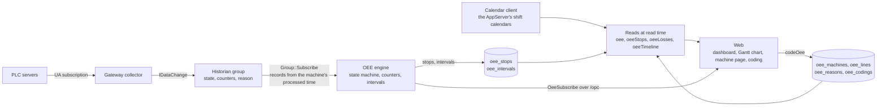

# OEE spec

2026-10-19, open questions #1 to #15 ruled 2026-10-20, its review's sixteen findings folded the same day; the plan is [`plan.md`](plan.md), whose own review folded two items here 2026-10-20 and whose issues are filed under [#398](https://github.com/Jde-cpp/opc-hub/issues/398). Nothing here is built. Its schedule moved the same day to the calendar spec ([`../calendar/spec.md`](../calendar/spec.md)), the AppServer's shift calendar every gateway shares. The demo spec's review ([`demo-spec-review.md`](../../../reviews/demo-spec-review.md) #6) added `planned` and the stop's `small` to *Live* 2026-10-21, for its floor map.

## Overview

Overall equipment effectiveness is the share of planned production time a machine spent making good parts at its ideal rate: **availability**, the time it ran over the time it was meant to, times **performance**, the parts it made at the ideal cycle time over the time it ran, times **quality**, the good parts over all parts. What the product falls short of is the six big losses: unplanned and planned stops against availability, small stops and slow cycles against performance, rejects against quality. It is the one figure a plant manager asks a line for, and the stops behind it, with a reason on each, are what an operator and a maintenance planner work from.

The gateway already has what the figure needs. The collector subscribes to a machine's run state and its counters from any server it connects to, the historian stores them with source timestamps, status and the gaps it could not bridge, a group's access row says who may see them, and `Group::Subscribe` replays a group's records from any time, gap-free, then streams every record as it is stored ([`libs/historian/docs/spec.md`](../../libs/historian/docs/spec.md) *Subscriptions*). So this spec makes OEE the first application on the historian: a **machine** is a historian group whose members are given roles, an **engine** subscribes to the group and turns its records into stops and per-interval facts, a minute by default, which it keeps as rows, and the figures are computed when they are read, from those rows, a shift **calendar** the AppServer holds for every gateway ([`../calendar/spec.md`](../calendar/spec.md)), a list of **reasons** and the **codings** operators put on stops; a **line** is a named set of machines, or of lines, at a level of the ISA-95 hierarchy, a site, an area, a line or a cell, whose figures are its members' combined, each factor weighted by the time it is over. Nothing is collected twice, a restart resumes where it stopped, and an edit to the history recomputes what it touched.

Line numbers cite opc-hub2 at `4bf17829`, main with the gateway refactor merged, as the calendar spec does.

## Requirements

| Area | Requirement | From |
| --- | --- | --- |
| Machines | A machine is one historian group's members given roles: State, Total or Rate, Good, Reject, Reason; with an ideal cycle time, a small-stop threshold, an idle timeout, an interval width and a calendar. One machine per group. | this spec |
| State | Running or stopped from the State signal, a value held until the next record as the historian reads it: a Boolean's true, or a listed value of a code. Without a State signal, running while counts arrive and stopped once `idleTimeout` passes without one. A Bad or Uncertain record, and a `Bad_DataLost` marker, is unknown time until the next Good record. | this spec, *Open questions* #5, #12 |
| Stops | Every leave of running is a stop, from the record that left to the record that returned, carrying the Reason signal's code when the machine has one. A stop shorter than `smallStop` is a small stop, a performance loss, not an availability loss. | this spec |
| Counts | A Total, Good or Reject signal is a counter: its deltas count, a decrease is a reset, and the delta across a gap counts in the interval where the gap ends. A Rate signal is integrated into a count. Good is Good, else Total less Reject; without Good or Reject, quality is not measured. | this spec, *Open questions* #6 |
| Intervals | The engine keeps one row per machine per interval, a width the machine sets, one minute by default: the milliseconds it ran, stopped and was unknown, and its total, good and reject counts. Any range's figures are sums of its intervals, a row that straddles a bucket or a planned-time boundary split by time. | this spec, *Open questions* #2 |
| Calendars | A machine names a shift calendar of the calendar spec ([`../calendar/spec.md`](../calendar/spec.md)), the AppServer's, held in the gateway's calendar client. Planned production time is its shift occurrences less their breaks and the closed exceptions, plus the open ones. A machine without a calendar is planned around the clock. | calendar spec, *Open questions* #4 |
| Reasons | One list per gateway, each reason Unplanned, Planned or Excluded, with an optional code the Reason signal's value resolves to. | this spec, *Open questions* #10 |
| Codings | An operator's reason over a range of a machine's time, with a comment, the operator's identity and name as it was then. A coding overrides the signal's code; the engine never touches one. | this spec, *Open questions* #7 |
| Figures | Availability, performance, quality, OEE and TEEP, with the loss split, for any range, as one figure or by shift, day, week, month or a duration, computed at read time from the rows, the calendar, the reasons, the codings and the machine's thresholds, so changing any of those changes past reports without a recompute. Counts, like run time, are taken within planned time, and unknown time is excluded from planned time and reported. | this spec, *Open questions* #3, #5 |
| Lines | A line is a named set of machines and of lines, nested to any depth, each machine once within a line, at a level, Site, Area, Line or Cell, the ISA-95 names, a member's no higher than its parent's. Its figures are its members' combined, each factor weighted by the time it is over, and every read, the live feed and the Gantt chart take a line as they take a machine. | this spec, *Open questions* #13, #14, #15 |
| Live | A client subscribes to a machine or a line over `/opc` and receives its state, its current stop and the current shift's figures as they change. | this spec |
| Replay | A restart resumes each machine from the last interval it wrote. A record older than a written interval, an edit to the history, or `recomputeOee` rebuilds the intervals and stops it touches from the group's history. | this spec |
| Access | A machine's figures, stops, losses and live feed need Read on its group, as its history does, and a line's on the group of every machine it reaches. Machines, lines and reasons are tables, gated as tables are; the calendars are the AppServer's resources. Coding needs Update on the codings table and Read on the machine's group, uncoding Delete and the same. | historian spec *Authorization*, *Open questions* #7 |
| Web | The gateway's page gains Machines, Lines and Reasons, and an OEE dashboard: a tile per top-level line and unassigned machine, the Gantt chart across the machines, a line's page with its members, and a machine's page with its figures, Gantt chart, losses, trend and stops, where stops are coded. | this spec, *Open questions* #9 |
| Gantt | A Gantt chart: time along the x axis, the current shift across every machine on the dashboard, a row each, live; the chosen period on a machine's page, a row for its planned time and one for its state, and on a line's page the same per machine. Running, a stop in its reason's category colour, unknown grey; a stop's band opens the coding dialog. | this spec |
| Emulator | A production mode, so the demo has a machine with counts, rejects and stops with codes. | this spec, *Open questions* #11 |
| Deploy | Runs in the gateway, standalone or inside the hub, beside the historian, which it needs, and the calendar client, which the gateway fills from the AppServer. No `oee` block, no OEE. | this spec |

## Design



**Placement.** The computation is a library, `libs/oee`, target `Jde.Opc.OeeLib`: the engine that turns a stream of a group's records into stops and intervals, and the formulas over a calendar snapshot of `Jde.CalendarLib` ([`../calendar/spec.md`](../calendar/spec.md) *Resolution*), with no gateway in it, so its tests replay scripted record streams as the historian's replay Part 13's examples. `Jde.Opc.GatewayLib` links it, and `apps/OpcGateway/src/oee` hosts it: the tables join the gateway's schema ([`opcGateway-meta.jsonnet:53`](../../apps/OpcGateway/config/opcGateway-meta.jsonnet#L53)), the reads and mutations join `Gateway::CustomQuery` and `CustomMutation` ([`GatewayQL.cpp:35`](../../apps/OpcGateway/src/ql/GatewayQL.cpp#L35), [`:38`](../../apps/OpcGateway/src/ql/GatewayQL.cpp#L38)), which `GatewayQL` and `HubQL` both call, the live feed is a message of `/opc`, and an `OeeHost` beside `HistHost` starts after it ([`gatewayStartup.cpp:85`](../../apps/OpcGateway/src/gatewayStartup.cpp#L85)), so after the calendar client has loaded (calendar spec *The client*), and stops before it. Its settings are an `oee` block of [`Opc.Gateway.jsonnet`](../../apps/OpcGateway/config/Opc.Gateway.jsonnet) beside `hist` ([`:57`](../../apps/OpcGateway/config/Opc.Gateway.jsonnet#L57)), which the hub takes as it takes the gateway's other blocks:

```jsonnet
oee:{
	live:: "PT1S", //how often at most a subscribed client hears a machine's figures; a state change is pushed at once
	settle:: "PT5S" //how long after an interval ends the engine writes its row, for records still on their way; a member's MinTimeInterval past it makes each held value a rebuild
}
```

No block, no OEE, and the gateway is what it is today. The engine needs the historian: a gateway whose `hist` block is absent, or whose lock another process holds, logs a Critical and runs without OEE, and its OEE fields answer `ServiceUnavailable`, as a group's history fields do.

**Machines.** `oee_machines` has the slug columns, `hist_group_id`, a foreign key to `hist_groups` with a unique index, so a group has at most one machine, and `OeeMAwait` refuses the group's delete and purge, and a signal's member's purge, while a machine holds them, since the historian's own await acts before the key would refuse; the key is the backstop, `calendar_id`, nullable, the AppServer calendar's id as a value, not a foreign key, since the calendar is another schema's row and, in a split deployment, another process's, checked against the calendar client's cache when set, `ideal_cycle`, milliseconds per unit as UA's Duration is, nullable, `count_unit`, text for the pages, `small_stop`, milliseconds, `idle_timeout`, milliseconds, nullable, `interval`, the width of its rows in milliseconds, 60000 by default (*Intervals*), and `processed`, the end of the last interval the engine wrote. Its signals are `oee_machine_signals`: `oee_machine_id`, `role`, an enumeration of State, Total, Rate, Good, Reject and Reason, one row per role, `hist_group_node_id`, a foreign key to the member, which must be the machine's group's, so a member a machine uses cannot leave its group until the signal does, `running`, a json list of the State values that mean running, `[true]` by default, `[2,3]` for a code, and `rate_period`, the Rate's time unit in milliseconds, 60000 for a per-minute rate. A machine has a State signal or a count, Total or Rate, or both; one with neither is refused. A count is one Total or one Rate, not both. The web's form takes the ideal as a cycle time or as a rate per minute and stores the cycle. A count member's thresholds should store every change, since a deviation band holds a counter's record back by up to the band and the interval's delta lands in the wrong interval by that much; the mutation that sets a signal warns, in its result and the log, when the member has an `ExceptionDeviation` resolved, and the Machines page shows the warning, with the override a click away on the group's Members tab. A `MinTimeInterval` holds the newest value and stores it at the interval's end with its own time, so one longer than `settle` makes each held value a late record and a rebuild (*The engine*); the same mutation warns of that too.

**The engine.** One `ISubscriber` per machine ([`historian/Group.h:214`](../../include/jde/historian/Group.h#L214)) on its group, for its signals' indexes, from the machine's `processed`, or for a new machine from the `from` its creation names, now by default, so a machine made over a group with a year of history can be backfilled from any point of it. The snapshot opens with each signal's value before `from` as its bound, which is the stepped state and the counter's last value the engine starts from, then the history to now in source-time order, then every record as it is stored, late ones and `Modification` records included; a heartbeat record repeats a value and changes nothing, so the engine skips it, and on a machine without a State signal a heartbeat is not a count. A restart first deletes both tables' rows with `start` at or after `processed`, written before it stopped and about to be replayed, so nothing is written twice. `OnRecords` runs on the historian's path and only enqueues to the engine's strand, as the historian's own `SendDataChange` only enqueues; the engine processes there and awaits its database writes on the executor. Per machine it keeps the state, the stop in progress, each counter's last value, the open interval's tallies and the current shift's running sums. An interval's row is written once the machine's clock passes its end by `settle`, and `processed` moves to that end after the write: while the subscription replays, the stream is the clock, an interval closing once a record past its end is seen or at the snapshot's end, so a backfill writes each row once, and live the clock is the wall clock less the signals' source offset, the one the historian keeps per node for its heartbeats, so a server whose clock lags is not late by the lag; a record whose source time falls in a written interval, a late record or a `Modification`, reopens that interval: the engine reads the group's records from the record's time to the next stored record of the same signal, or to now, since a stepped state holds until then and a counter's next delta is against it, with the record before for the stepped state and the counters' last values, through `Group::Read` ([`:378`](../../include/jde/historian/Group.h#L378)), rebuilds the intervals and the stops that overlap that span, and rewrites the rows (*Intervals* says at what width); a rebuild that reaches the open interval re-derives the state, the stop in progress and the counters' last values from what it read, and the live state continues from there; a `Bad_DataLost` marker, a crash's among them, is such a record; it never touches a coding. `recomputeOee(machine, start, end)` does the same on demand, which is how a change to a signal's `running` list or to `idle_timeout`, the engine's inputs, reaches the past; the mutation that changes either says so in its result, and the page offers the recompute. The machine's other columns and the calendar, reasons and codings are read-time (*Figures*) and need none. A machine's deletion stops its subscriber and keeps its rows, and drops it from its lines' figures until its restore; its purge takes its rows and its memberships (*Lines*). A group's own delete and purge are refused while a machine holds it.

**State.** The State signal is read as the historian reads a stepped node: a record's value holds until the next record. Running is a value in the signal's `running` list, stopped is any other Good value, and a Bad or Uncertain record, as the aggregates' `TreatUncertainAsBad` default has it, or a `Bad_DataLost` marker, is unknown until the next Good record. A stop begins at the source time of the record that left running and ends at the source time of the record that returned to it. A gap ends a stop at the gap's start, and a Good record after the gap that reads stopped starts a new stop at its own time, so no stop spans time the engine knows nothing of; the unknown time between is a row of its own (*Stops*). Without a State signal the count is the state: the machine is running from a count record whose delta is positive, or while a Rate is positive, and a stop begins at the last such record's time once `idle_timeout` has passed with no further count, so the timeout is the detection delay, not stop time, and ends at the next counted record; the engine's clock, not a record, detects it, reopening the rows written since the stop's start as a late record does (*The engine*), and a restart's replay reproduces it from the records' times; on such a machine a Bad record or a `Bad_DataLost` marker on its counter makes the span unknown from the record's time, replacing the idle stop it overlaps, so an outage is never a coded stop. A stop in progress when an interval is written stays open in its row, `end` null, and a restart loads it as the machine's state, the snapshot's bound outranking it where they differ, an edit having landed meanwhile.

**Stops.** `oee_stops`: `oee_machine_id`, `start`, `end`, null while open, `code`, nullable, the Reason signal's value: the value it held at the stop's start when that is non-zero, else the first non-zero value before the stop's end, since a PLC sets its reason just before or just after it stops, and `unknown`, a bit. A row with `unknown` set is a span of unknown time, not a stop: from the Bad record or the gap's start to the next Good record, written as a stop is, so the Gantt chart has its bounds; the sums of *Figures* take unknown time from the intervals and never read these rows, `oeeStops` and the losses leave them out, and a coding that overlaps one changes nothing of it, unknown time being outside planned time. The engine owns the rows, unique on machine and start: it inserts a stop when it begins, sets `end` when it ends, and rewrites those a recompute rebuilds. A stop shorter than `small_stop` is written like any other and the reads classify it, so a changed threshold reclassifies the past at the next read. No row carries an identity: a stop is the machine's, not a user's.

**Counts.** A Total, Good or Reject record's delta is its value less the counter's last Good value, counted in the interval of the record's source time; a value below the last is a reset and counts whole, so a counter that restarts at zero or wraps at its PLC's limit loses the count between, and a downward correction counts the new value over again, both accepted, since a recompute cannot tell them apart either. A Bad or Uncertain record counts nothing and leaves the last value where it was, and the first Good value after a gap counts its delta against the last Good value before it, in its own interval, since the parts were made and their time is all that is lost (*Open questions* #6). A Rate signal is integrated stepped, value times the time it held over `rate_period`, split at the interval boundaries it spans, into the Total count, so a pump's rpm with `rate_period` 60000 counts revolutions and its ideal cycle is a revolution's time at rated speed; a Bad stretch integrates nothing. Good is the Good signal's count, else Total less Reject; Reject is the Reject signal's, else Total less Good; Total is the Total signal's or Rate's, else Good plus Reject; a machine with Total and neither Good nor Reject has no quality figure.

**Intervals.** `oee_intervals`: `oee_machine_id`, `start`, `ms`, the row's width, `run`, `stop` and `unknown`, milliseconds summing to `ms`, and `total`, `good` and `reject`, floats, since a Rate integrates fractions, with a unique index on machine and start. The width is the machine's `interval`, one minute by default, or 2, 3, 4, 5, 6, 10, 12, 15, 20, 30 or 60 minutes, the widths that divide an hour, so rows align to the hour and two machines' rows line up; the form offers 1, 5, 15 and 30. A change takes effect at the next boundary of the new width, the open interval closing at its old end, and needs no recompute, since each row says its own width and a range of mixed widths sums as before; a rebuild covers the whole aligned spans of the width in force that the intervals it touches fall in, deleting every row inside them first, so a rebuilt range is rows of one width with no overlap, and the rows between a width change and the new width's first boundary keep the old width. Every interval is written, a weekend's idle ones included, so an absent row means the engine has not reached that interval rather than anything about the machine. A boundary that falls inside a row, a bucket's of any `by` or planned time's, a shift at 06:10 under fifteen-minute rows, splits that row by time, its times and counts taken as even across it, so the error at a boundary is bounded by one row and is nil at the minute, where every shift boundary is a row boundary; the stops and the unknown spans are exact whatever the width, being rows of their own (*Open questions* #2). A row is 60 bytes or so; at the minute a month is 43,200 rows a machine and a site with fifty machines writes a million rows a fortnight, which the database dialects take, a wider interval divides, and a retention setting can trim later (*Later*).

**Calendars.** A machine's `calendar_id` names a calendar of the calendar spec ([`../calendar/spec.md`](../calendar/spec.md)), the AppServer's, which the gateway's calendar client holds as an immutable snapshot and keeps current (calendar spec *The client*). Planned production time of a range is the snapshot's `Planned(start, end)`: the shift occurrences less their breaks, less the closed exceptions, plus the open ones; the shift at an instant, the next boundary and the `by` buckets come from the same snapshot, and the production day, the week, the cycle and the clock-change rule are the calendar's. A break is time the machine is not expected to run, so it is excluded, not a planned stop; a site that wants its breaks counted against availability leaves them out of the shift and codes them Planned (*Open questions* #4). A machine with no calendar, or one whose calendar the client no longer finds, is planned every minute, its days begin at midnight UTC, it refuses `by: shift`, its `oeeTimeline` planned band is one occurrence over the range with no shift, its `OeeStatus` shift is the UTC day, and its status says which. A calendar change resets the machine's live shift sums (*Live*) and nothing else: planned time is read-time, so the change reaches past reports at the next read.

**Reasons and codings.** `oee_reasons` has the slug columns, `category`, Unplanned, Planned or Excluded, and `code`, nullable and unique, the value the Reason signal reports for it. One list per gateway, shared by its machines (*Open questions* #10); a deleted reason keeps resolving for the codings and the stop codes that name it and leaves the pickers, and its purge is refused while a coding names it. `oee_codings`: `oee_machine_id`, `start`, `end`, `oee_reason_id`, `comment`, nullable, `identity_id` and `user_name`, the operator's name as it was then, the historian's identity rule, and `created`. A coding covers a range of a machine's time, not a stop: one over a whole stop codes it, one over part of a stop splits its time, one over several stops codes each, and one over running time codes nothing. A machine's codings do not overlap; `codeOee(machine, start, end, reason, comment)` refuses one that would, except that a coding with the same machine and start is replaced, checked against the others as an insert is, so re-coding is the same call, and `uncodeOee(id)` deletes one. Both are registered by their whole names, as the history edits are, so only a POST or the socket runs them, and both stamp the caller's identity and name server-side, which a generic table mutation cannot. The engine's recompute never reads or writes a coding, which is why coding is kept apart from the stops the engine rebuilds; a coding whose stop a recompute no longer finds simply covers running time and codes nothing, and the stops read lists it under the stop it overlaps or not at all.

**Figures.** Every figure is computed when it is read, for a machine over a range, from the intervals, the stops, the calendar, the reasons, the codings and the machine's `ideal_cycle` and `small_stop` as they are then, so a corrected calendar, a re-coded stop or a better cycle time changes last month's report at the next read. For a range: *planned* is its planned production time (*Calendars*), less the time of stops coded or categorised Excluded that falls in it, less the unknown time that falls in it, a row at the boundary split as *Intervals* says, which is reported beside the figures and flagged `partial`, since a feed that was down neither ran nor stopped the machine (*Open questions* #5). The counts of a range, total, good and reject, are summed over its rows within planned time the same way; the parts made outside it, in a break, an Excluded stop or outside the shifts, are reported beside the figures as `outside` and are in no factor, so a machine that runs through a break does not read a performance above the truth. A stop's time is split by the codings that overlap it; what no coding covers takes the stop's `code` reason, else it is *uncoded*, which counts as Unplanned and is listed as its own loss. Within planned time, a stop classed by its whole length and counted by the part of it inside, *unplanned* is the time of stops no shorter than `small_stop` that are Unplanned or uncoded, *plannedStop* that of stops coded Planned, and *small* that of stops shorter than `small_stop` whatever their coding, bar Excluded. *Run* is planned less unplanned less plannedStop, which is the intervals' run time plus the small stops. *Availability* is run over planned. *Ideal* is the total count times `ideal_cycle`, and *performance* is ideal over run, so small stops and slow cycles both lower it; it is null without a count or a cycle, and a figure above one is returned as it is, since it says the cycle time is wrong, and the page marks it. *Quality* is good over total, null when not measured. *OEE* is the product of the factors measured, and the result says which they were. *TEEP* is OEE times planned over the range's whole length. The *losses* are the time per reason, uncoded and small stops as rows of their own, with each row's stop count.

**Lines.** `oee_lines` has the slug columns, `level`, Site, Area, Line or Cell, and `calendar_id`, nullable, as a machine's, for the line's buckets and its current shift. `oee_line_members`: `oee_line_id`, `oee_machine_id` or `member_line_id`, one of the two, and `sort`, the members' order on the pages; a line's purge takes its memberships both ways, as parent and as member. A line is a set of machines and of lines to any depth, and its level names its place in the ISA-95 equipment hierarchy (IEC 62264), Enterprise, Site, Area, Work Center, Work Unit, which MES products flatten to Enterprise, Site, Area, Line and Cell: the hub is the enterprise, a gateway a site or part of one, and a machine a work unit, so a line's level is Site, Area, Line or Cell, and a cell, a line, an area and the site are each a line of what they hold; a line may be a member of several lines and a machine of several, so a reporting line across areas, every machine of one kind, say, is a line too, at the Line level with no parent. The await that claims the two tables' mutations, as `HistGroupMAwait` claims the groups', refuses a member that would make a line reach itself, or reach a machine by two paths, so each machine counts once in a line; a member line whose level is above its parent's, so an area holds areas and lines, a line holds lines and cells, and any of them holds machines. A line's figures for a range combine its members' components, a machine's from its rows as *Figures* has them and a member line's its own: *planned*, *run*, *unplanned*, *plannedStop*, *small*, *excluded*, *unknown* and the range's whole length are summed, and so are *ideal*, each machine's total count times its `ideal_cycle`, and *good ideal*, its good count times the same, since counts in bottles and counts in cases do not add and their ideal times do. Each factor's sums run over the machines that measure it: the line's availability is run over planned across every machine, its performance ideal over run across those with a cycle, and its quality good ideal over ideal across those that measure quality, each factor its members' weighted by the time it is over, and its OEE is the product of the three as computed, which at full coverage is good ideal over planned, the fully productive time over the planned time, the planned-time weighted mean of its machines' OEE; `coverage` says how many of the line's machines each factor is over, and the bucket's `measured` says which factors every machine measured. TEEP is OEE times planned over the whole, and `partial` is any member's. The line's `by` buckets and its shift are its own calendar's, and each machine's planned time within a bucket is its own calendar's; without a calendar the line's days begin at midnight UTC and a shift bucket is refused. The reasons are the gateway's, so a loss row and a stop mean the same across machines, which is what a line's Pareto needs (*Open questions* #10). The level changes no figure: an area is read, subscribed and drawn as a line is, and the level names it on the pages and orders them (*Web*), so a report over the lines of a site is the lines at the Line level (*Open questions* #15).

**Reads.** Four custom queries, each taking `machine` or `line`, gated as *Authorization* says. `oee(machine, start, end, by)` answers one bucket, or one per `by`: `shift`, `day`, `week` or `month`, the calendar's `Buckets` in its zone, its production day and a week on Monday, or an ISO 8601 duration from the widest row width in the range up, a line's from the widest any machine it reaches has, buckets from `start`; each bucket is `{start, end, shift, planned, run, unplanned, plannedStop, small, excluded, unknown, total, good, reject, outside, ideal, availability, performance, quality, oee, teep, measured, partial}`, `shift` the occurrence's name for a shift bucket, `partial` true where unknown time or the open interval falls in it. A line's bucket adds `machines`, the number it reaches, and `coverage{performance quality}`, the number each is over, and `members: true` adds `members`, a bucket of the same shape per direct member over the same bounds with `machine{id name}` or `line{id name level}` set on each, so a line's page lists its members in one read. A read of more than `readLimit` buckets, the `hist` block's, is refused, so a year is asked for by day, not by minute. `oeeStops(machine, start, end, uncoded, limit, continuation)` answers the stops that overlap the range, a line's over every machine it reaches with `machine{id name}` on each, newest first, each `{id, start, end, ms, small, open, code, reason{id name category}, codings{id start end reason{…} comment userName time}}`, the reason resolved as *Figures* resolves it, `uncoded: true` keeping only stops with uncoded unplanned time, paged at `limit`, `readLimit` at most, with an opaque continuation as the history reads carry. `oeeLosses(machine, start, end)` answers the loss rows of *Figures*, longest first, a line's summed across its machines. `oeeTimeline(machine, start, end)` answers what the Gantt chart draws (*The Gantt chart*), one `{machine{id name}, planned, segments}` per machine, a machine's read one of them and a line's one per machine it reaches, in member order: `planned`, the calendar's `Occurrences` of the range, each `{start, end, shift, name, breaks[{start, end}]}` with the calendar's meanings, a closed exception's time cut from them and an open exception an occurrence with no shift, and `segments`, the machine's time in the range cut at every change, each `{start, end, state, stop, reason{id name category}, small, uncoded}`, `state` running, stopped or unknown, `stop` the row's id, a stop cut again where its codings split it so each piece carries its own reason, and the last segment ending at `end` or now, whichever is sooner. It is refused above `readLimit` segments in all, as `oee` is above that many buckets, so the page narrows the range. The machine, signal, reason, line and member tables are read and edited through the generic table queries and mutations, as the historian's tables are, with the live side of each edit, a signal's change, a machine's deletion, a line's membership, routed to `OeeHost` by `OeeMAwait` as `HistGroupMAwait` routes the groups'; the interval, stop and coding tables are not: `OeeMAwait` claims and refuses every generic mutation on them, which only the engine, `codeOee` and `uncodeOee` write, and the gateway's custom-query arm refuses their generic selects by name, so their rows reach a client only through the four reads and their gates, which the generic path knows nothing of. The sums are SQL over the range's rows, grouped in the engine by the buckets the calendar gives, so a month by shift for one machine reads its rows once. A fifth read, `oeeMachineStatus(machine)` or `oeeLineStatus(line)`, answers what *Calendars* and *Lines* call the status, for the admin pages: whether OEE is enabled, the calendar found, missing or none, `processed`, and the engine's state, gated as the four are.

**Live.** `OeeSubscribe{machine}`, or `{line}`, is a message of `/opc` beside `HistSubscribe` ([`types/proto/Opc.FromClient.proto:21`](../../apps/OpcGateway/src/types/proto/Opc.FromClient.proto#L21)), after the socket's session is bound, and `OeeUnsubscribe` takes it back by its `request_id`, as the historian's pair do. The ack carries the machine's state now, and from then every `live` at most, when anything changed, and at once on a state change, the socket pushes `OeeStatus`: the state, running, stopped or unknown, and since when, the stop in progress with its start, its resolved reason and `small`, whether it is still shorter than `small_stop`, `planned`, whether the instant is inside the machine's planned time (*Calendars*), so a client tells a break from planned time without a read (demo spec *Live*, 2026-10-21), the current shift, its name, start and end, the shift's figures so far, the stored intervals plus the open interval's tallies, within planned time as *Figures* has them, and the time of the last count. The engine keeps the shift's running sums per machine for it, so a push costs no read. Dropping the socket drops the subscription, as it drops the others, and a machine deleted, or OEE stopping, ends it with an exception under its id. A line's `OeeStatus` carries its state as counts, the machines running, stopped and unknown, its current shift by its own calendar, and the shift's figures so far, which are a read over its machines' rows rather than kept sums, so a line is pushed when a member's state changes or an interval closes, at most every `live`.

**Authorization.** `oee`, `oeeStops`, `oeeLosses`, `oeeTimeline`, the status reads and `OeeSubscribe` need Read on the machine's group, asked through `HistHost::Gate` ([`HistHost.h:53`](../../apps/OpcGateway/src/hist/HistHost.h#L53)) as a history read asks it, the group's own row by guid else the table's, since the figures are the group's records in another form and a user who may trend Pump1 may read its OEE and no other's; for a line, Read on the group of every machine it reaches, one refused refusing the read, since a plant figure over the machines a user happens to see is a different figure (*Open questions* #14). The machine, line and reason tables and their children ship as every table does, resources an admin enforces on the Resources page, and the calendars are the AppServer's (calendar spec *Authorization*), and their generic edits take the table's Create, Update, Delete and Purge; the interval, stop and coding tables take no generic query or mutation at all (*Reads*). `codeOee` needs Update on `oee_codings` and `uncodeOee` Delete, each with Read on the machine's group through the same gate, so a coding is only put on a stop its author may see, and both pass on an unenforced codings resource, as live writes do and history edits do not: a first run codes its first stop before anyone has granted a right, and the coding carries the caller's identity either way, `UserPK` 0 for an anonymous session, so the audit reasoning that closed history edits ([#237](https://github.com/Jde-cpp/opc-hub/issues/237)) is weaker here (*Open questions* #7). `recomputeOee` needs Update on `oee_machines` and Read on the group.

**Web.** The gateway's page ([`gateway-detail.html:11`](../../web/opc/control/src/lib/pages/gateway-detail/gateway-detail.html#L11)) gains three tabs, **Machines**, **Lines** and **Reasons**, lists that resolve themselves as Templates and Groups do ([`gateway-hist-list.ts`](../../web/opc/control/src/lib/pages/gateway-detail/hist-admin/gateway-hist-list.ts)), with detail routes under `apps/gateways/<instance>/machines/<slug>`, `.../lines/<slug>` and `.../reasons/<slug>`, where the templates' and groups' are, their pages loaders in [`opc-pages.ts`](../../web/opc/control/src/lib/pages/opc-pages.ts). A machine's Properties: its group, a signal per role picked from the group's members, with the band warning beside a count, the ideal as a cycle time or a rate, the small-stop threshold, the idle timeout, the interval, the calendar, picked from the AppServer's list through its GraphQL, the service the Access pages use, with a link to the calendar's page, and the Recompute action; a reason's: its category and code; a line's: its level, its calendar, and its Members, machines and lines picked from the gateway's, a line of a level no higher than its own, in order. The dashboard is `apps/gateways/<instance>/oee`: a tile per line that is in no line, in level order so the site or the areas come first, and per machine that is in no line, those the user may read, live over `OeeSubscribe`, a machine's with its state and since when and the stop's reason or an Uncoded badge, a line's with its machines running and stopped, each with the shift's availability, performance, quality and OEE, a tile opening the machine's or the line's OEE page, and under the tiles the Gantt chart of the shift across every machine (*The Gantt chart*). A line's page, `.../lines/<slug>/oee`, headed by its level and its name, is the machine's with its direct members' tiles above the figures, the Gantt chart a row per machine it reaches, the Pareto across them, and the stops table with a Machine column, coded there as on the machine's page. The machine's page, `.../machines/<slug>/oee`: a period picker, this shift, today, yesterday, this week, last week and a custom range, the figures with the loss split, the Gantt chart of the period, the losses as a Pareto, the trend by shift or day, and the stops table, newest first, with the Uncoded filter and the coding dialog: a reason, a comment, and a split time for a stop that had two causes. The charts come through the Highcharts add-on the trend already loads ([`highcharts-loader.ts:20`](../../web/opc/control/src/lib/pages/node-detail/node-history/highcharts-loader.ts#L20)); without the add-on the pages are their figures and tables, as the History tab is its table. A help topic, `oee.md` beside [`gateways.md`](../../web/opc/control/src/assets/help/gateways.md), explains the figures and the coding.

**The Gantt chart.** Time along the x axis and a band per segment of `oeeTimeline`: running in one colour, a stop in its reason's category colour, Unplanned, Planned or Excluded, an uncoded stop in a colour of its own, a small stop kept to a minimum width so it is seen at all, unknown grey, and above the state the planned band, each shift occurrence with its breaks cut out, so a stop outside planned time is seen to count for nothing. Hover gives a segment's times and length, its reason, and a coding's comment and user. On the dashboard the chart covers the current shift, each machine's by its own calendar, a row per machine the user may read, in the tiles' order, a line's machines under it; its last band grows with every `OeeStatus` the tile's subscription brings and a new one opens on a state change, so it is live without a read, and a band opens the machine's page at that shift. On a machine's page it covers the picker's period, a row for the planned band and one for the state, and on a line's page the pair per machine; a stop's band opens the coding dialog with that stop, and the chart is read again after a coding, as the stops table is. A period `oeeTimeline` refuses is narrowed, with a notice. It is an `xrange` chart, a module the Stock add-on's folder carries beside what the trend loads, not the Highcharts Gantt product, which is licensed on its own and is not used. A shift with every kind of loss, a row per stop here where the chart draws them along one band:

```mermaid
gantt
    title Pump1, first shift
    dateFormat HH:mm
    axisFormat %H:%M
    todayMarker off
    section Calendar
    Shift          :06:00, 14:00
    Break          :10:00, 10:20
    section Planned stop
    Changeover     :active, 07:00, 07:30
    section Unplanned
    Jam            :crit, 08:12, 08:40
    Uncoded        :crit, 12:30, 12:50
    section Small stops
    Small stop     :s1, 09:00, 09:02
    Small stop     :s2, 11:40, 11:42
    section Excluded
    No orders      :done, 13:00, 14:00
    section Unknown
    Feed down      :done, 11:00, 11:10
```



With 16,848 units counted at a one-second ideal cycle, 842 of them rejected, and a five-minute small-stop threshold, the shift reads: planned 390 minutes, its 480 less the break, the Excluded hour and the ten unknown minutes; unplanned 48, planned stop 30, small 4, run 312; availability 80.0, performance 90.0, quality 95.0, OEE 68.4 and TEEP 55.6 percent.

**Emulator.** The pumps nodeset ([`pumps.NodeSet2.xml:85`](../../apps/OpcServer/config/nodesets/pumps.NodeSet2.xml#L85)) gains `totalCount` and `rejectCount`, UInt32, and `reasonCode`, Int32, on each pump, published in the contract ([`pumps.libsonnet`](../../apps/OpcServer/config/pubsub/pumps.libsonnet)) and historized as `status` and `motorRpm` are. The emulator gains a `production` mode ([`Signals.cpp:8`](../../apps/OpcServer/emulator/Signals.cpp#L8)): a count that advances by one every `cycle` with a `jitter`, while the device's `status` is on, and a `reject` share of it on a second tag; and a device-level `stops` list, `{every, for, code}`, that forces `status` off on that period and sets `reasonCode` for it ([`Opc.PlcEmulator.jsonnet:71`](../../apps/OpcServer/emulator/config/Opc.PlcEmulator.jsonnet#L71)). pump1, which the web's run command drives, gives operator stops, pump2's `toggle` gives small stops every fifteen seconds, and a scheduled stop with a code gives a coded one, so a machine on each shows every kind of loss within a minute of starting.

**Tests.** The library's suite replays scripted record streams, a shift of state changes and counts with a gap, a reset, a heartbeat, a count in a break, a late record and an edit, and asserts the intervals, the stops and the figures by shift, including the shift of *The Gantt chart* and the textbook example, a 420-minute planned shift with 47 minutes down, 19,271 pieces at a one-second cycle and 423 rejects, which gives 88.81, 86.11, 97.80 and 74.79 percent; the formulas with each factor unmeasured, the calendar's own cases being its library's, and a line's combination, nested, with a member that measures no performance. The gateway's suite, over the embedded OpcServer's pumps group, writes `status` and the counts and sees the stop with the written times, the interval's counts, a reset, unknown time while the OpcServer is stopped, its row and the count across it, no double count after a restart from `processed`, an interval rebuilt after `updateHistory` of the state, the width changed to five minutes mid-shift, the figures across the change and a rebuild across it, a restart's rows reconciled, a shift boundary inside a row, a coding that splits a stop, `oee` by shift and `oeeTimeline` against figures and segments computed by hand, and a line over two pumps against the same. The web's model tests cover the bucket maths and the tile's figures.

**Later.** Products: a Product signal, a per-product ideal cycle, and the product on each interval. Line state as all-run, a line running only while every machine it reaches runs. A bottleneck method on a line, its figures the constraint machine's, which is what a serial line reports (*Open questions* #13). Machine types: the role mapping on a template, so a machine is made from a group as a group is from a template (*Open questions* #8). Reasons in a hierarchy. Targets and alerts: an OEE under target, an uncoded stop older than a limit. Manual counts and manual stops, for a machine with no signal for them. CSV export of a period. Interval retention. A hub-wide OEE page over every gateway, the enterprise and the site above a gateway's levels, since a site may span gateways. OEE on the gateway's UA endpoint once the servers spec is built ([`../servers/spec.md`](../servers/spec.md)): an `_Oee` object per machine with its state and the shift's figures.

**Out of scope.** MES and ERP integration, work orders, operator sign-in at a machine, labour and cost, energy, SPC, and alarms and events in the Part 9 sense; the losses here are the historian's records and the operators' codings.

## Pieces

Sizes are the GitHub project's Size field. The engine and its reads are the useful core; the web, the emulator and the lines follow.

| # | Piece | Size | Notes |
| --- | --- | --- | --- |
| 1 | The library | M | `libs/oee`: the engine over records, the formulas over a calendar snapshot, the replay suite |
| 2 | The host | L | the four tables, `OeeHost`, the calendar client's snapshots, the subscriber per machine, intervals, stops and unknown spans written, `processed`, the late-record and `recomputeOee` rebuilds, the `oee` block |
| 3 | Reads and coding | M | the reasons and codings tables, `oee`, `oeeStops`, `oeeLosses`, `oeeTimeline`, `oeeMachineStatus`, `codeOee`, `uncodeOee`, the gates, `OeeMAwait`'s refusals |
| 4 | Live | S | `OeeSubscribe`, `OeeUnsubscribe`, `OeeStatus`, the shift's running sums |
| 5 | Web admin | M | the two tabs and their detail pages, the signal picker, the calendar picker |
| 6 | Web dashboard | L | the tiles, the Gantt chart on the dashboard and the machine's page, the machine's OEE page, the Pareto, the coding dialog, the help topic |
| 7 | Emulator | M | the nodeset's counts and code, the contract, `production` and `stops` |
| 8 | Lines | M | the two tables, their rules and the level, the weighted combination over members, `line` on the four reads and the subscription |
| 9 | Web lines | M | the Lines tab and page, the dashboard's line tiles, the line's OEE page |

## Open questions

1. **The source.** A machine over a historian group, the engine a subscriber of the group's records: the collector, the compression, the gaps, the access row, the edits and the gap-free replay come with it, and nothing is collected twice. Recommended. The alternative, an `IDataChange` listener of the engine's own ([`MonitoringNodes.h:18`](../../apps/OpcGateway/src/types/MonitoringNodes.h#L18)), sees every delivered value but has no history to resume or recompute from, so a restart loses what passed meanwhile and an edit never reaches a report. Ruled 2026-10-20: as recommended.
2. **The minute.** One row per machine per minute, fixed. Recommended: shift boundaries fall on minutes, an hour's trend within a shift is possible, and the sums are exact. The alternatives: five-minute rows, a fifth of the rows and a shift boundary on a five-minute mark, or run-length rows written only when a minute differs from the last, fewer still and a read that has to interpret absence. Ruled 2026-10-20: configurable per machine, one minute the default, as *Intervals* now says: each row carries its width, a change takes effect at the next boundary with no recompute, and a bucket boundary inside a row splits it by time.
3. **Read time.** The calendar, the reasons, the codings, `ideal_cycle` and `small_stop` are applied when a figure is read, never stored into a row. Recommended: a corrected calendar or a re-coded stop corrects last month without a recompute, and the only recompute is for the engine's own inputs. The alternative stores each interval's planned and loss split and recomputes on every such edit. Ruled 2026-10-20: as recommended.
4. **Breaks.** A shift's breaks are excluded from planned production time. Recommended: it is what a shift grid means. The alternative counts them as planned stops against availability, which a site can still have by leaving them out of the grid and coding them Planned. The calendar reports breaks on each occurrence and leaves their meaning here (calendar spec *Fit with the OEE spec*). Ruled 2026-10-20: as recommended.
5. **Unknown time.** Excluded from planned time and reported, the figure flagged partial. Recommended: a feed that was down is not a stop, and a phantom stop would be coded as one. The alternative counts it as an unplanned stop, which is the conservative reading and forces attention to the outage. Ruled 2026-10-20: as recommended.
6. **Counts across a gap.** The first value after a gap counts its delta, in its own interval. Recommended: the parts exist. The alternative drops them, which understates performance by the gap's output. Ruled 2026-10-20: as recommended.
7. **Codings while unenforced.** `codeOee` passes on an unenforced resource, as live writes do. Recommended: a first run codes stops, and the identity is recorded either way. The alternative refuses it as history edits are refused ([#237](https://github.com/Jde-cpp/opc-hub/issues/237)), on the audit reasoning, which would leave a fresh install unable to code until an admin enforces the table. Ruled 2026-10-20: allowed, as recommended.
8. **Machine types.** Later. Recommended: a machine's signals are a handful of picks, and the demo's four pumps are four machines; a type over a template is the house pattern when a site has forty. Ruled 2026-10-20: as recommended.
9. **Where in the web.** Under the gateway, a dashboard and the three tabs on its page; the calendars are on the AppServer's. Recommended: the groups are the gateway's, and the hub's pages are per application. A hub-wide page across gateways is *Later*. Ruled 2026-10-20: as recommended.
10. **Reasons.** One list per gateway, with the signal's code global. Recommended: operators learn one list, and a Pareto across machines needs one. The alternative scopes reasons and codes to a machine or a type. Ruled 2026-10-20: as recommended.
11. **The demo rig.** The pumps gain counts and a code, and a `production` mode drives them. Recommended: pump1's run command and pump2's toggle already give the two kinds of stop, and the contract and the historized members are there. The alternative is a new device in a nodeset of its own. Ruled 2026-10-20: as recommended.
12. **State from counts.** In the first cut, with `idle_timeout`. Recommended: a line with counters and no run bit is common, and the engine's clock already closes intervals. The alternative requires a State signal and defers it. Ruled 2026-10-20: as recommended.
13. **Lines.** A line is a set of machines and of lines, each machine once within a line, with a method on the line: Weighted, the members' components summed so that each factor is weighted by the time it is over and OEE is fully productive time over planned time, or Bottleneck, the constraint machine's figures. Recommended: the weighted figure is the one a plant reports and the bottleneck's the one a serial line does, and both are sums over rows the machines already have. The alternatives: an unweighted mean of the machines' OEE, which lets a small machine move the plant's figure as much as a large one; or the line as a machine of its own, running only while every machine runs, which needs the engine to keep a line state and is *Later*. Ruled 2026-10-20: Weighted only, so a line has no method and no bottleneck; the bottleneck figure is *Later*.
14. **A line's rights.** Read on the group of every machine the line reaches, one refused refusing the read. Recommended: a plant figure over the machines a user happens to see is a different figure under the same name. The alternative computes over the machines the user may read and marks the result, which keeps a tile visible to everyone at the cost of a figure that depends on who reads it. Ruled 2026-10-20: as recommended.
15. **Levels.** A `level` on the line, Site, Area, Line or Cell, the ISA-95 names below the enterprise, which is the hub's, with one rule, a member's no higher than its parent's, and no effect on the figures. Recommended: an area is a line of lines already, and the level is what names it on the pages and lets a report compare the lines of a site. The alternative is a table per level, the hierarchy taken literally, which fixes the depth, so a line cannot hold a line nor an area an area, and doubles the admin pages and the reads for nothing the level does not give. Ruled 2026-10-20: as recommended.