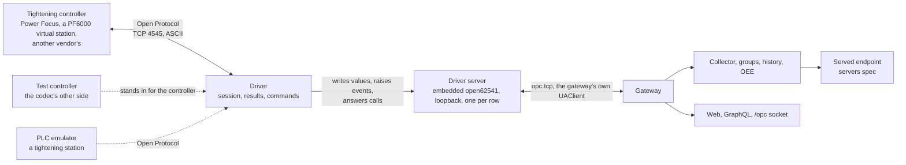

# Open Protocol spec

2026-10-21, its fifteen open questions ruled the same day, each as recommended, and the review's ten findings ([`open-protocol-spec-review.md`](../../../reviews/open-protocol-spec-review.md)) applied the same day. The plan is [`plan.md`](plan.md), and its review's fifteen findings ([`open-protocol-plan-review.md`](../../../reviews/open-protocol-plan-review.md)) are folded here where they touch the spec. Its issues are [#461](https://github.com/Jde-cpp/opc-hub/issues/461), the parent, and #462 to #475, label `open-protocol`. Nothing here is built. Tightening controllers over Open Protocol, Atlas Copco's and the other vendors' that speak it, through a native driver, are the subject. The shape is the one the PLCs spec ruled ([`../plcs/spec.md`](../plcs/spec.md), *Open questions* #1, #2 and #9), a driver kind on `server_connections` behind an embedded UA server per row. That spec is parked (its first paragraph), so this one carries the parts of the shape that belong to no one kind, the `kind` column, the per-row server host, its trust anchor and its own-certificate rule, and the Allen-Bradley driver, when it un-parks, and Modbus TCP, a spec of its own (servers spec *Open questions* #9), sit on them.

## Overview

The gateway is a UA client and nothing else: a connection is a url and a certificate URI ([`ServerCnnctn.h:21`](../../apps/OpcGateway/src/types/ServerCnnctn.h#L21)), and a device reaches the product only through an OPC UA server. A tightening controller has none to count on. The PF6000 and PF8 manuals name no OPC UA anywhere ([PF6000][pf6k34], [PF8][pf8]); the OPC Foundation's companion specification for tightening, *OPC UA for Joining Systems* ([OPC 40450-1][ijt], 1.01.0, 2025-10-06), has no Atlas Copco controller that claims it in any source found. What every tightening controller on a line does speak is Open Protocol: Atlas Copco's, framed ASCII over TCP on 4545 ([§2.1.1][op]), implemented by Desoutter, Stanley, Ingersoll Rand, Cleco, Bosch Rexroth and Kolver controllers besides ([Tulip][tulip], [DeMeter][demeter]), and the interface a line PLC or an MES takes results through.

What a tightening controller gives is not what a PLC gives. A PLC is tags, read when asked. A tightening controller is results, one per rundown, pushed when it happens: a record of the final torque and angle against their limits, OK or NOK, the parameter set that ran, the batch, the VIN, the controller's time and a tightening id ([§5.8.2][op]). And it takes commands, not writes: select a parameter set or a job, disable or enable the tool, download a VIN. So the driver here pushes values and answers methods, where the Allen-Bradley driver was a read-through cache with writes; the server it sits behind, and everything the gateway does with that server, is the same.

There is no library. No C or C++ implementation is both maintained and licensed for linking; the mature ones are OpenProtocolInterpreter, a C# parser under MIT ([github][opi]), and node-open-protocol, a JavaScript client under GPL 3 ([github][nop]). The protocol is small, so the codec is the product's, on asio, and the same codec plays the controller in the suite and in the emulator, where the PLCs spec took the library's simulator because the library was the protocol.

Line numbers cite opc-hub2 at `af6ea641`, main with the web and OpcServer refactors merged, re-pinned at the plan review's fold. Refs re-anchored on 2026-10-23, the UA server library's move among them, cite branch `servers-1a-ua-server-library`. open62541 refs are v1.5.9, the version the build links. Section numbers are the Open Protocol specification's, Atlas Copco 9836 4415 01, Release 2.20.1; Atlas Copco publishes no download of it, and the copy cited is the one OpenProtocolInterpreter's repository carries ([PDF][op]). The per-product appendices are Atlas Copco's own, the PF6000's on ServAid ([PF6000 appendix][pf6kapp]).

## Requirements

| Area | Requirement | From |
| --- | --- | --- |
| Kind | A `server_connections` row has a `kind`: `ua`, today's row, or `open-protocol`, one Open Protocol connection to a controller, a PF6000 or PF8 virtual station being one connection on its own port. The PLCs spec's `ab-eip` joins when it un-parks. | PLCs spec *Open questions* #1, #2; servers spec *Open questions* #9 |
| Host | Each driver row, whatever its kind, is an embedded UA server on loopback that the gateway's own client dials; the host knows no kind, and a driver per kind sits behind it. | PLCs spec *Open questions* #1, #9 |
| Session | MID 0001 at revision 6, stepping down on error 97; the identity MID 0002 answers; link-level acknowledgement where the controller numbers its messages, application acknowledgement where not; a keep-alive after 10 s without traffic; reconnect with backoff. | this spec, *The protocol* |
| Controllers | Atlas Copco PF4000, PF6000 and PF8; other vendors' controllers by the same protocol, untested; the MT Focus 6000 and PowerMACS, whose results are not MID 0061, later. | this spec, *Controllers* |
| Results | Every MID 0061 result, revisions 1 to 7, written to a `Result` object's variables with the controller's time as source timestamp, distinct and increasing per row, so that a collector item at sampling interval 0 sees each one; counters of tightenings, OK and NOK. | this spec, *Results* |
| Backfill | The results a controller made while its link was down are fetched by MID 0064 when it returns, and written in order before the live ones, within one gateway run, bounded. | this spec, *Backfill* |
| State | The selected parameter set, job and VIN, and the controller's alarm, as variables that read `Bad_NoCommunication` while the link is down. | this spec, *Address space* |
| Commands | Select a parameter set or a job, disable or enable the tool, download a VIN: methods held asynchronously for the controller's answer. A call needs Execute on an enforced row of a group that holds a variable of the row, and is logged with the hub user. | this spec, *Commands*; access posture ruling #237 |
| Events | An event per result on `Result`, its fields the result's. | this spec, *Events* |
| Sessions and rights | The driver server opens sessions as the OpcServer does, through the hub; a web user reaches it by issued token and the collector by the gateway's own certificate, as the gateway's own user with no hub lookup. Browse and reads are open to every session; nothing is writable. | [`UAAccess.cpp:310`](../../libs/opc/server/src/UAAccess.cpp#L310), [`../servers/spec.md`](../servers/spec.md) *Sessions and rights*, PLCs spec *Sessions and rights* |
| Groups, history and OEE | A template resolves against a driver row as against any server, a result member records every result, and a station is an OEE machine through its counters. | historian spec *Collector contract*; OEE spec *Counts*, *State* |
| Endpoint | The servers spec's endpoint serves a driver row's members as it serves any connection's, under the row's own namespace. | [`../servers/spec.md`](../servers/spec.md) *Namespaces* |
| Diagnostics | An `_Op` object on the driver server: `Connected`, `Since`, `Url`, `LastError`, `Reconnects`, `Identity`, `Revisions`, `LinkLevel`, `Results`, `LostResults` and `Skew`. The connection page shows it. | this spec |
| Test | `testConnection` on a driver row opens a session, reports MID 0002's identity, stops the session, and registers nothing. | [`TestConnectionQLAwait.h:6`](../../apps/OpcGateway/src/ql/TestConnectionQLAwait.h#L6) |
| Limits | A `/gateway/drivers` block: the port base every kind shares, and an `openProtocol` block with the keep-alive, the reply and call deadlines, the reconnect backoff, the backfill bound, the skew warning and the frame log. | this spec, *Limits* |
| Simulator | A test controller on the driver's own codec, in-process in the suite; the emulator plays a tightening station. | this spec, *Tests*, *Emulator* |
| Deploy | No library, nothing bundled, no notices entry; the installers change nothing, since the driver server is loopback-only and the driver dials out. | this spec, *Roles* |

## Design



**Roles.** The driver turns a tightening controller into a UA server the gateway already knows how to use, and its server is not a product endpoint: it binds loopback and only the gateway's own clients reach it. A SCADA or MES that wants the results takes them from the servers spec's endpoint, with the group's history behind them, or keeps its own Open Protocol connection where the controller has a slot for it (*Connections*). Nothing is added to the deploy: there is no library, so nothing joins the superbuild, the third-party notices or the installers' file lists ([`files.txt:22`](../../apps/OpcHub/setup/files.txt#L22); [`build-deb.sh:160`](../../apps/OpcHub/setup/linux/build-deb.sh#L160)), no port opens, and the driver's connection is outbound, to the controller's 4545 or its virtual station's port.

**The protocol.** A message is a 20-byte ASCII header, the length, the MID, the revision, a no-ack flag, the station and spindle, a sequence number and two part fields, then a data field of two-digit parameter ids and fixed-width values, and a NUL the length does not count. The receiver finds the end by the length, since MID 0900 carries binary after its NUL. A message is at most 9999 bytes, or 99 linked parts ([§2.2, §2.3, §3.8][op]). The integrator opens TCP to the controller and sends MID 0001; the controller answers MID 0002, or MID 0004 with an error code, and answers nothing else first ([§3.1, §5.2.1][op]). After that, each direction has one message outstanding at a time ([§3.2.1][op]).

The integrator chooses one of two ways to acknowledge. At application level, a subscription's push is answered by its own ack MID, 0062 for a result. At link level, OP 2.0's MID 9997 and 9998 answer against a sequence number running 1 to 99 per direction; this replaces the per-topic acks, and the specification calls it "almost a mandatory" ([§3.2–3.2.2][op]). The driver takes link level where MID 0002 revision 6 says the controller numbers its messages, and application level otherwise (*Open questions* #7). A repeat of the number last acknowledged is a retransmission, answered with the same 9997 and dropped; any other number out of order is answered by 9998 carrying the expected one, then a disconnect and a reconnect, as the specification prescribes ([§3.2.2][op]).

The controller drops a connection that is silent for 15 s, a time a PF6000 or PF8 sets per virtual station between 15 and 60 s ([PF6000 manual][pf6k]). The driver sends MID 9999 after `keepAlive`, 10 s, without a message either way, which is the specification's own suggestion ([§5.28.1][op]). A request or an ack unanswered within `replyTimeout`, 10 s, the specification's suggestion over TCP in place of resends ([§3.3.5][op]), is a lost link.

There is no revision negotiation: a request in a revision the controller lacks is answered by MID 0004 with code 74, 76 or 97 ([§5.2.1, Table 23][op]), or in the revision the controller has, as §1.4's example answers a MID 0052 at 2 in revision 1 ([§1.4][op]). So the driver asks for the highest revision it decodes and steps down on those codes, MID 0001 from 6 and MID 0061 from 7, as the open clients do ([node-open-protocol][nop-session]), and it decodes every reply and push by the revision in its own header, so a controller that answers lower is read right. It stays under the row's `revisions` ceilings, keeps the revision the controller answered for the connection's life, whichever side stepped down, and shows it in `_Op.Revisions` (*Open questions* #8).

The MIDs the driver speaks:
- 0001 to 0005;
- 0014 to 0017 for the selected parameter set, and 0018;
- 0034 to 0038 for job info and job select;
- 0042 and 0043;
- 0050 to 0054 for the VIN;
- 0060 to 0065 for results and their recovery;
- 0070 to 0077 for alarms;
- 0080 and 0081 for the controller's time;
- 9997 to 9999.

It subscribes by the per-topic MIDs, not the generic 0008, since the PF6000 appendix lists no 0008 ([PF6000 appendix][pf6kapp], Table 1).

**The codec.** `Jde.Opc.OpenProtocol`, in `libs/opc/openProtocol`, has no open62541 and no I/O in its core: a header and field codec, a type per MID the driver speaks, each revision's fields, tested from byte buffers. A session runs on an asio TCP socket on the gateway's executor ([`execution.h:10`](../../include/jde/fwk/process/execution.h#L10)), one strand per row, with the read loop, the outstanding request, the acks, the keep-alive timer and the reconnect on that strand. The controller's side of the same codec, the accept, MID 0002 and the pushes, is in the library too, for the suite and the emulator. A controller on a plant network is untrusted input: the decoder bounds the length, reads each part field as one character by the specification's §7.1 table, refuses a field that is not its width or a digit field with mixed content, and has a fuzz target. A digit field that is all spaces is its default, the table's where it names one, revision 1, station 1, spindle 1, and not used otherwise, and a revision of `000` is 1 ([§2.2.2, Table 1][op]; plan review #10); the specification's own MID 0001 example carries nine of them ([§5.2.1][op]). The driver sends digits. Its log is an `OpenProtocol` tag, with each frame in and out at Trace when `/gateway/drivers/openProtocol.log` is on.

**Connections.** A controller takes a bounded number of Open Protocol clients: several per virtual station on a PF6000 or PF8, with no number stated; two over TCP on an MT Focus 6000 ([MT Focus 6000][mtf], p. 4); an unstated number on a PF4000. The session types Actor, Viewer and Classic decide who may command, a Viewer's command answered by code 92 and a second Actor refused with 35 ([§3.3.4][op]). The gateway's connection is one more beside the line PLC's or an MES's. Where the controller has one slot, the gateway takes it from them, which a site decides before it adds the row.

A PF6000 or PF8 can lock the tool when an Open Protocol client disconnects, set per virtual station as its *Disconnect action* ([PF6000 manual][pf6k]). A row's virtual station keeps that action at None, or the line stops whenever the gateway restarts, and the help says so. For the same reason, the driver never asks for MID 0001 revision 8's tool lock at disconnection ([Table 12][op]).

**The row.** `server_connections` ([`opcGateway-meta.jsonnet:22`](../../apps/OpcGateway/config/opcGateway-meta.jsonnet#L22)) grows `kind`, `ua` by default, and `driver`, a json text. Both are nullable, and null means a UA row. `kind` is `open-protocol` here, `ab-eip` when the PLCs spec un-parks, and `flow` for the flows spec's flow server, a row with no driver behind it (plan review #7), with that spec's `plc`, `path` and `tag_list` as members of `driver` rather than columns of their own (*Open questions* #2).

For an Open Protocol row:
- `url` is `open-protocol://<host>[:<port>]`, 4545 by default ([§2.1.1][op]), or a virtual station's own port where the controller has several ([PF6000 manual][pf6k]).
- `driver` holds `timeZone`, the IANA zone the controller's clock keeps, the gateway's own by default (*Results*), and `revisions`, per-MID ceilings for a controller that answers a revision it implements badly, `{"0061": 3}`.
- `certificate_uri` is the driver server's applicationUri, which is the gateway's own. The save refuses a value and `ServerCnnctn` supplies it for a driver kind, since a save hook gets the mutation `const` (plan review #6). It is the server URI a client holds the endpoints against ([`UAClient.cpp:346`](../../apps/OpcGateway/src/UAClient.cpp#L346)); its being set selects Sign & Encrypt; and the pair the driver server presents carries that URI in its SAN.
- `default_browse_ns` is the driver server's one namespace, 2, supplied the same way.

The insert procs take the new columns ([`sqlite/gateway_server_connection_insert.cpp:7`](../../apps/OpcGateway/config/sql/sqlite/gateway_server_connection_insert.cpp#L7), [`gateway_server_connection_insert.sql:4`](../../apps/OpcGateway/config/sql/mysql/gateway_server_connection_insert.sql#L4)). The save rules run on insert, and on update over the merged row: a known `kind`, a url of its scheme, and a `driver` the kind's rules accept.

`connectionEdited` ([`OpcQLHook.cpp:77`](../../apps/OpcGateway/src/ql/OpcQLHook.cpp#L77)) treats a change to `kind` or `driver` as it treats one to the url: the row's clients go first ([`UAClient.cpp:201`](../../apps/OpcGateway/src/UAClient.cpp#L201)), then the driver server stops and the driver starts again, and the clients reconnect to it on the new row. A row inserted while the gateway runs gets its server then, a delete stops it as a purge does, and a restore starts it (plan review #3).

The client dials the driver server, not the url. Where the connect sets the url it dials ([`UAClient.cpp:784`](../../apps/OpcGateway/src/UAClient.cpp#L784)), a row of a kind with a driver takes `opc.tcp://127.0.0.1:<port>`, and any other kind, `flow` among them, dials its stored url. `ReachableUrl` beside it, the fallback probe for a name with several addresses ([`:747`](../../apps/OpcGateway/src/UAClient.cpp#L747)), is left alone. A driver row's `testConnection` never reaches `TestConnectAwait` ([`TestConnectAwait.h:11`](../../apps/OpcGateway/src/async/TestConnectAwait.h#L11)), since it builds no client.

The clients spec's columns ([`../clients/spec.md`](../clients/spec.md) *Connection settings*, [#413](https://github.com/Jde-cpp/opc-hub/issues/413)) keep their meaning where they have one, the session and request timeouts, the keep-alive and the TTL; the mode and the policy are fixed.

`testConnection( opc, url, certificateUri )` ([`TestConnectionQLAwait.cpp:14`](../../apps/OpcGateway/src/ql/TestConnectionQLAwait.cpp#L14)) takes `kind` and `driver` as optional arguments, under the same right, Update on `serverConnections` ([`:18`](../../apps/OpcGateway/src/ql/TestConnectionQLAwait.cpp#L18)). For an Open Protocol row it opens the TCP connection, sends MID 0001 with the step-down, sends MID 0003 and closes. In place of the server description and the namespaces, it reports what MID 0002 answered ([Tables 13–20][op]): the controller name, the system type and subtype, the supplier code, the Open Protocol, controller and tool software versions, the serial number, and the station's id and name.

**The driver server.** There is one per driver row, whatever its kind, under `apps/OpcGateway/src/drivers/`: a `DriverHost` that owns the server, and an `IDriver` per kind that builds the address space, feeds the values and answers the methods. The Open Protocol driver is under `drivers/openProtocol/`. This is the PLCs spec's `PlcHost` (its *The driver server*) made kind-agnostic, and its rules carry over as written there.

It sits on `Jde.Opc.UAServer`, the library the servers spec moves out of the OpcServer ([`../servers/spec.md`](../servers/spec.md) *The server library*; the servers plan's phase 1, [#380](https://github.com/Jde-cpp/opc-hub/issues/380) and [#381](https://github.com/Jde-cpp/opc-hub/issues/381)). Its `UASettings` are filled from the row and the `/gateway/drivers` block:
- the process's own `/http/ssl` pair as the endpoint's certificate, as the gateway's endpoint presents it;
- bound to `127.0.0.1` on `portBase + server_connection_id`, 4870 plus the row's id, which is stable for the row's life and never typed, a collision being a start-up error naming the port and `portBase`;
- Sign & Encrypt under Basic256Sha256, and no None endpoint;
- a trust list of two, in memory, fed to the channel's PKI and to the session's alike, as the OpcServer's one list is ([`UATrust.h:24`](../../include/jde/opc/server/UATrust.h#L24)).

The two certificates on that list:
- The certificate the gateway issued for the slug ([`UAClient.h:135`](../../apps/OpcGateway/src/UAClient.h#L135)), which a web session's channel presents.
- The process's own `/http/ssl` pair, which the collector presents for its channel and its token alike. A certificate credential takes the app client's pair for both ([`UAClient.cpp:359`](../../apps/OpcGateway/src/UAClient.cpp#L359)), and the collector is one unless `hist.credentials` names a user ([`HistHost.cpp:103`](../../apps/OpcGateway/src/hist/HistHost.cpp#L103)).

For that list, the library's `UASettings` gains an in-memory trusted list beside its directories, holding the two files' paths and re-reading them on a failed verify, as the OpcServer's list heals a re-issue. The host makes sure the slug's certificate exists before it builds the list, since the gateway issues it on a web user's first connect and re-issues it when it expires ([`UAClient.cpp:307`](../../apps/OpcGateway/src/UAClient.cpp#L307); plan review #4). Anonymous is off; the token types are certificate and issued; there are no users and no rejected directory. The library's `limits` are open62541's own, except `maxAsyncOperationQueueSize`, which the block's `maxAsyncOperations` sets, and the `queueSizeLimits` maximum, which a kind may raise (*Backfill*). Its applicationUri is the gateway's own, the SAN of the pair it presents, which the suite's gateway `http` block already carries ([`Opc.Tests.jsonnet:48`](../../apps/OpcGateway/tests/config/Opc.Tests.jsonnet#L48)). Its applicationName is `Jde-Cpp <kind> <slug>` with no bracketed suffix, since a driver row keeps no instance schema for the node-access page to address (*Sessions and rights*).

Its sessions are `UAAccess`'s. A web user's client sends an issued token carrying the hub session ([`OpcServerSession.h:12`](../../apps/OpcGateway/src/auth/OpcServerSession.h#L12)). The hub resolves it in-process through the lookup the servers spec's endpoint adds ([#382](https://github.com/Jde-cpp/opc-hub/issues/382)); a split gateway resolves it over the socket.

The collector presents the process's certificate, which `UASettings` maps by an own-certificate rule to the gateway's own user, with no hub lookup. The hub holds no user for its own key: a user is keyed to a public key only by a socket login ([`LoginAwait.cpp:52`](../../libs/access/src/server/awaits/LoginAwait.cpp#L52)), and the hub's app client makes none ([`HubAppClient.h:9`](../../apps/OpcHub/src/HubAppClient.h#L9)). So the lookup a split gateway could make ([`UAAccess.cpp:220`](../../libs/opc/server/src/UAAccess.cpp#L220)) is skipped in both shapes, and a loopback server a process runs for itself admits that process as itself.

The gateway's own clients verify a server's certificate against `/gateway/trustedCertDirs` ([`ServerTrust.cpp:29`](../../libs/opc/shared/src/ServerTrust.cpp#L29); [`Opc.Gateway.jsonnet:53`](../../apps/OpcGateway/config/Opc.Gateway.jsonnet#L53)), and the process's own pair is in neither shipped directory. So a driver row's client anchors that pair in memory beside the directories, an extra anchor the verifier's context takes for any driver kind. The shipped list and `verifyServerCertificate` keep their meaning.

The server starts with the gateway, after the access snapshot ([`gatewayStartup.cpp:64`](../../apps/OpcGateway/src/gatewayStartup.cpp#L64)) and before `HistHost::Start` ([`:68`](../../apps/OpcGateway/src/gatewayStartup.cpp#L68)), which kicks each group's first subscribe, so that subscribe finds it listening. It runs on a thread of its own, one per row, as the OpcServer's does. It stops with its row, through a shutdown hook registered after the UA clients' ([`:66`](../../apps/OpcGateway/src/gatewayStartup.cpp#L66)), since the hooks run in registration order ([`process.cpp:281`](../../libs/fwk/src/process/process.cpp#L281)): the collectors unsubscribe, the clients close their sessions on a live server, then the servers stop. The endpoint's hook goes ahead of the historian's because the endpoint reads it; a driver server is what it reads. Until the servers plan's phase 1 lands, the driver waits for the library rather than link `Jde.Opc.ServerLib` as it is, which the servers spec's #11 declined for the gateway for its libxml2 and app-client baggage.

**Address space.** It is fixed, the same for every Open Protocol row, built when the server starts and before the controller first answers. Every variable is a stored value the driver writes, and no read reaches the controller. Under Objects, in the row's one namespace, URI `urn:jde:<slug>:open-protocol`, with each NodeId the string of its path, `s=Result.Torque`:

- **`Result`.** An object with a variable per field of MID 0061, revisions 1 to 7 ([§5.8.2][op]), named in the specification's words, camel-cased. The exceptions are the cell id, the channel id and the controller name, which `_Op.Identity` carries. The types:
  - `TighteningId` is a UInt32, its ten digits topping out at 4294967295.
  - `Time` and `PsetChangeTime` are DateTime (*Results*).
  - `Status`, the tightening status, is a Boolean, true for OK.
  - The statuses with listed codes, `TorqueStatus`, `AngleStatus`, `BatchStatus`, `RundownAngleStatus` and the rest, are a Byte holding the specification's code: 0 low, 1 OK, 2 high, and for the batch 0 NOK, 1 OK, 2 not used, 3 running.
  - `Torque`, `TorqueMin`, `TorqueMax` and `TorqueFinalTarget`, and the self-tap and prevail torques, are a Double, the wire's integer over 100 ([Table 108][op]), in the unit revision 3's `TorqueUnit` names, Nm when nothing does ([§2.3.1][op]).
  - `Angle`, `AngleMin`, `AngleMax`, `AngleFinalTarget` and the rundown angles are a Double in degrees, with revision 7's final angle decimal replacing `Angle`'s whole degrees where it is sent.
  - `TighteningErrorStatus` and `TighteningErrorStatus2` are a UInt32 of their bits.
  - `Pset`, `JobId`, `BatchSize`, `BatchCounter` and `JobSequenceNumber` are UInt16; `Strategy` and `ResultType` are a Byte.
  - `Vin`, `PsetName`, `ToolSerialNumber`, the identifier parts 2 to 4 and the customer error code are a String.

  A field the settled revision does not carry reads `Bad_NotSupported`, set once when the subscription is accepted, so a group member over it stores that one status.
- **`Counters`.** `Total`, `Ok` and `Nok`, each a UInt64 (*OEE*).
- **`Selected`.** `Pset` from MID 0015, `Job` from MID 0035 and `Vin` from MID 0052, with revision 2's identifier parts beside it.
- **`Alarm`.** `Code`, a String, the four-character error code of MID 0071; `Active`, a Boolean; and `Time`, a DateTime, from MID 0071 and MID 0076.
- **`Commands`.** An object holding the methods (*Commands*).
- **`_Op`.** The diagnostics, readable by any session:
  - `Connected`, true while the session with the controller is up;
  - `Since`;
  - `Url`;
  - `LastError`, the last MID 0004's MID, code and name, or the socket's error;
  - `Reconnects`;
  - `Identity`, a String of MID 0002's fields as `testConnection` reports them;
  - `Revisions`, a String of the revision settled per MID, `0001:6 0061:7 0071:3`;
  - `LinkLevel`, a Boolean;
  - `Results` and `LostResults`, UInt64 since the gateway started;
  - `Skew`, a Double of the controller's clock less the gateway's in seconds.

Every variable has AccessLevel CurrentRead, WriteMask 0 and MinimumSamplingInterval 0. Until the first result, every `Result` field reads `Bad_WaitingForInitialData` and `Counters` read Good 0; the first result replaces the one and advances the other. `Selected`, `Alarm` and `_Op.Connected` follow the link: losing it sets `Bad_NoCommunication` on `Selected` and `Alarm`, keeping their last values, and each one's next report replaces it. `Result` and `Counters` keep their last value and status across a loss. A result is a thing that happened, not a reading that went stale, and a Bad record between two results would land a backfilled result before it (*Backfill*). Whether a controller pushes the current parameter set, job or VIN when the subscription opens, or only on the next change, is a hardware check (*Open questions* #15); until a report comes, the value stays Bad.

**Results.** MID 0061 arrives on the strand. The driver acks it, at once and before any write, with 0062 or 9997. It decodes the result and writes it to `Result`, one `UA_Server_writeDataValue` per field ([`server.h:460`](https://github.com/open62541/open62541/blob/v1.5.9/include/open62541/server.h#L460)), `TighteningId` last. Every field of one result carries the same source timestamp and the gateway's receipt as server timestamp. The counters follow, then the event (*Events*).

The source timestamp is the result's own time. The wire gives `YYYY-MM-DD:HH:MM:SS`, local to the controller, with no zone and no fraction ([Table 108][op]). The driver reads it in the row's `timeZone`. A result whose time is not after the last result written for the row gets the last time plus a millisecond, so the row's source timestamps are distinct and increasing. Two rundowns inside one second keep their order and are two records; after a break, the historian refuses a value sourced earlier than the last it stored for a node ([`Group.cpp:400`](../../libs/historian/src/Group.cpp#L400)).

The controller's clock is the controller's. At each connect, the driver reads it with MID 0080 and sets `_Op.Skew`, and warns past `maxSkew`, five minutes. The driver does not correct the skew, since a clock the plant has set wrong is the plant's to set right (*Open questions* #5).

**Backfill.** The specification's recovery for a network failure is MID 0064, an old result by tightening id, id 0 being the latest ([§5.8.5, Table 121][op]); nothing is pushed again on its own. On a PF6000 the ids are global across virtual stations and not consecutive. So the appendix's procedure walks back: ask for id 0, then for the id received less one, which answers the result before it, until a known id comes back, dropping each result whose station id, MID 0065 revision 7's, is not the connection's, MID 0002 revision 6's ([PF6000 appendix][pf6kapp] §2.4).

When the link returns, the driver:
1. subscribes to results first, and holds and acks what arrives;
2. walks back by that procedure, from the oldest held id less one, the appendix's start for a known id, or from id 0 when nothing is held, until it reaches the last tightening id it wrote, or a result no later than the last time it wrote, or a MID 0004, or `maxBackfill` requests, 2 000;
3. writes what it found, oldest first, then the held results, each tightening id once whichever way it came. A found result is a MID 0065, which carries no limits, no parameter set name and no time of its last change ([§5.8.6][op]), so each `Result` variable it lacks is written with the result's source timestamp and `Bad_NotSupported`, the next live result writing it Good, and its event leaves it out (plan review #5).

Short of the last id, it adds the gap's unknown size as one to `_Op.LostResults` and warns, naming the last id it has and the oldest it reached.

There is no last id on a row's first connection in a run, so nothing is filled then. Nor is anything filled after a gateway restart, which is the gap every source's collection has across a restart (*Open questions* #6).

A fill is a burst of writes inside one publishing interval of the collector's subscription, 500 ms ([`HistGroupHost.h:90`](../../apps/OpcGateway/src/hist/HistGroupHost.h#L90)). So the Open Protocol driver raises its server's `queueSizeLimits` maximum ([`server.h:2303`](https://github.com/open62541/open62541/blob/v1.5.9/include/open62541/server.h#L2303)) to the larger of open62541's 100 and twice `maxBackfill`, the walk's bound plus as many held, since the held count is not known when the config is fixed, and a fill reaches the collector's queue whole (plan review #8).

**Commands.** These are methods on `Commands`, each the MID of the same purpose ([§4.5][op]):
- `SelectPset( pset: UInt16 )`, MID 0018, 000 to 999;
- `SelectJob( job: UInt16 )`, MID 0038 at 2, 0000 to 9999, or at 1, 00 to 99, a value out of range refused `Bad_OutOfRange` before anything is sent (plan review #11);
- `DisableTool()` and `EnableTool()`, MIDs 0042 and 0043 at revision 1, every tool of the connection;
- `DownloadVin( vin: String )`, MID 0050, 25 characters at most.

The rights come first, from the Call service, which asks `getUserExecutableOnObject` before it runs a method; the library's `UAAccess` answers it, and `getUserExecutable`, from the host's `INodeAccess`, where today it says no to every method (plan review #1). A method's callback runs on the server's thread under the service lock. It posts the request to the row's strand, and returns `Good_CompletesAsynchronously`. The strand sends the request behind whatever is outstanding and answers through `UA_Server_setAsyncCallMethodResult` ([`server.h:1417`](https://github.com/open62541/open62541/blob/v1.5.9/include/open62541/server.h#L1417)):
- Good on MID 0005;
- `Bad_InvalidState` on MID 0004, with the code and its name in `_Op.LastError` and the log, a Viewer's 92 and a second Actor's 35 among them;
- `Bad_Timeout` after `replyTimeout`;
- `Bad_NoCommunication` while the link is down.

The server's `asyncOperationTimeout` for a call is `callTimeout`, 30 s, past the reply deadline and the queue. A pending call is kept by the host, keyed by the output pointer the server handed it. `asyncOperationCancelCallback` ([`server.h:2255`](https://github.com/open62541/open62541/blob/v1.5.9/include/open62541/server.h#L2255)) erases the entry, as the PLCs spec's host does for its reads, so a reply that finds none logs and drops. The cancel is the timeout's and the shutdown's; a session's close cancels nothing, so a call outlives its session: once posted to the strand it is sent, its answer logged, and the result dropped where no session remains.

Rights resolve through the servers plan's 3a map ([#383](https://github.com/Jde-cpp/opc-hub/issues/383)). A method resolves to the groups that hold any of the row's variables. A call needs Execute ([`usings.h:33`](../../include/jde/access/usings.h#L33)), the right the vocabulary keeps for methods (clients spec *Open questions* #9), on the enforced row of one of those groups, through `Authorize::Rights`'s criteria overload as the endpoint uses it, a lookup and never `Gate` under the service lock. A row that no group holds refuses commands; so does a group whose row is unenforced or grants no Execute. The refusal is the Call service's `Bad_UserAccessDenied`, before anything is sent, with the message #237 gave history edits in the log, since a Call result carries a status only (*Open questions* #10). Every call is logged at Information with the hub user, the method, its arguments and the answer.

**Events.** `TighteningResultEventType` is a subtype of BaseEventType in the row's namespace, with a property per `Result` variable. Each result written raises one, through `UA_Server_createEventEx` ([`server.h:1616`](https://github.com/open62541/open62541/blob/v1.5.9/include/open62541/server.h#L1616)), with:
- SourceNode `Result`, whose EventNotifier has SubscribeToEvents;
- Time the result's source timestamp;
- Severity 100 for OK and 500 for NOK;
- Message `OK` or `NOK`, with the parameter set.

The Server object emits every event ([`ua_subscription_event.c:1630`](https://github.com/open62541/open62541/blob/v1.5.9/src/server/ua_subscription_event.c#L1630)), so a client subscribed there sees them too. Events are on in this build: `UA_ENABLE_SUBSCRIPTIONS_EVENTS` defaults on ([`CMakeLists.txt:116`](https://github.com/open62541/open62541/blob/v1.5.9/CMakeLists.txt#L116)) and the superbuild leaves it ([`build/CMakeLists.txt:477`](../../build/CMakeLists.txt#L477)); alarms and conditions are off.

An event is one result whole, where the variables arrive as separate items. It is the clients spec's Events tab ([#424](https://github.com/Jde-cpp/opc-hub/issues/424)) that shows them, and the historian keeps none. OPC 40450-1 delivers results this way too, as a `Result` field of an abstract `JoiningSystemResultReadyEventType` ([OPC 40450-1 §8.1][ijt-events]). This type is not that one (*Open questions* #3, #4).

**Sessions and rights.** These are the PLCs spec's (its *Sessions and rights*), by group, the servers spec's endpoint model. A web user comes by issued token and the collector by the process's certificate under the own-certificate rule. Browse and reads are open to every session, as #237 ships `nodeIds`. Nothing is writable, so the PLCs spec's write rule has nothing to govern here. Its place is taken by the command rule above, which keys on the same groups with Execute in place of Update.

The OpcServer's per-tag acls are not offered, for the PLCs spec's reasons. The provider the gateway creates per connection ([`UM.cpp:42`](../../apps/OpcGateway/src/auth/UM.cpp#L42)) is an identity provider and plays no part.

**Groups, history and the endpoint.** Nothing changes for the collector. A template member's path resolves on the driver server through the translate the collector uses ([`HistHost.cpp:284`](../../apps/OpcGateway/src/hist/HistHost.cpp#L284)), with the row's namespace URI in its segments, and the collector subscribes through its own client ([`HistGroupHost.cpp:193`](../../apps/OpcGateway/src/hist/HistGroupHost.cpp#L193)).

One rule is the driver's: a result member records every result only at sampling interval 0. That is a member with no `MinTimeInterval`, for which the collector asks 0 and the largest queue ([`HistGroupHost.cpp:659`](../../apps/OpcGateway/src/hist/HistGroupHost.cpp#L659)). A stored value at 0 is sampled on each write ([`ua_subscription.c:1669`](https://github.com/open62541/open62541/blob/v1.5.9/src/server/ua_subscription.c#L1669); [`ua_services_attribute.c:1918`](https://github.com/open62541/open62541/blob/v1.5.9/src/server/ua_services_attribute.c#L1918)), and the server's limits do not raise a 0 ([`ua_services_monitoreditem.c:323`](https://github.com/open62541/open62541/blob/v1.5.9/src/server/ua_services_monitoreditem.c#L323)), so each result reaches the item's queue. A member with a `MinTimeInterval` is sampled on a clock and keeps the last result of each interval, and the help says so.

A field equal to the previous result's, an OK after an OK, is no data change under the default trigger of status and value ([`ua_subscription_datachange.c:121`](https://github.com/open62541/open62541/blob/v1.5.9/src/server/ua_subscription_datachange.c#L121)), and it is not stored; the historian reads it as the stepped value it is. `TighteningId` and the counters change with every result, so a result's record is theirs, and every field of a result shares its source timestamp.

The servers spec's endpoint serves a driver row's members under the row's own URI, `urn:jde:<slug>:open-protocol`, which its namespace rule keeps as it is, being already prefixed with the slug ([`../servers/spec.md`](../servers/spec.md) *Namespaces*; the PLCs plan's 0.4 in [#383](https://github.com/Jde-cpp/opc-hub/issues/383)). The search index crawls the driver server as it crawls any ([`NodeIndex.cpp:78`](../../apps/OpcGateway/src/NodeIndex.cpp#L78)).

**OEE.** A station is a machine of the OEE spec over a group that holds `Counters.Total`, `Counters.Ok` and `Counters.Nok` as its Total, Good and Reject signals ([`../oee/spec.md`](../oee/spec.md) *Counts*). The counters count since the driver started and restart at zero with the driver, at a gateway start or a row edit (*The row*), which the engine reads as a reset and counts whole. Without a State signal, the station runs while results arrive and stops once the machine's `idleTimeout` passes without one (OEE spec *State*).

At revision 3 and above, a counter counts a result of result type 1, a tightening ([§5.8.2][op]), so a loosening, a batch increment or a bypass counts for nothing; below revision 3, every result counts. `Ok` and `Nok` count by the tightening status (*Open questions* #13).

**Controllers.** The supported ones:
- **PF4000.** One connection per controller, on 4545.
- **PF6000 and PF8.** A row per virtual station on that station's port, opened in the controller's firewall ([PF6000 manual][pf6k34]). The PF6000 appendix's ceilings are 0001 at 6, 0061 and 0064 at 8, the alarms at 3, 0042, 0043 and 0050 at 1, the VIN subscription at 2, 0034 to 0037 at 4 and 0038 at 2, with multi-spindle results unsupported ([PF6000 appendix][pf6kapp], Table 1).
- **Other vendors.** Desoutter's CVI3 takes a port per tightening unit and Cleco a port per tool ([Tulip][tulip]), and Stanley, Ingersoll Rand, Bosch Rexroth and Kolver controllers speak the protocol with their own MID tables. A row per port works for all of them, with the step-down and the row's ceilings for their differences, untested until a site has one.

Not in this spec:
- **MT Focus 6000.** It implements neither 0061 nor 0042 and 0043, and sends results only as MID 1201 and 1202 ([MT Focus 6000][mtf], pp. 35–36).
- **PowerMACS.** Its results are its own MIDs.

`testConnection` names the system type either reports from MID 0002 revision 5, and the driver refuses either until the MID 1201 piece (*Later*).

**Emulator.** The PLC emulator gains a tightening station: an `/emulator/tightening` block with a port, 4545, and a `cycle`. The emulator serves Open Protocol on the library's controller side, one rundown per `cycle`, its torque about the parameter set's target with noise, NOK at a `reject` rate, the batch counting up. It answers `SelectPset`, `DisableTool` and `EnableTool`, and a disabled tool makes no results. The `cycle` and `reject` are the OEE plan's production mode's ([#407](https://github.com/Jde-cpp/opc-hub/issues/407)), so a demo station runs on the same figures. The emulator stays out of the release targets ([`linux-release.yml:81`](../../.github/workflows/linux-release.yml#L81)).

**Web.** The connection page ([`client-detail.ts:52`](../../web/opc/control/src/lib/pages/gateway-detail/client-detail/client-detail.ts#L52)) gets a kind picker that swaps the form. An Open Protocol row shows host, port, time zone and the revision ceilings behind a disclosure in place of the url and certificate URI, and Test Connection reports the identity. The Connection tab ([`server-properties.ts:40`](../../web/opc/control/src/lib/pages/gateway-detail/client-detail/server-properties/server-properties.ts#L40)) shows `_Op` in place of the server description.

The node pages, the search, the History tab, the groups and the templates are untouched. A command is the clients spec's Call dialog on `Commands` ([#318](https://github.com/Jde-cpp/opc-hub/issues/318)), and the result stream is its Events tab on `Result` ([#424](https://github.com/Jde-cpp/opc-hub/issues/424)); until #318 lands, nothing in the product calls a command, and the suite calls them through a helper of its own (plan review #2). The help's *Instances* section ([`gateways.md:58`](../../web/opc/control/src/assets/help/gateways.md#L58)) describes the row, the virtual station's port and its Disconnect action, and the sampling rule for result members; *Security* ([`:83`](../../web/opc/control/src/assets/help/gateways.md#L83)) gives the command rule.

**Tests.** `Jde.Opc.Tests` runs a test controller in-process on the library's controller side, on 4645, the live port plus 100 as the suite's other ports are ([`Opc.Tests.jsonnet:33`](../../apps/OpcGateway/tests/config/Opc.Tests.jsonnet#L33)), with a driver row against it under a `/gateway/drivers.portBase` of 4970. The fixture is scripted per case: which revisions it answers, whether it numbers its messages, two virtual stations sharing global non-consecutive tightening ids, and faults, a dropped link, a late reply, a silent socket, a malformed frame.

The fixture shares the driver's codec, so the suite proves the two sides agree, not that either agrees with a controller. The codec's own cases therefore decode messages built from the specification's tables, field by field. Conformance is checked by hand against Jarrekstar's open-protocol-device-simulator, Rust under Apache 2.0 or MIT, which serves the session, parameter sets, jobs, the VIN, tool control and MID 0061 at revisions 1 to 7 to several clients ([github][sim]), and against a controller (*Open questions* #12, #15). The simulator has no MID 0064, no alarms, no MID 0080 and no link-level acknowledgement, so backfill, the alarms, link level, the skew and the Disconnect action are the controller's check alone.

The cases:
- The codec round-trips each MID the driver speaks, decodes the specification's example frames, blank header fields and all, and refuses a length past 9999, a short field, a mixed digit field and a missing NUL; a fuzz target runs over the decoder.
- The session steps MID 0001 down from 6 to a fixture that answers 97 above 3, and reads a MID 0002 at 3 answered to a MID 0001 at 6, and 0061 pushes at 3 to a 0060 at 7, by their headers. It takes link level when MID 0002 revision 6 says so and application acks when not, re-acknowledges and drops a repeated sequence number, and reconnects on any other out of order. It keeps alive past a fixture that drops at 15 s of silence, and treats a reply past `replyTimeout` as a lost link.
- `testConnection` reports the fixture's identity.
- A result of each revision, 1 to 7, lands in `Result` with its fields, in the row's zone. Two in one second get distinct, increasing timestamps; a field outside the settled revision reads `Bad_NotSupported`; the counters count tightenings and skip a loosening.
- A group over `Result.TighteningId`, `Result.Torque` and `Counters.Ok` with no `MinTimeInterval` records every one of a burst faster than the publishing interval. With a `MinTimeInterval`, it keeps the last result per interval. A processed read agrees with the QL.
- Backfill: the link drops, both stations make results, and the driver fills only its own, in order, before the held live one; a result pushed between the subscribe and the first MID 0064 is written and counted once. A `maxBackfill` too short sets `LostResults`. A group over the row records the filled results with their own timestamps.
- `Selected` and `Alarm` follow their pushes, go `Bad_NoCommunication` with the link, and recover.
- Each command, called through a suite helper on a user's client, sends its MID, answering Good on 0005, `Bad_InvalidState` on 0004 and `Bad_Timeout` on silence. It refuses on an ungrouped row and on an unenforced group, and passes with Execute on an enforced one. A shutdown with a call pending leaves no entry.
- A result raises an event that a suite helper receives at the Server object, with its fields, an event item on a user's client, since the gateway subscribes to no events before the clients spec's Events (plan review #2).
- The driver server's certificate is refused when the anchor is withheld, the suite's list being its own certs directory ([`Opc.Tests.jsonnet:65`](../../apps/OpcGateway/tests/config/Opc.Tests.jsonnet#L65)), and the collector's session opens as the gateway's user.

The emulator's tests add a station that makes one result in a cycle.

**Limits.** The `/gateway/drivers` block:

```jsonnet
gateway:{
	drivers:{
		portBase:: 4870, //a driver row's server listens on 127.0.0.1 at portBase + its row id, every kind; the tests take 4970
		openProtocol:{
			keepAlive:: "PT10S", //MID 9999 after this long without a message either way; a controller drops a link silent for 15 s
			replyTimeout:: "PT10S", //a request, an ack or a command unanswered this long is a lost link
			callTimeout:: "PT30S", maxAsyncOperations:: 0, //how long a method call holds, the server's asyncOperationTimeout; and its async queue, maxAsyncOperationQueueSize, 0 unlimited as open62541's
			reconnectMin:: "PT1S", //the backoff between connection attempts, doubling to reconnectMax
			reconnectMax:: "PT1M",
			maxBackfill:: 2000, //MID 0064 requests one recovery may send
			maxSkew:: "PT5M", //the controller's clock against the gateway's, past which each connect warns
			log:: false //every frame in and out at Trace under the OpenProtocol tag
		}
	}
}
```

The PLCs spec's `/gateway/plc.portBase` is this block's `portBase` when it un-parks, its other keys a `drivers.plc` block.

**Later.**
- MID 1201 and 1202, the operation results the MT Focus 6000 and newer firmware send, and their replay from an index or a time on subscribe ([Table 151][op]), which would make backfill a subscription option.
- Multi-spindle results, MID 0100 and 0101.
- Trace curves, MID 0900 and 0901, as arrays.
- The selected parameter set's data, MID 0012 and 0013, as properties.
- Batch size and reset, MID 0019 and 0020.
- Alarm acknowledge, MID 0078, and alarms as conditions once a condition object exists (clients spec, [#425](https://github.com/Jde-cpp/opc-hub/issues/425)).
- Inputs and relays, MID 0200 to 0225.
- Backfill across a gateway restart, from a last id kept on disk.
- TLS, which the specification allows ([§2.1.1][op]).
- The controller dialing the gateway, the specification's second connection scenario ([§3.3.1][op]).
- OPC 40450-1's address space, served beside this one or instead of it (*Open questions* #3).
- EngineeringUnits on the torques from `TorqueUnit`.
- The gateway setting a controller's clock, MID 0082.

**Out of scope.**
- Downloading or editing tightening programs and parameter sets, MID 2500 to 2506, or anything else a controller's own tool, ToolsTalk, owns: its ports, its firewall, its Disconnect action.
- The serial transports, STX and ETX framing and 3964R ([§2.1.2][op]).
- ToolsNet or any vendor collector as a dependency.

## Pieces

Sizes are the GitHub project's Size field. Piece 3 can start now, and piece 1 follows it, since its `testConnection` speaks MID 0001 to 0003 (the plan's *The row follows the session*). Piece 2 needs the servers plan's phase 1 ([#380](https://github.com/Jde-cpp/opc-hub/issues/380), [#381](https://github.com/Jde-cpp/opc-hub/issues/381)) and, for the hub's sessions, the lookup of its phase 2 ([#382](https://github.com/Jde-cpp/opc-hub/issues/382)). Piece 4 needs 2 and 3. Pieces 5 to 8 follow 4, and 7 needs the servers plan's 3a as well ([#383](https://github.com/Jde-cpp/opc-hub/issues/383)), or builds its map. Piece 9 follows 3. Piece 10 follows 1 for the form and Test Connection and 4 for `_Op`, with its Call and Events from the clients plan ([#318](https://github.com/Jde-cpp/opc-hub/issues/318), [#424](https://github.com/Jde-cpp/opc-hub/issues/424)). Pieces 1 and 2 are the generic halves of the parked PLCs plan's phases 1 and 2b ([#433](https://github.com/Jde-cpp/opc-hub/issues/433), [#435](https://github.com/Jde-cpp/opc-hub/issues/435)), which these replace as [#465](https://github.com/Jde-cpp/opc-hub/issues/465) and [#466](https://github.com/Jde-cpp/opc-hub/issues/466), and which the flows plan ([#444](https://github.com/Jde-cpp/opc-hub/issues/444), [#454](https://github.com/Jde-cpp/opc-hub/issues/454)) now waits on through them.

| # | Piece | Size | Notes |
| --- | --- | --- | --- |
| 1 | The row | M | `kind` and `driver`, the insert procs, the save rules, `connectionEdited`, the loopback dial, `testConnection`'s dispatch and MID 0002 identity |
| 2 | The host | L | `DriverHost` and `IDriver` on `Jde.Opc.UAServer`, the settings, the loopback ports, the in-memory trust and the client's anchor, the own-certificate rule, start-up, insert, delete, restore and shutdown, `/gateway/drivers`, the Open Protocol driver's skeleton and `_Op`; the settings, trust list and anchor usable by a server with no row, the flows plan's flow server |
| 3 | The codec and the test controller | M | `Jde.Opc.OpenProtocol`: framing, fields, both kinds of ack, the session, the keep-alive, the step-down, the controller side, the fuzz target |
| 4 | Results | L | the address space, MID 0061 revisions 1 to 7, the timestamps, the counters, the collector cases |
| 5 | Backfill | M | the MID 0064 walk, the station filter, the held results, `LostResults`, the queue limit |
| 6 | State and alarms | S | `Selected` and `Alarm`, their subscriptions and the loss status |
| 7 | Commands | M | the five methods, the asynchronous calls, Execute by group, the audit line |
| 8 | Events | S | the event type and its raise |
| 9 | Emulator | S | the tightening station |
| 10 | Web | M | the kind picker and the Open Protocol form, Test Connection, `_Op` on the Connection tab, the help |

## Open questions

All fifteen ruled 2026-10-21, each as recommended; the plan is [`plan.md`](plan.md).

1. **The shape.** The PLCs spec ruled the shape (its *Open questions* #1, #2 and #9): a driver behind an embedded UA server per row, inside the gateway, on loopback, at `portBase` plus the row's id. That spec is parked, not withdrawn, and its reasons hold here: `UAClient` is `final` with no interface ([`UAClient.h:32`](../../apps/OpcGateway/src/UAClient.h#L32)), and every operation is an await through it. Recommended: take the ruling as standing, with the host made kind-agnostic so the Allen-Bradley driver and Modbus sit on it later. Ruled 2026-10-21: as recommended.
2. **The row's fields.** One json `driver` column, which each kind's save rule validates, against typed columns per kind, which the PLCs spec added (`plc`, `path`, `tag_list`) and which would grow with every family. Recommended: `driver`, with the PLCs spec's three as its members when it un-parks. Typed columns give the schema's own checks and a QL filter; neither matters for fields only the driver reads. Ruled 2026-10-21: as recommended.
3. **The address space.** Our own flat model against OPC 40450-1's. The companion specification's smallest claim, the IJT Result Server Facet, makes result events mandatory, each result one ExtensionObject field, and makes the result variable optional ([OPC 40450-1 §11.2.2.2][ijt-facet]). It needs DI, AMB, IA, Machinery and Machinery Result loaded, and its types compiled into open62541, which the superbuild does not do, or loaded at run time by a nodeset loader the gateway does not link ([`../servers/spec.md`](../servers/spec.md) *The server library*). A group cannot collect an event. Recommended: our own model now, with the variables a group collects and an event of our own; OPC 40450-1 later, when a client asks for it by name. Ruled 2026-10-21: as recommended.
4. **Values and events.** Each result as variables, which groups, history, the endpoint and OEE take, and as an event, which carries it whole to the Events tab and to clients that expect results as events. The alternatives are variables only, or events only, the companion specification's way, which the historian cannot store. Recommended: both, the event as its own small piece after the variables. Ruled 2026-10-21: as recommended.
5. **Timestamps.** The controller's time, read in the row's zone, nudged to stay distinct and increasing, with the gateway's receipt as server time. The alternative is the gateway's receipt as source time, which is right to the millisecond for a live result and wrong by the outage for a backfilled one. Recommended: the controller's time, with `_Op.Skew` and the warning, the clock left to the plant. Ruled 2026-10-21: as recommended.
6. **Backfill.** Within a run, by the MID 0064 walk, bounded, against none at all, as no other source of the gateway backfills. Across a gateway restart, from a last id on disk, is the third option. A controller keeps its results, up to 100 000 on a PF8 ([PF8 manual][pf8]), and DeMeter calls traceability lost without the recovery ([DeMeter][demeter]). Recommended: within a run now, across restarts later. Ruled 2026-10-21: as recommended.
7. **Acknowledgement.** Link level with sequence numbers where MID 0002 revision 6 says the controller supports it, and application acks otherwise. The alternative is application acks everywhere, which every controller answers. Recommended: link level where offered; the specification all but requires it ([§3.2][op]). Ruled 2026-10-21: as recommended.
8. **Revisions.** Step down per MID from the highest the driver decodes on codes 74, 76 and 97, under the row's ceilings, as node-open-protocol and Desoutter's DeMeter do. The alternative is Kepware's: fixed revisions per row that the user sets ([Kepware][kep], pp. 12–13). Recommended: step down, with the ceilings for a controller that answers a revision badly. Ruled 2026-10-21: as recommended.
9. **MID 0061's range.** Revisions 1 to 7, against 1 to 12 plus 998's stages and 999's light form. Seven is what the simulator serves; the PF6000's ceiling is 8; Kepware stops at 5. Recommended: 1 to 7, the rest later, a controller above 7 answering 7 since every revision below the highest is implemented ([§1.4][op]). Ruled 2026-10-21: as recommended.
10. **The command right.** Execute on an enforced row of a group that holds one of the row's variables, the group model's answer for a method, which belongs to no node a group holds. The alternatives are Update by the same route, which the PLCs spec's writes take, and Administer on `serverConnections`, which makes every command an admin's. Recommended: Execute by group. A command changes what the line does next, and the group is who runs the station. Ruled 2026-10-21: as recommended.
11. **The command set.** Five methods: parameter set, job, tool disable and enable, VIN. The alternative adds batch size and reset, alarm acknowledge and job restart now. Recommended: the five, the rest later; these are the ones a line's MES sends. Ruled 2026-10-21: as recommended.
12. **The test controller.** In-process, on our own codec, with the specification's tables as the codec's oracle and Jarrekstar's simulator and a controller as hand checks. The alternative spawns that simulator in the suite, which brings a Rust toolchain to both runners and a dependency on a project with one author. Recommended: our own. Ruled 2026-10-21: as recommended.
13. **Counters.** Kept by the driver since it started, counting tightenings by result type. The alternative is the controller's batch counter, which resets per batch and per parameter set, so is no running count. Recommended: the driver's counters. Ruled 2026-10-21: as recommended.
14. **The MT Focus 6000.** Out until the MID 1201 piece, the driver refusing its system type, against MID 1201 in this spec. It implements no MID 0061 and sends only 1201 and 1202, a second result decode in the variable-field pattern ([§2.4][op]). Recommended: later. Ruled 2026-10-21: as recommended.
15. **Hardware.** Nothing here is verified against a controller. The step-down, link level, the PF6000's walk and station filter, whether a subscription answers the current state at once, and what a controller does with results while a 0062 is outstanding are the specification's and the appendices' account, or unknown. Recommended: the plan names a bench controller, a PF6000 with two virtual stations, for the hand checks; until then, the suite's coverage is the fixture's. Ruled 2026-10-21: as recommended.

[op]: https://github.com/Rickedb/OpenProtocolInterpreter/blob/master/docs/OpenProtocol_Specification.pdf
[pf6kapp]: https://servaid.atlascopco.com/AssertWeb/en-US/AtlasCopco/Document/10268853/GetFile
[mtf]: https://github.com/Rickedb/OpenProtocolInterpreter/blob/master/docs/AtlasCopco/OpenProtocolSpecification_MTF6000_2025.pdf
[pf6k]: https://picontent.atlascopco.com/cont/external/short/html/Power_Focus_6000/en-US/91215627.html
[pf6k34]: https://picontent.atlascopco.com/cont/external/dir/f8/16261047819__html5_external/en-US/print-section.html?section=all
[pf8]: https://picontent.atlascopco.com/cont/external/dir/53/28073695627__html5_external/en-US/print-section.html?section=all
[kep]: https://downloads.softwaretoolbox.com/demodnld/prod_docs/topserver_help_pdf/common/torque-tool-ethernet-manual.pdf
[tulip]: https://support.tulip.co/docs/using-the-torque-open-protocol-driver
[demeter]: https://support.desouttertools.com/en/support/solutions/articles/44002564231-open-protocol-assets-pre-requisites
[opi]: https://github.com/Rickedb/OpenProtocolInterpreter
[nop]: https://github.com/st-one-io/node-open-protocol
[nop-session]: https://github.com/st-one-io/node-open-protocol/blob/master/src/sessionControlClient.js
[sim]: https://github.com/Jarrekstar/open-protocol-device-simulator
[ijt]: https://reference.opcfoundation.org/specs/OPC-40450-1/
[ijt-events]: https://reference.opcfoundation.org/specs/OPC-40450-1/8.1
[ijt-facet]: https://reference.opcfoundation.org/specs/OPC-40450-1/11.2.2.2