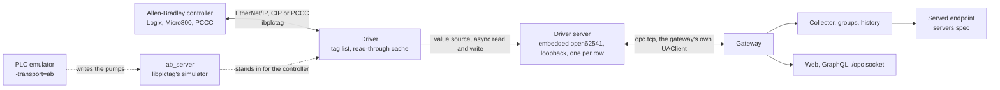

# PLCs spec

**Parked 2026-10-21.** The request behind it named Allen-Bradley by mistake for Atlas Copco, whose controllers get their own spec on Open Protocol ([`../open-protocol/spec.md`](../open-protocol/spec.md)); its issues stay open under [#430](https://github.com/Jde-cpp/opc-hub/issues/430), labelled `parked`, with no milestone. The shape ruled here, a driver kind behind a loopback UA server per row, carries over, and the Open Protocol spec takes over the `kind` column and the per-row server host, its trust anchor and own-certificate rule; what is left here is the Allen-Bradley driver on top of them.

2026-10-21, its open questions ruled the same day, the review's fifteen findings ([`plcs-spec-review.md`](../../../reviews/plcs-spec-review.md)) applied the same day, and the plan review's fourteen ([`plcs-plan-review.md`](../../../reviews/plcs-plan-review.md)) the same day again, the first of which re-ruled the rights model; the plan is [`plan.md`](plan.md), and its issues are filed under [#430](https://github.com/Jde-cpp/opc-hub/issues/430). Nothing here is built. Allen-Bradley controllers over EtherNet/IP, through a native driver, are the subject; the shape it gives the gateway, a driver kind on `server_connections` behind an embedded UA server, is the one every later family takes, Modbus TCP first, which the servers spec ([`../servers/spec.md`](../servers/spec.md), *Open questions* #9) left to a spec of its own and which stays one: the driver below already speaks it, so that spec is the addressing and the row's fields, not a second driver.

## Overview

The gateway is a UA client and nothing else: a connection is a url and a certificate URI ([`ServerCnnctn.h:19`](../../apps/OpcGateway/src/types/ServerCnnctn.h#L19)), and a PLC reaches the product only through an OPC UA server, its own, a vendor's gateway, or the OpcServer standing in for one with a nodeset ([`apps/OpcServer/README.md`](../../apps/OpcServer/README.md)). Rockwell's current controllers have one: ControlLogix 5580 and CompactLogix 5380 at firmware 36 serve OPC UA on 4840, ten clients, a per-tag *OPC UA Access* property, and a node budget that runs from none on an L81E through 600 on an L82E to 15 000 on an L85E, counting every UDT member as a node ([1756-UM023](https://literature.rockwellautomation.com/idc/groups/literature/documents/um/1756-um023_-en-p.pdf), *OPC UA node limits*); the manual names no history, alarms or methods, and the server shares the controller's time with CIP class 3 messaging at lower priority. Those connect today, as any server does. Everything else Allen-Bradley ships or has shipped does not: the 5570 and 5370 Logix families and older, GuardLogix, Micro800, and the PCCC generation, MicroLogix, SLC 500 and PLC-5, which speak EtherNet/IP with CIP tag reads, or PCCC data-file reads carried over it, and nothing UA. That installed base is most of it, and the redesign note already places the native driver as the aggregator's second way in ([`redesign.md:25`](../../../reviews/redesign.md#L25)).

This spec adds the driver as a kind of connection, where the servers spec's ruling put it: a `server_connections` row grows a `kind`, and a row of kind `ab-eip` names a controller instead of a server. The driver speaks EtherNet/IP through libplctag, a C library in production since 2012 that covers every family above and Modbus TCP besides, and presents the controller to the gateway as a UA server of its own: an embedded open62541 server per driver row, bound to loopback, on the server library the servers spec extracts from the OpcServer, with the controller's tag list as its address space and a value source that reads through to the controller. The gateway connects to it with the client it has. Browse, read, write, subscribe, the search index, groups, history and the served endpoint work as they do against any server, and the driver is the only new code. The reason is the shape of the client: `UAClient` is `final` with no interface ([`UAClient.h:32`](../../apps/OpcGateway/src/UAClient.h#L32)), and every operation is an await that takes one and calls open62541 through it, the async service ([`UAAwait.cpp:21`](../../apps/OpcGateway/src/async/UAAwait.cpp#L21)), the reads ([`ReadAwait.cpp:198`](../../apps/OpcGateway/src/async/ReadAwait.cpp#L198)), the write ([`WriteAwait.h:11`](../../apps/OpcGateway/src/async/WriteAwait.h#L11)), the browse ([`Browse.cpp:51`](../../apps/OpcGateway/src/uatypes/Browse.cpp#L51)), the subscription and its items ([`Subscriptions.cpp:80`](../../apps/OpcGateway/src/async/Subscriptions.cpp#L80), [`DataChanges.cpp:67`](../../apps/OpcGateway/src/async/DataChanges.cpp#L67)), the namespace array ([`NamespacesAwait.cpp:32`](../../apps/OpcGateway/src/async/NamespacesAwait.cpp#L32)), the path translation ([`UAClient.cpp:1405`](../../apps/OpcGateway/src/UAClient.cpp#L1405)), with the socket session, the index and the collector on top of them. A driver that replaced the client would be a second implementation of each, or an interface threaded through all of them; a driver behind a UA server costs a loopback hop per value and nothing else, and gets the library's sessions, trust, rights and async value sources for free. The alternatives, the OpcServer as the driver's host and a client-side kind, are *Open questions* #1.

Line numbers cite opc-hub2 at `fc413ed1`. open62541 refs are v1.5.9, the version the build links; libplctag refs are its `release` branch at v2.7.2, the version this spec pins.

## Requirements

| Area | Requirement | From |
| --- | --- | --- |
| Kind | A `server_connections` row has a `kind`: `ua`, today's row, or `ab-eip`, a controller reached over EtherNet/IP. A driver row names the controller's address, CIP path and family. | servers spec *Open questions* #9 |
| Families | ControlLogix, CompactLogix and GuardLogix, 5570 and 5580, 1769 and 5069, by tag name over CIP; Micro800 by tag name with its listing gaps; MicroLogix, SLC 500 and PLC-5 by data-file address over PCCC, from a tag list. | this spec, *Families* |
| Address space | A driver row's server holds every tag the controller lists, controller and program scoped, as a variable per atomic tag or array and an object per structure with a variable per member, at the tag's Logix path, so a template member names a tag as it names a node on any server. A controller that cannot list, and a PCCC family, takes the row's tag list. | this spec, *Address space* |
| Types | Each Logix atomic type serves as the UA built-in it is: BOOL as Boolean, SINT as SByte, INT as Int16, DINT as Int32, LINT as Int64, the unsigned four as Byte to UInt64, REAL as Float, LREAL as Double, STRING and the counted strings as String, DT as DateTime, LTIME as Int64 nanoseconds, a BOOL array as a Boolean array. A structure is nodes, not an ExtensionObject; an array of atomics is one variable with a UA array, whole. | this spec, *Address space* |
| Values | A read answers the last value the controller gave, timestamped by the gateway's clock, and refreshes it; a UA subscription samples it at the client's interval and the driver polls the controller at that rate, batched into multi-service packets. A first read with nothing cached waits for the controller. A controller's loss sets `Bad_NoCommunication` on its nodes until the first value after. | this spec, *Values* |
| Writes | A write goes to the controller and the client's Write holds for its answer, as the servers spec's write-through holds; an index range, once the clients spec's `updateVariable` sends one, writes the slice. A write refuses unless an enforced group row grants Update on a group that holds the tag, and is logged with the hub user, the node and the controller's answer. | this spec, *Writes*; access posture ruling #237 |
| Sessions and rights | The driver server opens sessions as the OpcServer does, through the hub; a web user reaches it by issued token and the collector by the gateway's own certificate, which opens a session as the gateway's own user with no hub lookup. Browse and reads are open to every session; a write needs Update on an enforced access row of a group that holds the tag, and a tag no group holds refuses writes. | [`UAAccess.cpp:319`](../../apps/OpcServer/src/access/UAAccess.cpp#L319), [`../servers/spec.md`](../servers/spec.md) *Sessions and rights*, access posture ruling #237 |
| Groups and history | A template resolves against a driver row as against any server, the collector subscribes through its own session, and the group's thresholds set the poll rate; the driver keeps no history of its own. | historian spec *Collector contract* |
| Endpoint | The servers spec's endpoint serves a driver row's members as it serves any connection's, under a namespace of the row's own. | [`../servers/spec.md`](../servers/spec.md) *Namespaces* |
| Diagnostics | A `_Plc` object on the driver server: `Connected`, `Since`, `Url`, `LastError`, `Reconnects`, the controller's `Identity`, `TagCount` and `Requests`. The connection page shows it. | this spec |
| Test | `testConnection` on a driver row reads the controller's identity and counts its tags, and registers nothing. | [`TestConnectionQLAwait.h:6`](../../apps/OpcGateway/src/ql/TestConnectionQLAwait.h#L6) |
| Limits | A `/gateway/plc` block: the port base, the sampling floor, the request ceiling, the node cap, the handle TTL, the read and write deadlines and libplctag's log level. | this spec, *Limits* |
| Simulator | libplctag's `ab_server`, built with the library, is the suite's controller and the emulator's `-transport=ab` target; it lists no tags and answers no identity, which are hand checks. | this spec, *Tests*, *Emulator* |
| Deploy | libplctag joins the superbuild and the third-party notices, static, on both platforms; the installers change nothing, since the driver server is loopback-only. | this spec, *The library* |

## Design



**Roles.** The driver turns a controller into a UA server the gateway already knows how to use. Its server is not a product endpoint: it binds loopback, it is reached only by the gateway's own clients, and the SCADA that wants the controller's tags gets them from the servers spec's endpoint, with the group's history behind them. The OpcServer keeps its roles, the nodeset-defined address space and the bundled first connection; nothing moves into it, and a site with Allen-Bradley controllers and no UA server anywhere runs the hub alone.

**The library.** libplctag ([github](https://github.com/libplctag/libplctag)) is C11 with no dependency but libc and pthreads, built with CMake, dual-licensed MPL 2.0 or LGPL 2+, taken here under MPL 2.0 as open62541 is ([`THIRD-PARTY-NOTICES.txt:745`](../../THIRD-PARTY-NOTICES.txt#L745)), and tested per release on Ubuntu 24.04 with GCC and Windows 11 with MSVC. It speaks EtherNet/IP with CIP to the Logix families, Micro800 and Omron's NJ/NX, PCCC over EtherNet/IP to MicroLogix, SLC 500 and PLC-5, and Modbus TCP, lists a Logix controller's tags and reads its UDT templates, packs concurrent requests to one Logix controller into multi-service packets, shares a session among the tags of one controller that carry the same `connection_group_id`, which the host sets per row, and completes reads and writes asynchronously with a callback per tag handle ([API](https://github.com/libplctag/libplctag/wiki/API), [Tag String Attributes](https://github.com/libplctag/libplctag/wiki/Tag-String-Attributes), [Performance Tips](https://github.com/libplctag/libplctag/wiki/Performance-Tips-with-AB-CIP-based-PLCs)). The pin is v2.7.2: the 2.7.1 notes say every release through 2.7.0 lacked checks that let a hostile or emulated controller overflow the library's buffers, and a controller on a plant network is untrusted input. It joins the superbuild as an `ExternalProject_Add` beside open62541's ([`build/CMakeLists.txt:477`](../../build/CMakeLists.txt#L477)), `libplctagTag` among the pins ([`:67`](../../build/CMakeLists.txt#L67)), installed under its own directory, static, with `BUILD_EXAMPLES` and `BUILD_TESTS` off and `USE_MEM_SANITIZERS` and `USE_SERVER_MEM_SANITIZERS` off, since the library builds itself and its tools with ASan and UBSan unless told otherwise ([`CMakeLists.txt:72`](https://github.com/libplctag/libplctag/blob/v2.7.2/CMakeLists.txt#L72)) and would carry the sanitizer runtime into the gateway; the tools, `ab_server` among them, build unconditionally ([`:156`](https://github.com/libplctag/libplctag/blob/v2.7.2/CMakeLists.txt#L156)), which is how the suite gets its controller; the library generates a pkg-config file and its top-level CMake installs no package config, so the gateway finds it by path as the sqlite driver finds sqlite ([`libs/db/drivers/sqlite/src/CMakeLists.txt:7`](../../libs/db/drivers/sqlite/src/CMakeLists.txt#L7)), and `Jde.Opc.GatewayLib` links it ([`apps/OpcGateway/src/CMakeLists.txt:19`](../../apps/OpcGateway/src/CMakeLists.txt#L19)). `third-party-notices.sh` gains its entry on open62541's MPL template ([`build/third-party-notices.sh:125`](../../build/third-party-notices.sh#L125)). On Windows the superbuild builds it under `win-clang-release-repos` as it builds zlib and libxml2 there, and the deps cache key, which hashes `build/CMakeLists.txt` ([`setup-windows-toolchain/action.yml:90`](../../.github/actions/setup-windows-toolchain/action.yml#L90)), rebuilds the cache on the next `win2025-deps` run; on the Linux runner the host builds it once into the bind-mounted install tree ([`.github/docker/README.md:69`](../../.github/docker/README.md#L69)). Static, so the installers' file lists ([`files.txt:22`](../../apps/OpcHub/setup/files.txt#L22)) and the .deb's bundle ([`build-deb.sh:160`](../../apps/OpcHub/setup/linux/build-deb.sh#L160)) do not change, and no port opens, since the driver server is loopback. Its log goes through its logger callback into the gateway's log under a `Plc` tag, at the level `/gateway/plc.log` sets, errors by default, and `plc_tag_shutdown` runs from the gateway's shutdown hook after the last handle is destroyed ([`gatewayStartup.cpp:83`](../../apps/OpcGateway/src/gatewayStartup.cpp#L83)). Not in the library, and so not here: CIP Security, the TLS and DTLS transport Rockwell's newer controllers can require; its maintainer calls the handshake undocumented ([#665](https://github.com/libplctag/libplctag/issues/665)), and a controller set to secure-only is unreachable by this driver until that changes.

**The row.** `server_connections` ([`opcGateway-meta.jsonnet:22`](../../apps/OpcGateway/config/opcGateway-meta.jsonnet#L22)) grows `kind`, `ua` by default, `plc`, `path` and `tag_list`, all nullable and null meaning a UA row. For a driver row `url` is `ab-eip://<host>[:<port>]`, the controller's address and 44818 by default, the library's `gateway` attribute; `plc` is its `plc` attribute, `controllogix` for every Logix family, `micro800`, `micrologix`, `slc500`, `plc5` or `logixpccc`; `path` is the CIP route, `1,0` for a controller in slot 0 behind its chassis's Ethernet module, required for ControlLogix and CompactLogix and refused for Micro800, which takes none; `tag_list` is *The tag list*. `certificate_uri` is the driver server's applicationUri, which is the gateway's own, set at save and not editable: the column is the server URI a client holds the endpoints against ([`UAClient.cpp:384`](../../apps/OpcGateway/src/UAClient.cpp#L384)), its being set selects Sign & Encrypt, and the pair the driver server presents carries that URI in its SAN; `default_browse_ns` is the driver server's one namespace. The insert proc takes the new columns ([`gateway_server_connection_insert.cpp:7`](../../apps/OpcGateway/config/sql/sqlite/gateway_server_connection_insert.cpp#L7), [`gateway_server_connection_insert.sql:4`](../../apps/OpcGateway/config/sql/mysql/gateway_server_connection_insert.sql#L4)), the save rules run on insert and on update over the merged row, and `connectionEdited` ([`OpcQLHook.cpp:77`](../../apps/OpcGateway/src/ql/OpcQLHook.cpp#L77)) treats a change to any of them as it treats the url: the driver server stops, the row's clients are rebuilt ([`UAClient.cpp:201`](../../apps/OpcGateway/src/UAClient.cpp#L201)), and the driver starts again. The client dials the driver server, not the url: where the connect sets the url it dials ([`UAClient.cpp:839`](../../apps/OpcGateway/src/UAClient.cpp#L839)), a driver row takes `opc.tcp://127.0.0.1:<port>`, and `ReachableUrl` beside it, the fallback probe for a name with several addresses ([`:802`](../../apps/OpcGateway/src/UAClient.cpp#L802)), is left alone; a driver row's `testConnection` never reaches `TestConnectAwait` ([`TestConnectAwait.h:11`](../../apps/OpcGateway/src/async/TestConnectAwait.h#L11)), since it opens a library handle and builds no client. The clients spec's columns ([`../clients/spec.md`](../clients/spec.md) *Connection settings*, [#413](https://github.com/Jde-cpp/opc-hub/issues/413)) keep their meaning where they have one, the session and request timeouts, the keep-alive and the TTL, and the mode and policy are fixed. `testConnection( opc, url, certificateUri )` ([`TestConnectionQLAwait.cpp:14`](../../apps/OpcGateway/src/ql/TestConnectionQLAwait.cpp#L14)) takes `kind`, `plc` and `path` as optional arguments too, and for a driver row reads the controller's CIP Identity object, vendor, product name, revision and serial, and the count of its listed tags, in place of the server description and the namespaces, under the same right, Update on `serverConnections` ([`:18`](../../apps/OpcGateway/src/ql/TestConnectionQLAwait.cpp#L18)).

**The driver server.** One per driver row, under `apps/OpcGateway/src/plc/`, on `Jde.Opc.UAServer`, the library the servers spec moves out of the OpcServer ([`../servers/spec.md`](../servers/spec.md) *The server library*; the plan's phase 1, [#380](https://github.com/Jde-cpp/opc-hub/issues/380) and [#381](https://github.com/Jde-cpp/opc-hub/issues/381)), with its `UASettings` filled from the row and the `/gateway/plc` block: the process's own `/http/ssl` pair as the endpoint's certificate, as the gateway's endpoint presents it, bound to `127.0.0.1` on `portBase + server_connection_id`, 4870 and the row's id, which is stable for the row's life and never typed, Sign & Encrypt under Basic256Sha256 and no None endpoint, a trust list of two, in memory and fed to the channel's PKI and the session's alike, as the OpcServer's one list is ([`UATrust.cpp:15`](../../apps/OpcServer/src/UATrust.cpp#L15)): the certificate the gateway issued for the slug ([`UAClient.h:135`](../../apps/OpcGateway/src/UAClient.h#L135)), which a web session's channel presents, and the process's own `/http/ssl` pair, which the collector presents for its channel and its token alike, since a certificate credential takes the app client's pair for both ([`UAClient.cpp:381`](../../apps/OpcGateway/src/UAClient.cpp#L381)) and the collector is one unless `hist.credentials` names a user ([`HistHost.cpp:103`](../../apps/OpcGateway/src/hist/HistHost.cpp#L103)); the library's `UASettings` gains an in-memory trusted list beside its directories. Anonymous off, the token types certificate and issued, no users and no rejected directory, since the list is in memory, and the library's `limits` open62541's own but `maxAsyncOperations`, which the block sets. Its applicationUri is the gateway's own, the SAN of the pair it presents, which the suite's gateway `http` block already carries ([`Opc.Tests.jsonnet:48`](../../apps/OpcGateway/tests/config/Opc.Tests.jsonnet#L48)); its applicationName is `Jde-Cpp PLC <slug>`, with no bracketed suffix, since the node-access page offers per-tag acls only on a server that names an instance schema and a driver row keeps none (*Sessions and rights*). Its sessions are `UAAccess`'s: an issued token carrying the hub session a web user's client sends ([`OpcServerSession.h:12`](../../apps/OpcGateway/src/auth/OpcServerSession.h#L12)), resolved in-process in the hub through the lookup the servers spec's endpoint adds ([#382](https://github.com/Jde-cpp/opc-hub/issues/382)) and over the socket in a split gateway, and the process's certificate for the collector, which `UASettings` maps by an own-certificate rule to the gateway's own user with no hub lookup: the hub holds no user for its own key, a user being keyed to a public key only by a socket login ([`LoginAwait.cpp:52`](../../libs/access/src/server/awaits/LoginAwait.cpp#L52)) and the hub's app client making none ([`HubAppClient.h:9`](../../apps/OpcHub/src/HubAppClient.h#L9)), so the lookup a split gateway could make ([`UAAccess.cpp:427`](../../apps/OpcServer/src/access/UAAccess.cpp#L427)) is skipped in both shapes, and a loopback server a process runs for itself admits that process as itself. The gateway's own clients verify a server's certificate against `/gateway/trustedCertDirs` ([`ServerTrust.cpp:32`](../../libs/opc/src/ServerTrust.cpp#L32); [`Opc.Gateway.jsonnet:53`](../../apps/OpcGateway/config/Opc.Gateway.jsonnet#L53)), and the process's own pair is in neither shipped directory, so a driver row's client anchors it in memory beside the directories, an extra anchor the verifier's context takes for `kind: ab-eip`; the shipped list and `verifyServerCertificate` keep their meaning, and the suite, whose list is its own certs directory ([`Opc.Tests.jsonnet:65`](../../apps/OpcGateway/tests/config/Opc.Tests.jsonnet#L65)), tests the anchor with that directory withheld. It starts with the gateway, after the access snapshot ([`gatewayStartup.cpp:80`](../../apps/OpcGateway/src/gatewayStartup.cpp#L80)) and before `HistHost::Start` ([`:85`](../../apps/OpcGateway/src/gatewayStartup.cpp#L85)), which kicks each group's first subscribe, so the subscribe finds it listening, on a thread of its own as the OpcServer's runs, one per row, and stops with its row, with the hook registered ahead of the historian's as the endpoint's is. Until phase 1 lands, the driver could link `Jde.Opc.ServerLib` as it is, the quick route the servers spec's #11 declined for the gateway and declines here for the same libxml2 and app-client baggage; the driver waits for the library.

**Address space.** The driver reads the controller's tag list when its CIP connection comes up and again on a `refreshTags( opc )` system mutation, Update on `serverConnections`, which the connection page offers: `@tags` for the controller-scoped tags, whose `Program:<name>` entries name the programs, `Program:<name>.@tags` for each, and `@udt/<id>` for each structure type the tags use, recursively, the listing libplctag's own tool makes ([`list_tags_logix.c:158`](https://github.com/libplctag/libplctag/blob/v2.7.2/src/tools/list_tags_logix/list_tags_logix.c#L158), [`:195`](https://github.com/libplctag/libplctag/blob/v2.7.2/src/tools/list_tags_logix/list_tags_logix.c#L195), [`:724`](https://github.com/libplctag/libplctag/blob/v2.7.2/src/tools/list_tags_logix/list_tags_logix.c#L724)). An entry is an instance id, a symbol type word, an element length, three dimensions and the name ([`:523`](https://github.com/libplctag/libplctag/blob/v2.7.2/src/tools/list_tags_logix/list_tags_logix.c#L523)); the type word's high bits say structure, system and dimension count, its low twelve the template id of a structure, its low byte the atomic code otherwise ([`:49`](https://github.com/libplctag/libplctag/blob/v2.7.2/src/tools/list_tags_logix/list_tags_logix.c#L49)); a template is its size and member count, then each member's metadata, type and byte offset, then the names ([`:784`](https://github.com/libplctag/libplctag/blob/v2.7.2/src/tools/list_tags_logix/list_tags_logix.c#L784)), the metadata being the bit number of a BOOL member within the integer that hosts it and the element count of an array member. Under Objects, in the row's one namespace, URI `urn:jde:<slug>:ab-eip`: a controller-scoped tag at the top, and a folder `Program:<name>` per program with its tags under it, so a tag's browse path from Objects is its Logix path with `.` read as `/`, and its NodeId is the string of that Logix path, `s=Program:MainProgram.Motor1.Speed`, the spelling an integrator types into Logix Designer. An atomic tag is a BaseDataVariable of its mapped type, BOOL `0xC1` Boolean, SINT `0xC2` SByte, INT `0xC3` Int16, DINT `0xC4` Int32, LINT `0xC5` Int64, USINT to ULINT `0xC6` to `0xC9` Byte to UInt64, REAL `0xCA` Float, LREAL `0xCB` Double, DT `0xC0` DateTime from its microseconds, LTIME `0xDF` Int64 nanoseconds, a 32-bit bit string `0xD3`, which is how a BOOL array lists, a Boolean array ([`:630`](https://github.com/libplctag/libplctag/blob/v2.7.2/src/tools/list_tags_logix/list_tags_logix.c#L630)); the controller's STRING and any template of the counted-string shape, a DINT `LEN` and a SINT `DATA[n]`, serve as String. A structure tag, a UDT, an AOI's data, or a predefined one such as TIMER, COUNTER and CONTROL, is a FolderType object with a variable per member at `<tag>.<member>`, nested where the member is a structure, with no UA DataType per template and no ExtensionObject anywhere: each member is a node, which is what a template member and a group want, and the clients spec's structures piece ([`../clients/spec.md`](../clients/spec.md) *Structures*) stays a third-party-server matter. An array of atomics is one variable with ValueRank 1, 2 or 3 and the ArrayDimensions the listing gives, its value the UA array, whole: a group stores the array, no gateway surface sends an index range today ([`MonitoringParameters.h:8`](../../apps/OpcGateway/src/uatypes/MonitoringParameters.h#L8); [`WriteAwait.h:11`](../../apps/OpcGateway/src/async/WriteAwait.h#L11)), the slice write arrives with the clients spec's `indexRange` on `updateVariable` ([#423](https://github.com/Jde-cpp/opc-hub/issues/423)), and element reads and subscriptions are later, the value source honouring a range all the same since the library's support is free; a Logix array of 10 000 DINTs is one tag and is one node. An array of structures is an object per element, `Tanks[3]`, each with its members, since UA has no array of objects without a type. AccessLevel is CurrentRead and CurrentWrite on every variable: the listing carries no *External Access*, and a controller that refuses a write or a read to a restricted tag answers the request, which the node reports. Every node carries WriteMask 0. `maxNodes`, 50 000 by default, stops the build with a warning naming the first tag left out. A listing the controller refuses, Micro800 for its templates ([#317](https://github.com/libplctag/libplctag/issues/317)) and its BOOL arrays ([#408](https://github.com/libplctag/libplctag/issues/408)), the PCCC families for everything, and the simulator, is where *The tag list* comes in. A refresh rebuilds the address space in place: a node no longer listed is deleted ([`server.h:1366`](https://github.com/open62541/open62541/blob/v1.5.9/include/open62541/server.h#L1366)) and, since a deleted node detaches no monitored item, reads `Bad_NodeIdUnknown` to its items until the group is re-resolved; a node listed again keeps its id, so items recover on their own; a new node appears on the next browse; and the refresh rebuilds the row's clients as `connectionEdited` does, which refreshes the search index with them. Each row's server also holds a `_Plc` object: `Connected`, true while the CIP connection is up, `Since`, `Url`, `LastError`, the library's status name and the CIP status of the last failure, `Reconnects`, `Identity`, a String of the vendor, product name, revision and serial from the Identity object, `TagCount`, and `Requests`, a UInt64 of reads and writes sent since the gateway started; all readable by any session.

**The tag list.** `tag_list` is a json text: `types`, each a name with its `size` and `members`, a member a `name`, `type`, `offset`, a `bit` for a BOOL and `dims` for an array; and `tags`, each a `name`, `type`, the Logix spelling or a listed type's name, and `dims`. It is the address space when the controller lists nothing or `plc` is a PCCC family, and it fills in what a listing lacks, a Micro800's templates, so the driver can decode a structure tag the controller listed but would not describe; a tag the list and the listing both name takes the listing's type. For a PCCC family a tag is a data file: `N7` of type `INT` with `dims [100]` is an Int16 array variable named `N7`, `F8` Float, `L19` Int32, `ST18` String, `B3` a Boolean array of sixteen per word, and `T4`, `C5` and `R6` objects per element with the `PRE`, `ACC` and status-bit members the library addresses as `T4:0.ACC`, the element being the index range or the member's node. An L5X import, Logix Designer's export of the same tags and types, is the natural way to fill the list and is later; the suite writes its list by hand.

**Values.** Each variable has a callback value source ([`server.h:884`](https://github.com/open62541/open62541/blob/v1.5.9/include/open62541/server.h#L884), [`:985`](https://github.com/open62541/open62541/blob/v1.5.9/include/open62541/server.h#L985)) backed by a libplctag handle on the node's *backing tag*: the atomic tag or array itself, the whole structure for a member, read raw and decoded by its template, so a structure of forty members is one request however many of them are watched, and an element of a structure array for its members. A handle is created the first time a node is read, with `plc_tag_create` at timeout 0 so the create completes on the library's thread, and destroyed after `handleTtl`, five minutes, without a read, as the gateway's clients expire ([`Opc.Gateway.jsonnet:21`](../../apps/OpcGateway/config/Opc.Gateway.jsonnet#L21)). `read` answers the cached `DataValue`, status and both timestamps, and starts a refresh, `plc_tag_read` at timeout 0, unless one is in flight; the completion event stores the decoded value with the gateway's clock as source and server time, since the controller timestamps nothing. A UA client that subscribes gets an item the server samples at its interval, so each sample kicks a read and answers the one before it, one interval stale as any sampled server is; the poll rate is the fastest item's interval, with no bookkeeping, and the library packs the concurrent reads of one controller into multi-service packets as they queue. A first read with no cached value answers `Good_CompletesAsynchronously` ([`server.h:861`](https://github.com/open62541/open62541/blob/v1.5.9/include/open62541/server.h#L861)) and `UA_Server_setAsyncReadResult` ([`:1422`](https://github.com/open62541/open62541/blob/v1.5.9/include/open62541/server.h#L1422)) when the controller answers; a monitored item's sample reads through the same async path ([`ua_subscription_datachange.c:259`](https://github.com/open62541/open62541/blob/v1.5.9/src/server/ua_subscription_datachange.c#L259)), so a cold sample waits too, up to eight outstanding per item ([`ua_subscription.h:108`](https://github.com/open62541/open62541/blob/v1.5.9/src/server/ua_subscription.h#L108)), past which a sample reports `Bad_TooManyOperations`. The server bounds only the Read service's wait, by `asyncOperationTimeout` ([`:2250`](https://github.com/open62541/open62541/blob/v1.5.9/include/open62541/server.h#L2250)), and a sampled read not at all ([`ua_server_async.c:645`](https://github.com/open62541/open62541/blob/v1.5.9/src/server/ua_server_async.c#L645)), so the driver keeps a deadline per pending read, `readTimeout`, and completes every pending operation itself: `Bad_Timeout` at the deadline, `Bad_NoCommunication` on the loss event, which answers the pending reads and writes before it rewrites the cache. An index range on a read answers the slice of the cached array ([`:884`](https://github.com/open62541/open62541/blob/v1.5.9/include/open62541/server.h#L884), the `range` argument). Status: a timeout is `Bad_Timeout`, a tag the controller does not know `Bad_NodeIdUnknown`, a refused read `Bad_UserAccessDenied`, a reply the library could not decode `Bad_DataEncodingInvalid`, each with the library's status name in the log; a CIP connection loss, the library's connection-down event, sets `Bad_NoCommunication` on every node of the row, keeping the last value, and the first value after the reconnect replaces it, `_Plc.Connected` following the two events; the library reconnects on its own. The gateway sees none of that as a connection loss: its session with the driver server stays up, the values go bad, the group stores a bad value as it stores one from any server, and the servers spec's endpoint serves it so. The floor `minSamplingInterval`, 100 ms, is the driver server's `samplingIntervalLimits` ([`:2302`](https://github.com/open62541/open62541/blob/v1.5.9/include/open62541/server.h#L2302)), so a client asking faster, the collector's 0 for a member without a `MinTimeInterval` ([`HistGroupHost.cpp:654`](../../apps/OpcGateway/src/hist/HistGroupHost.cpp#L654)) included, is revised to it; `maxInFlight`, 64, bounds the reads one row has outstanding, a sample past it finding its refresh skipped, within the server's own eight pending reads per item. Threading: a value source callback runs on the server's thread under the service lock, and `plc_tag_read` at timeout 0 is the only library call made there; a create, a destroy and a write run on the row's executor strand; the library's callback runs on its thread with its mutexes held, so it posts the event to the strand and nothing else, and the strand stores the value and calls `UA_Server_setAsyncReadResult`, which takes the service lock, as the servers spec's tap does from the executor. A pending read or write is kept by the host keyed by the result pointer the server handed it, and `asyncOperationCancelCallback` ([`server.h:2255`](https://github.com/open62541/open62541/blob/v1.5.9/include/open62541/server.h#L2255)), which the server calls under the service lock when it cancels an operation on timeout, shutdown, session loss or queue overflow ([`ua_server_async.c:46`](https://github.com/open62541/open62541/blob/v1.5.9/src/server/ua_server_async.c#L46)), erases the entry, so a completion that finds none logs and drops rather than writing into a freed result. Nothing under the service lock waits on the strand, and nothing on the strand holds a lock the callbacks take.

**Writes.** The value source's `write` returns `Good_CompletesAsynchronously` ([`server.h:913`](https://github.com/open62541/open62541/blob/v1.5.9/include/open62541/server.h#L913)), converts the value through the node's mapped type into the handle's buffer, a member's bytes within its structure or the array's elements, a BOOL member its bit, a String through `plc_tag_set_string`, and writes it; a member, or an index range once the clients spec's `updateVariable` sends one ([#423](https://github.com/Jde-cpp/opc-hub/issues/423)), writes through a handle of its own, `name=<tag>.<member>` or `name=<tag>[i]&elem_count=n`, made with `plc_tag_create_from_tag` on the backing tag's connection, so a slice write never rewrites the elements around it. The completion event answers with `UA_Server_setAsyncWriteResult` and the controller's status, the servers spec's held write with the same `writeTimeout` and cancel path; the cached value does not change on the write, it changes when the next read reports it, as it would against the controller. A write to a tag no group holds, or whose group's row is unenforced or grants no Update, refuses with `Bad_UserAccessDenied` and the message #237 gave history edits, and every write-through is logged at Information with the hub user, the node and the answer. A type the value does not match refuses `Bad_TypeMismatch` before anything is sent; the driver server's own check does the same for the UA side.

**Sessions and rights.** A driver server's sessions are the library's `UAAccess`, keyed to the hub as the OpcServer's are ([`UAAccess.cpp:319`](../../apps/OpcServer/src/access/UAAccess.cpp#L319)): a web user by the issued token its client sends, the collector by the process's own certificate under the own-certificate rule (*The driver server*). Rights are the servers spec's endpoint model, by group ([`../servers/spec.md`](../servers/spec.md) *Sessions and rights*), not the OpcServer's per-tag acls. The driver host's `INodeAccess` resolves a node to the guid of the group that holds it, the map the servers plan's 3a keeps for the endpoint from `HistHost`'s rows and hooks ([`HistHost.h:79`](../../apps/OpcGateway/src/hist/HistHost.h#L79)), and answers `Authorize::Rights` on that guid with the criteria overload 3a adds, a lookup and never `Gate` under the service lock, mapped with `ToAccess` as the library carries it ([`OpcAuthorize.h:26`](../../apps/OpcServer/src/access/OpcAuthorize.h#L26)): Update gives the write. Browse and reads are open to every session, as #237 ships `nodeIds`, so a tag is read by whoever may reach the gateway; a write needs Update on an enforced row of a group that holds the tag, and a tag no group holds refuses writes, since a tag is driven through the gateway once a group manages it; `_Plc` is open to every session. The OpcServer's per-tag acls, which the node-access page addresses by an instance schema read from the server's applicationName ([`node-access.ts:32`](../../web/opc/control/src/lib/pages/node-detail/node-access/node-access.ts#L32); [`server.ts:21`](../../web/opc/control/src/lib/model/server.ts#L21)), are not offered on a driver row: giving a driver server one costs `OpcAuthorize` moved out of the OpcServer or rebuilt, a gateway-side answer to the AppServer's delegated admin check ([`OpcServerAppClient.cpp:52`](../../apps/OpcServer/src/OpcServerAppClient.cpp#L52)), the `opc` schema shipped with the hub, and a runtime add and remove of schema pairs in the access client and the AppServer, which hold one per instance ([`AppClientSocketSession.cpp:37`](../../libs/app/client/AppClientSocketSession.cpp#L37)); that is a later piece if a site asks. The provider the gateway creates per connection ([`UM.cpp:42`](../../apps/OpcGateway/src/auth/UM.cpp#L42)) is an identity provider, the home of `slug\user` logins ([`UAAccess.cpp:477`](../../apps/OpcServer/src/access/UAAccess.cpp#L477)), and plays no part. *Open questions* #6.

**Groups, history and the endpoint.** Nothing changes: a template member's path resolves on the driver server through the translate the collector uses ([`HistHost.cpp:284`](../../apps/OpcGateway/src/hist/HistHost.cpp#L284)), with the row's namespace URI in its segments, the collector subscribes through its own client ([`HistGroupHost.cpp:193`](../../apps/OpcGateway/src/hist/HistGroupHost.cpp#L193)) with its member's `MinTimeInterval` as the sampling interval ([`:654`](../../apps/OpcGateway/src/hist/HistGroupHost.cpp#L654)), which is now the controller's poll rate for that tag, the deadband is applied where it is ([`Group.cpp:417`](../../libs/historian/src/Group.cpp#L417)), and the records carry the gateway's timestamps. The servers spec's endpoint serves a driver row's members under `urn:jde:<slug>:<remote URI>`, which for a driver row doubles the slug, `urn:jde:plc1:urn:jde:plc1:ab-eip`; *Open questions* #10 proposes that the endpoint keep a URI already prefixed with its slug, so a driver member serves under `urn:jde:plc1:ab-eip` as it is. The search index crawls the driver server as it crawls any ([`NodeIndex.cpp:78`](../../apps/OpcGateway/src/NodeIndex.cpp#L78)), bounded by `search.maxNodes` ([`Opc.Gateway.jsonnet:24`](../../apps/OpcGateway/config/Opc.Gateway.jsonnet#L24)).

**Families.** `controllogix` covers ControlLogix, CompactLogix and GuardLogix of every generation the library reaches, connected messaging and packing on; firmware 20 and later negotiates the large packet, older takes the 500-byte one and the library fragments. `micro800` takes connected messaging, no path, lists its tags and not its templates, so a UDT tag on a Micro800 is decoded by the tag list or stays an opaque node that reads `Bad_DataEncodingInvalid`. The PCCC families, `micrologix`, `slc500`, `plc5` and `logixpccc`, a Logix controller addressed through its PCCC mapping, have no listing and take the list as above; their types are INT, Float, Int32 on MicroLogix, bits and strings, and arrays are untested on SLC 500 by the library's own account. A controller with CIP Security enforced is out of reach, *The library*. Omron NJ and NX speak the same protocol under `plc=omron-njnx` and list their tags; a `kind` for them is a row of the same table and is later.

**Emulator.** `-transport=ab` beside `pubsub` and `write` ([`Emulator.cpp:23`](../../apps/OpcServer/emulator/Emulator.cpp#L23), [`:66`](../../apps/OpcServer/emulator/Emulator.cpp#L66)): the emulator links libplctag, opens a handle per pump on a running `ab_server` at `/emulator/ab.url`, and writes each pump's `motorRpm` and `status` into it as a PLC program would update its tags, the five pumps as `pump1` to `pumpManual` of a `Pump` structure, `status` a BOOL and `motorRpm` an LREAL, which `ab_server` holds as a SINT array of the structure's size, `--tag=pump1:SINT[16]`, and the gateway's driver row decodes by a tag list naming the type. Commands stay subscribed over the OpcServer session as they are ([`Emulator.cpp:104`](../../apps/OpcServer/emulator/Emulator.cpp#L104)); a demo of a command written through the driver is the gateway writing `status`, which the emulator then reads back from the simulator, later. The emulator is not packaged, absent from the release targets ([`linux-release.yml:100`](../../.github/workflows/linux-release.yml#L100)), and stays so.

**Web.** The connection page ([`client-detail.ts:53`](../../web/opc/control/src/lib/pages/gateway-detail/client-detail/client-detail.ts#L53)) gets a kind picker that swaps the form: a driver row shows address, port, family and path in place of the url and certificate URI, a tag-list editor behind a disclosure, Test Connection reporting the identity and the tag count, and a Refresh Tags button. The Connection tab ([`server-properties.ts:40`](../../web/opc/control/src/lib/pages/gateway-detail/client-detail/server-properties/server-properties.ts#L40)) shows `_Plc` in place of the server description. The node pages, the search, the History tab, the groups and the templates are untouched, since the driver server is a server. The help's *Instances* section (`assets/help/gateways.md:58`) describes the driver row and its fields, and *Security* (`:86`) the write rule.

**Tests.** `Jde.Opc.Tests` spawns `ab_server` as a child process from the install tree, `--plc=ControlLogix --path=1,0 --port=44918`, the live port plus 100 as the suite's other ports are ([`Opc.Tests.jsonnet:33`](../../apps/OpcGateway/tests/config/Opc.Tests.jsonnet#L33)), with a tag of each atomic type, a DINT array, a STRING and the `pump1` structure bytes, and a driver row whose `tag_list` names them, under a `/gateway/plc.portBase` of 4970 for the driver servers. The simulator answers reads, writes, fragmented and multi-service requests and PCCC, and refuses the listing service, which it defines and does not dispatch ([`cip.c:57`](https://github.com/libplctag/libplctag/blob/v2.7.2/src/tools/ab_server/cip.c#L57), [`:215`](https://github.com/libplctag/libplctag/blob/v2.7.2/src/tools/ab_server/cip.c#L215)), so the suite covers the tag-list path live and the listing decode over a captured `@tags` and `@udt` byte buffer from a real controller, a fixture file, with the live listing checked by hand against hardware; a listing patch to `ab_server`, upstream, is the way to close that. The cases: `testConnection` on a driver row opens the simulator's connection and reads the list's first tag, the identity and the count being hand checks against hardware, since the simulator answers neither; the row's server browses the list, a structure as an object with its members, an array as one variable; a read of each type; the first read of a cold node waits and answers; a subscription through the socket and the collector sees a value the test writes into the simulator through libplctag directly, as the controller's program would; a write of each type and a member lands in the simulator, an element by index range through the suite's own open62541 client, since the gateway sends none, a write to an ungrouped tag refuses, and to a grouped one refuses until the group's row is enforced with Update; a group over driver members stores values with the gateway's timestamps and a processed read agrees with the QL; the simulator stopped sets `Bad_NoCommunication` and restarted clears it; `maxNodes` stops a list past it; `refreshTags` after the row's `tag_list` is written past the hook, through the schema's data source, a tag removed and one added, the removed one's item reading `Bad_NodeIdUnknown` and the group re-resolved; the driver server's certificate refused when the anchor is withheld; a PCCC row against `--plc=Micrologix --tag=N7[10]` reads and writes `N7`; and the fault injection the simulator offers, `--delay`, `--reject_fo`, `--empty_frag` ([`main.c:235`](https://github.com/libplctag/libplctag/blob/v2.7.2/src/tools/ab_server/main.c#L235)), drives the timeout and reconnect cases. The emulator's tests add `-transport=ab` writing one cycle.

**Limits.** The `/gateway/plc` block:

```jsonnet
gateway:{
	plc:{
		portBase: 4870, //a driver row's server listens on 127.0.0.1 at portBase + its row id; the tests take 4970
		minSamplingInterval: "PT0.1S", //the fastest a tag is polled, whatever a client asks (samplingIntervalLimits)
		maxInFlight:: 64, //reads one row may have outstanding; a sample past it skips its refresh
		maxNodes:: 50000, //a row's address space stops here with a warning
		handleTtl:: "PT5M", //a tag handle is released after this long without a read
		readTimeout:: "PT2S", //a pending read's deadline, the driver's own: the server times out no sampled read
		writeTimeout:: "PT10S", //how long a client's Write holds for the controller's answer, the Write service's asyncOperationTimeout
		maxAsyncOperations:: 0, //the server's async queue (maxAsyncOperationQueueSize), 0 unlimited
		log:: 1 //libplctag's debug level, 0 none to 5 spew, into the gateway's log under the Plc tag
	}
}
```

**Later.** Element reads and subscriptions by index range through the gateway. Discovery: EtherNet/IP's ListIdentity broadcast on UDP 44818 lists every controller on the subnet, the clients spec's `discover` for a driver row. The L5X import. A listing patch to `ab_server`. `kind: modbus-tcp`, its own spec: register addresses, a unit id, the tag list as its address space, on the same driver server. `kind` for Omron NJ/NX. A UA DataType per UDT, so a structure tag can also be read whole. Bit nodes on integers, `Tag.5`. A clock-skew warning from the controller's WallClockTime object. DH+ bridging, which the library speaks. Write coalescing. CIP Security, when the library has it.

**Out of scope.** Implementing CIP or PCCC in the product: the library is the protocol. Class 1 implicit I/O connections, produced and consumed tags, and anything but tag access: no program upload, no online edits, no controller mode changes. FactoryTalk Linx or any vendor OPC server as a dependency. Redundant controller pairs as one row. Reading a controller's *External Access* attribute, which the listing does not carry.

## Pieces

Sizes are the GitHub project's Size field. Pieces 1 and 2 are independent of each other; 3 needs the servers plan's phase 1 and, for the hub's sessions, the lookup of its phase 2; the rest follow 3, and 4 the servers plan's 3a as well, or builds its map.

| # | Piece | Size | Notes |
| --- | --- | --- | --- |
| 1 | The library | S | libplctag v2.7.2 in the superbuild, static, both platforms, the notices entry, the tools built; the Windows deps cache re-run |
| 2 | The row | M | `kind`, `plc`, `path`, `tag_list`, the insert procs, the save rules, `connectionEdited`, `ReachableUrl`, `testConnection`'s identity; the tag-list json |
| 3 | The driver server | L | the embedded server per row on `Jde.Opc.UAServer`, its settings, trust and sessions, the listing and its decode, the address space from a listing and from a list, the type map, the read-through value source, the status rules, `_Plc`, the limits, the log, startup and shutdown |
| 4 | Writes | M | the held write, members and index ranges by their own handles, the unenforced rule, the audit line |
| 5 | Structures and arrays | M | templates, whole-structure reads and the member decode, BOOL packing, structure arrays as element objects, BOOL arrays, STRING |
| 6 | PCCC families | M | the data-file address space from the list, the T/C/R objects, the type map, against `--plc=Micrologix` |
| 7 | Simulator and tests | M | `ab_server` spawned by the suite, the listing fixture, the cases above |
| 8 | Emulator | S | `-transport=ab` writing the pumps into `ab_server` |
| 9 | Web | M | the kind picker and the driver form, the tag-list editor, Refresh Tags, `_Plc` on the Connection tab, the help |

## Open questions

All fourteen ruled 2026-10-21, each as recommended; #10's amendment is folded into the servers spec, and the plan is [`plan.md`](plan.md).

1. **Where the driver lives.** Three shapes. A driver behind an embedded UA server inside the gateway, per row, reached by the gateway's own client over loopback. The OpcServer as the host: it is a UA server with the sessions, acls and history already, and a `/opcServer/plcs` block would give it controllers, but it is an optional component a site may not install, its configuration is files where the gateway's is rows and pages, and the hub would then depend on a second process for every PLC. A native kind that replaces `UAClient`: the shape the servers spec's #9 read into the kind column, and the one the client's surface rules out, every operation being an await on open62541 through a `final` class (*Overview*). Recommended: the first. The loopback hop is a few thousand values a second on one machine, and the library's sessions, trust, rights and async sources come with it. Ruled 2026-10-21: as recommended.
2. **One server per row.** Each driver row gets a server on its own port, so every path starts at Objects and node ids are the Logix paths, as the gateway and the templates expect. The alternative is one server with a folder per row and a `root` column on `server_connections`, a connection as a subtree of a server, which is a feature in its own right but puts the root in every path translation, the index's crawl and the templates. Recommended: per row; the root column can come later if ports ever matter. Ruled 2026-10-21: as recommended.
3. **The read model.** Read-through: a sample refreshes the backing tag and answers the previous value, so the poll rate is the items' rate with no bookkeeping, and a cold read completes asynchronously. The alternative is a scan table kept from the server's `monitoredItemRegisterCallback` ([`server.h:2321`](https://github.com/open62541/open62541/blob/v1.5.9/include/open62541/server.h#L2321)), which says which nodes have items but not at what interval, with the values pushed by `UA_Server_writeDataValue` ([`:460`](https://github.com/open62541/open62541/blob/v1.5.9/include/open62541/server.h#L460)), the stored-value shape the servers spec declined for the held write. Recommended: read-through, with the async first read verified against a monitored item's sampling in the plan. Ruled 2026-10-21: as recommended; the review's #4 then verified it, sampling takes the async path.
4. **Structures.** Members as nodes, the structure read whole and decoded by its template, no UA DataType per UDT. The alternative mirrors each template as a DataType and serves the tag as an ExtensionObject, which the clients spec's registry could then decode; it is the richer model and nothing the groups need. Recommended: members as nodes, the type later. Ruled 2026-10-21: as recommended.
5. **Arrays.** One variable per atomic array with index ranges for its elements; an object per element of a structure array. The alternative, a node per element everywhere as some commercial drivers browse, multiplies the address space by the array sizes. Recommended as stated, under `maxNodes`. Ruled 2026-10-21: as recommended.
6. **Rights.** Rights by group, the servers spec's endpoint model: a driver server's `INodeAccess` resolves a node to its group's access row, browse and reads are open to every session as #237 ships `nodeIds`, a write needs Update on an enforced row of a group that holds the tag, and a tag no group holds refuses writes. The alternative, the OpcServer's per-tag acls under an instance schema `opc.<slug>`, which the node-access page addresses from the server's applicationName, costs `OpcAuthorize` moved or rebuilt, a gateway-side admin check, the `opc` schema shipped with the hub and a runtime add and remove of schema pairs in the access client and the AppServer, and is later as its own piece if a site asks. Recommended as stated. Ruled 2026-10-21 as a provider-keyed acl, restated by the spec review's #1 as the instance schema and applied so, then re-ruled by the plan review's #1 to the group-keyed model, the instance schema's cost being four subsystems and the installers, and applied the same day.
7. **The tag list.** A json text column now, written by hand or by a later L5X import; the alternative is the L5X itself as the column, parsed with libxml2, which the gateway does not link and a PCCC controller cannot export. Recommended: json now, L5X as an importer later. Ruled 2026-10-21: as recommended.
8. **Timestamps.** The gateway's clock for source and server time, since the controller stamps nothing per tag. The alternative reads the controller's WallClockTime and offsets, which is a skew check, not a timestamp. Recommended: the gateway's clock, the skew warning later. Ruled 2026-10-21: as recommended.
9. **Ports.** `portBase + server_connection_id`, deterministic and never typed; a collision is a start-up error naming the port and `portBase`. Recommended. Ruled 2026-10-21: as recommended.
10. **The endpoint's namespace.** The servers spec prefixes every remote URI with the slug; a driver row's URI already carries it, so the endpoint would serve `urn:jde:plc1:urn:jde:plc1:ab-eip`. Recommended: amend the servers spec's rule to keep a URI already prefixed `urn:jde:<slug>:`, a one-line change there. Ruled 2026-10-21: as recommended.
11. **PCCC in scope.** Piece 6 after the Logix pieces, list-only. The alternative defers the PCCC generation to a later spec. Recommended: in scope; the library and the simulator both speak it and the address space is the list. Ruled 2026-10-21: as recommended.
12. **The simulator.** libplctag's `ab_server`, spawned by the suite, the listing exercised from a captured fixture and by hand against hardware. The alternative, a CIP server of our own in the emulator, is a protocol implementation for the sake of a test. Recommended: `ab_server`, and a listing patch offered upstream later. Ruled 2026-10-21: as recommended.
13. **Writes and enforcement.** Writes refuse on an unenforced `nodeIds` resource, as history edits do. The alternative admits them on an open resource, which makes the first write to a controller possible with no acl at all. Recommended: refuse; a PLC write is the most consequential action the product takes. Ruled 2026-10-21: as recommended.
14. **Hardware.** Nothing here is verified against a controller: the listing, the template decode, system structures through `@udt`, Micro800's gaps and the PCCC files are the library's and its issues' account. Recommended: the plan names a bench controller for the listing fixture and the hand checks, and until then the suite's coverage is the list path. Ruled 2026-10-21: as recommended.