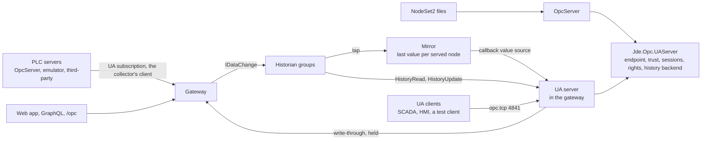

# Servers spec

2026-10-19, its open questions ruled the same day; the plan is [`plan.md`](plan.md), and the review's fifteen findings ([`servers-spec-review.md`](../../../reviews/servers-spec-review.md)) were ruled and folded the same day. Nothing here is built.

## Overview

The product runs OPC UA servers in two places today. `Jde.Opc.Server` serves an address space loaded from NodeSet2 files and keeps the history of the nodes they mark as historizing ([`apps/OpcServer/README.md`](../../apps/OpcServer/README.md)). The PLC emulator runs a headless server of its own, bound to loopback, only so that open62541's PubSub writer has nodes to sample ([`PlcServer.h:10`](../../apps/OpcServer/emulator/PlcServer.h#L10)). The gateway is a client only: it connects to OPC servers, and the web app, GraphQL and its socket are its only outputs.

This spec makes the gateway a server as well. It serves the nodes it already collects, from every server it connects to, as one OPC UA endpoint with live values, writes, and Part 11 history over its historian's groups. That is the shape of an aggregating server: many sources behind one address space, node-level security, a local historian. A SCADA, an HMI, a plant historian or a test client then needs one endpoint, not one per PLC, and gets the gateway's history with it. The 2026-10-09 design note sketched a mirror on the OpcServer side instead ([`redesign.md`](../../../reviews/redesign.md)); this spec moves it to the gateway, where the collector, the groups, their access rows and the hub's sessions already are, and answers that note's open questions as it goes.

It takes the OpcServer's UA server core along: the endpoint and its security policies, the trust list, the session login and the rights-to-access-level mapping, and the history backend become a library the gateway links too. The OpcServer keeps what is its own, the nodeset loader, the values its nodesets give an HA Configuration and the PubSub reader, and stays the bundled first connection.

Line numbers cite opc-hub2 at `04ef20c9`; the cites under *Live values*, *Writes* and *History* are refreshed once the gateway refactor ([`plan.md`](plan.md)) merges. Refs re-anchored on 2026-10-23, the UA server library's move among them, cite branch `servers-1a-ua-server-library`. open62541 refs are v1.5.9, the version the build links.

## Requirements

| Area | Requirement | From |
| --- | --- | --- |
| Endpoint | The gateway, standalone or inside the hub, listens on an opc.tcp endpoint of its own, with the OpcServer's security policies and a None endpoint, or the None policy for discovery alone. No `/gateway/server` block, no endpoint. | this spec |
| Served set | The endpoint serves every node of every historian group, under a folder per connection, at the node's browse path on its server. | this spec, *Open questions* #2 |
| Node ids | A served node keeps its identifier. Its namespace is the gateway's own, one per connection and remote namespace, so two sources with the same namespace URI never collide. | this spec, *Open questions* #4 |
| Attributes | A served variable carries the source's DisplayName, Description, ValueRank, ArrayDimensions and AccessLevel, and its EngineeringUnits and EURange properties when it has them. Its DataType is the source's where that is a namespace-0 type, abstract or not, and otherwise the built-in the value encodes as, the historian's rule, so an enum serves as Int32 and a structure as Structure with its encoded ExtensionObject. They persist, so a restart serves the address space before any source is up. | this spec, *Open questions* #7; [`src/Group.cpp:318`](../../libs/historian/src/Group.cpp#L318) |
| Live values | A read answers the last value the collector delivered, with the source's timestamps and status. A UA subscription samples it at the client's interval. A connection's loss sets `Bad_NoCommunication` on its nodes until the first value after. A served node changes at the collector's rate, its member's `MinTimeInterval`, which is its MinimumSamplingInterval; a client asking to sample faster is revised to it. | this spec, historian spec *Gaps* |
| Writes | A write to a served node goes to the source under the collector's credential, and the client's Write holds until the source answers, or times out. A refusal is the client's answer, and the served value never changes except by a value from the source. Each write-through is logged with the hub user, the node and the source's answer. | this spec, *Open questions* #3 |
| Sessions | The three token types the OpcServer takes, certificate, issued and user name, and anonymous off by default. A session's user is a hub user, resolved in-process in the hub, the session lookup included. | [`UASettings.h:15`](../../include/jde/opc/server/UASettings.h#L15) |
| Rights | A served node's access level is its group's access row through the OpcServer's mapping: Read gives Read and HistoryRead, Update gives Write and HistoryWrite, Delete gives HistoryWrite, Administer the status, timestamp and semantic-change bits. A write and a history edit refuse on an unenforced resource. | [`OpcAuthorize.h:26`](../../apps/OpcServer/src/access/OpcAuthorize.h#L26), access posture ruling #237 |
| History | HistoryRead raw, modified, at-time and processed over a group's files, and HistoryUpdate's edits into them, as the OpcServer serves its own group. HistoryServerCapabilities and the AggregateFunctions folder, Median included, as the OpcServer's. | historian spec *OpcServer*, *UA backend* |
| Diagnostics | A `_Connection` object per connection folder: `Connected`, `Since`, `Url`, `LastError` and `Reconnects`. | this spec |
| Limits | The endpoint's `limits`: max sessions, max monitored items, session timeout, the sampling floor and the async queue, over open62541's own, and whether the None endpoint is offered. | this spec |
| Trust | A client certificate the endpoint rejects is written to `rejected/` beside `clients/`, for the admin to move. | this spec |
| OpcServer | Keeps its nodeset address space, its own history and its PubSub reader, on the shared server library. Its endpoint, config keys and tests do not change. | this spec |
| Emulator | `-transport=server`: the PLC server alone, on a reachable port with real security, for a source shaped like a PLC. | [`redesign.md`](../../../reviews/redesign.md) piece 5 |
| Deploy | The hub serves the endpoint beside its 1967 listener. The installers open the port. The standalone gateway serves it too. | this spec, *Open questions* #6 |

## Design



**Roles.** Three servers, each with a reason. The OpcServer serves an address space a nodeset defines, with the types, methods and HA Configuration objects that come with it, and keeps the history of what the nodeset marks; it is the stand-in for a UA-enabled PLC and the bundled first connection. The gateway's endpoint serves what the gateway collects, flat, by mapping, from any source, with the gateway's history behind it; it is the aggregator. The emulator's PLC server feeds either as a PLC would. Nothing moves between the first two: a nodeset still goes to the OpcServer, and a group still goes to the gateway.

**The server library.** The OpcServer's `src` holds the UA server core beside what is OpcServer-specific. The core moves to `libs/opc/server`, target `Jde.Opc.UAServer`, and both apps link it: `UAServer` and its thread ([`UAServer.cpp:34`](../../libs/opc/server/src/UAServer.cpp#L34)), `UAConfig` with the endpoint, its policies and the trust list ([`UAConfig.cpp:130`](../../libs/opc/server/src/UAConfig.cpp#L130)), `UATrust` and its rescan, `UAAccess`, the session login against the hub through `IAppClient`, `OpcAuthorize`'s rights-to-access-level mapping, `UAHistory`, the Part 11 backend, and the helper that adds an HA Configuration where a nodeset has none ([`HAConfiguration.h`](../../include/jde/opc/server/HAConfiguration.h)), which the served nodes need too. The library takes its settings as a `UASettings` struct the host fills, not `Settings::` reads of its own: the OpcServer's keys sit under three roots, `/opcServer` ([`globals.cpp:63`](../../apps/OpcServer/src/globals.cpp#L63)), `/opc` ([`:72`](../../apps/OpcServer/src/globals.cpp#L72)) and `/access/trustedCertDirs` ([`:70`](../../apps/OpcServer/src/globals.cpp#L70)), and the gateway's under `/gateway/server`, so a prefix alone would not cover it, and no shipped config changes. Two things generalise, each an interface the host implements and hands the server. The node resolver, `INodeAccess` ([`INodeAccess.h`](../../include/jde/opc/server/INodeAccess.h)): a node's rights, its edit rights, its browsability and its UserAccessLevel for a user, which the OpcServer's `OpcAuthorize` finds through the `nodeIds` resource tree and the gateway's finds through the node's group. The history host, `IHistoryHost` ([`IHistoryHost.h`](../../include/jde/opc/server/IHistoryHost.h)): the historian the server serves, a node's group and index, the HA Configuration properties that take the archive's start, each with its group, and whether `setValue` stores, so `UAHistory` holds no group or index map of its own ([`UAHistory.h:114`](../../include/jde/opc/server/UAHistory.h#L114)) and serves the OpcServer's one group ([`OpcServerHistoryHost.h`](../../apps/OpcServer/src/hist/OpcServerHistoryHost.h)) or one per served node alike, `setValue` installed only for the OpcServer, since the gateway's collector stores. The OpcServer keeps `Historized`, the nodeset loader with libxml2 ([`apps/OpcServer/src/CMakeLists.txt:20`](../../apps/OpcServer/src/CMakeLists.txt#L20)), `PubSubReader`, its app client, QL and web server. The emulator's `PlcServer` keeps its minimal config; it is not a product endpoint until *Emulator*, below.

**Startup and deploy.** The gateway's endpoint listens before `HistHost` loads the groups and starts after ([`gatewayStartup.cpp:76`](../../apps/OpcGateway/src/gatewayStartup.cpp#L76), [`:78`](../../apps/OpcGateway/src/gatewayStartup.cpp#L78)) and in the hub after `Connect` ([`hubStartup.cpp:58`](../../apps/OpcHub/src/hubStartup.cpp#L58)), on a thread of its own as the OpcServer's does, and stops before the historian does: its shutdown function is registered ahead of the historian's ([`gatewayStartup.cpp:71`](../../apps/OpcGateway/src/gatewayStartup.cpp#L71)), since `Process::Shutdown` runs them in registration order ([`process.cpp:281`](../../libs/fwk/src/process/process.cpp#L281)). Its settings are the `/gateway/server` block:

```jsonnet
gateway:{
	server:{
		port:: 4841, //the OpcServer has 4840 on the same dev box; the tests take 4941
		address: null, //every interface; the current-user install binds loopback as the OpcServer does
		//absent: the endpoint presents the process's own pair, /http/ssl, whose SAN already carries the gateway's applicationUri
		ssl:: {},
		trustedCertDirs:: [ args.serversDir("$(PRODUCT_NAME)") + "/clients" ], //the UA clients this endpoint admits on a secured channel
		rejectedCertDir:: args.serversDir("$(PRODUCT_NAME)") + "/rejected", //where a refused client certificate is written, for the admin to move into clients/
		none:: true, //a None endpoint beside the secured ones; false keeps the None policy for discovery alone (securityPolicyNoneDiscoveryOnly): GetEndpoints answers, a session needs a secured endpoint
		tokenTypes:: { anonymous: false, certificate: true, issued: true, username: true },
		users:: [], userTokenPolicyUri:: "http://opcfoundation.org/UA/SecurityPolicy#Basic256Sha256", //the user-name logins, as the OpcServer's /opc/users, and the policy the tokens ride on, /opc/userTokenPolicyUri's default
		writeTimeout:: "PT10S", editTimeout:: "PT5S", //how long a client's Write holds for the source's answer (asyncOperationTimeout), and a HistoryUpdate for the flush that writes it, the OpcServer's hist.editTimeout
		limits:: { maxSessions: 100, maxMonitoredItems: 0, sessionTimeout: "PT1H", minSamplingInterval: "PT0.05S", maxAsyncOperations: 0 } //open62541's own defaults, 0 unlimited; absent keeps them
	}
}
```

Without the block there is no endpoint and the gateway is what it is today. The hub's own certificate serves as the application instance certificate: the gateway presents it when it authenticates by certificate ([`UAClient.cpp:388`](../../apps/OpcGateway/src/UAClient.cpp#L388)), its issued pairs carry the same URI SAN ([`UAClient.h:121`](../../apps/OpcGateway/src/UAClient.h#L121)), and that SAN is the applicationUri ([`Opc.Hub.jsonnet:73`](../../apps/OpcHub/config/Opc.Hub.jsonnet#L73)): one application, one URI, the one every server already holds for this gateway, which is what a UA client checks. The installers open the port in the firewall rule and the systemd unit, beside 1967.

**Address space.** Under Objects, one folder per connection, named by the connection's slug, there while its `server_connections` row is and gone when the row is purged. Under it, each served node sits at its browse path on its server, with FolderType objects along the way carrying the remote browse names, so a member at `Objects/Pumps/Pump1/Rpm` on the source is `Objects/<slug>/Pumps/Pump1/Rpm` here. The connection is a `server_connections` row ([`opcGateway-meta.jsonnet:22`](../../apps/OpcGateway/config/opcGateway-meta.jsonnet#L22)), the endpoint and its credential; the group ([`:53`](../../apps/OpcGateway/config/opcGateway-meta.jsonnet#L53)) is a root object on it; and its template ([`:37`](../../apps/OpcGateway/config/opcGateway-meta.jsonnet#L37)) with the `hist_group_nodes` rows it resolved to ([`:64`](../../apps/OpcGateway/config/opcGateway-meta.jsonnet#L64)) is the served set.

A served variable is the source's variable by mapping, not a copy of the source's types. Its DisplayName, Description, ValueRank, ArrayDimensions and the source's AccessLevel are read once from the source, when the collector first joins the node, and stored on its `hist_group_nodes` row, together with EngineeringUnits and EURange when the source's variable has those properties. Its BrowseName, and each path folder's, is the segment's name in the mapped namespace of the segment's URI ([`HistRows.h:58`](../../apps/OpcGateway/src/hist/HistRows.h#L58)). Its DataType is the source's where that is a namespace-0 type, built-in or abstract, `Number` or `BaseDataType` say, since every namespace-0 type exists here and open62541's write check walks the subtypes; a type of another namespace, an enum or a structure, is a node there with no node here, so the mapped id would point at nothing, and it takes the built-in its values encode as, the rule the historian stores by ([`src/Group.cpp:318`](../../libs/historian/src/Group.cpp#L318)), an enum as Int32 and a structure as Structure, its value passing through as the encoded ExtensionObject, which a client cannot decode without the type; `data_type` holds that answer, the id, not the kind. Mirroring EnumStrings and the DataTypeDefinition is later. A restart builds the address space from the rows before any source is up, and the next connect refreshes them. A member its source has not described yet, one created while the connection is down, has no path or attributes on its row: it sits under the connection folder with its identifier as its browse and display name, `i=6042`, and BaseDataType, and moves to its path with the source's attributes once the collector describes it (2026-10-23). The variable's type is BaseDataVariableType; a type the source declares is not reproduced. Historizing is true, since every served node is a group member, and the group's thresholds appear as the node's HA Configuration object, as the OpcServer adds one where a nodeset has none. Membership changes keep the address space in step: a node added to a group is added here when it resolves, and a removed one is deleted; a group's deletion removes its nodes and the path folders left empty, and its connection's folder stays with the row. Every node here carries WriteMask 0, `UA_VariableAttributes_default`'s, so only Value is ever written: the attributes are the source's, refreshed on connect, and `GetUserRightsMask` hands a user with Update the attribute bits only within it ([`UAAccess.cpp:415`](../../libs/opc/server/src/UAAccess.cpp#L415)).

Each connection folder also holds a `_Connection` object: `Connected`, a Boolean, true while a client with an activated session exists for the slug, `Since`, a DateTime, the last change of state, the gateway's start until the first, `Url`, a String, `LastError`, a String, the status name and text of the last failure to connect or subscribe, empty while there has been none, and `Reconnects`, a UInt32 count since the gateway started of outages recovered: the connection's last activated session lost, then one activated again, whether open62541 re-activates the client in place or a new client connects. A client closed or idled out is no outage, and one credential's loss while another's session stays up is none either. It is readable by any session. A writable `_Enabled`, which pauses a connection's collection, is later: it changes the gateway's collection from a UA session, and a group has no paused state yet.

**Namespaces.** A served node keeps the identifier it has on its source. Its namespace is one of the endpoint's own, added per connection and remote namespace URI (`UA_Server_addNamespace`, [`server.h:1984`](https://github.com/open62541/open62541/blob/v1.5.9/include/open62541/server.h#L1984)), with the URI `urn:jde:<slug>:<remote namespace URI>`. Two S7 controllers both publish `http://www.siemens.com/simatic-s7-opcua`, and the OpcServer publishes DI, IA and `urn:jde:pumps` at once, so neither the remote URI alone nor one namespace per connection is enough, and a scheme that kept the remote URI while it was unique would change a client's node ids the day a second source with the same URI appeared. Prefixing always is deterministic; the one exception, 2026-10-21, is a URI already of the form `urn:jde:<slug>:…`, a driver row's own ([`../plcs/spec.md`](../plcs/spec.md) *Address space*), which is kept as it is, since it carries the slug already. The index is assigned at startup in slug order and may change between starts, which is what the URI is for. A value carries indices of its own: a NodeId, an ExpandedNodeId without a URI, a QualifiedName and an encoded ExtensionObject's encoding id, alone, in an array, inside a Variant or a DataValue, or a member of a structure, a decoded ExtensionObject's too, and an encoded one of namespace 0's types, decoded first, since the historian keeps every structure encoded and a history page returns it so, at any depth, walked by open62541's type descriptions (2026-10-24), all in the source's index, since the collector monitors by it ([`HistGroupHost.h:174`](../../apps/OpcGateway/src/hist/HistGroupHost.h#L174)). Every served `DataValue` is remapped on its way out, and a written one on its way back, by the NamespaceArray it came under: each cached value keeps the array its group's collector had read when the value arrived ([`HistGroupHost.h:175`](../../apps/OpcGateway/src/hist/HistGroupHost.h#L175)), re-read on each connect, so a source restarted with its namespaces reordered, or a connection pointed at another server, never has an earlier value read by the later array (2026-10-24). The URI at each index there gives the gateway's index for `urn:jde:<slug>:<uri>` in place of the source's; an index it cannot place is left as it is and warned of once per node. One index no remap reaches: a structure of the source's own types stays encoded, since the gateway reads none of their definitions, so its encoding id is remapped but its body passes as it came, and an index inside it stays the source's, unwarned. So that every index a value can carry maps, each read of the array adds a namespace here for every URI it lists, not only those a served node is in (2026-10-24): the endpoint's NamespaceArray names each connection's namespaces in full once its collector has read them. Each node along a member's path is its source node's, its identifier unchanged in the namespace mapped from the source's URI, as a served variable is (2026-10-24): two siblings of one name in two namespaces are two nodes, and a name's `/` never enters an id. The row's `path` carries each parent's id by URI for this. A parent that is itself a served member is that member's variable, a node under it its component by HasComponent, as on the source, a structure's member or a property historized beside its parent; while the parent is not served, a FolderType object with its id stands in, and the nodes under it move when it comes or goes. The gateway's own nodes are in the endpoint's own namespace, index 1, the applicationUri's, with string ids stable across starts: `<slug>` for a connection folder, `<slug>/_Connection` and `<slug>/_Connection/<name>`; an HA Configuration object and its properties take numeric ids there, as the OpcServer adds them ([`HAConfiguration.cpp:37`](../../libs/opc/server/src/HAConfiguration.cpp#L37)). The connection folder and `_Connection` have browse names in that namespace; a path folder and a served variable take their segment's (*Address space*).

**Live values.** The mirror is fed by a tap on `HistGroupHost`, the collector's `IDataChange` listener ([`MonitoringNodes.h:18`](../../apps/OpcGateway/src/types/MonitoringNodes.h#L18)), which already hears every value on the connection's strand with the member's index ([`HistGroupHost.cpp:702`](../../apps/OpcGateway/src/hist/HistGroupHost.cpp#L702)), so it costs no second subscription, no subscribe, retry and rebuild of its own, and sees each value as the full `UA_DataValue`. It keeps the last value per group member from the member's first, whether its variable is served yet or not: the endpoint listens before `HistHost` loads the groups, and the hook that tells it of a member comes before the member's item, so a variable added at the endpoint's start or re-added on a move serves the value at once and no served node waits for its next change (2026-10-24). Before any value a read answers `Bad_WaitingForInitialData`, and a loss before it `Bad_NoCommunication`, each with no value. Each served variable has a callback value source ([`server.h:980`](https://github.com/open62541/open62541/blob/v1.5.9/include/open62541/server.h#L980)) whose `read` answers from that cache, status and both timestamps included, under a lock the collector's threads take for a moment. A UA client that subscribes to a served node gets a monitored item the server samples at the client's interval, as open62541 samples every callback source, so a change reaches the client within one sampling interval. The collector's rate is the ceiling: a served node changes when the collector delivers, at its member's `MinTimeInterval`, so each served variable's MinimumSamplingInterval is that interval in ms, 0 where the member has none, rewritten when its thresholds change ([`HistGroupHost.h:24`](../../apps/OpcGateway/src/hist/HistGroupHost.h#L24)); open62541 raises a monitored item's interval to the node's ([`ua_services_monitoreditem.c:307`](https://github.com/open62541/open62541/blob/v1.5.9/src/server/ua_services_monitoreditem.c#L307)), after the server-wide floor `limits.minSamplingInterval`, so a client asking faster is revised to it and reads the rate from the attribute. `ConnectionLost` ([`:26`](../../apps/OpcGateway/src/types/MonitoringNodes.h#L26)) sets the cached status to `Bad_NoCommunication` on every node of the connection, keeping the last value, and the first value after `ConnectionRestored` replaces it. `_Connection.Connected` does not follow those two calls, which only a client with monitored items makes: it follows the connection's sessions through `UAClient`'s state callback (*Address space*).

The alternative is a stored value pushed with `UA_Server_writeDataValue` ([`server.h:460`](https://github.com/open62541/open62541/blob/v1.5.9/include/open62541/server.h#L460)), which notifies subscribers at once rather than at their sampling interval. It is what the OpcServer's PubSub reader does. It loses the held write below: a stored variable's write completes at once, and the only hook is a value callback after the fact, so a refusal from the source could only revert a value the client was already told was written. *Open questions* #3.

**Writes.** The callback source's `write` returns `Good_CompletesAsynchronously` ([`server.h:892`](https://github.com/open62541/open62541/blob/v1.5.9/include/open62541/server.h#L892)), forwards the value to the source through the collector's client as a `WriteAwait`, and answers with `UA_Server_setAsyncWriteResult` ([`server.h:1428`](https://github.com/open62541/open62541/blob/v1.5.9/include/open62541/server.h#L1428)) when the source answers, with the source's status. The set runs on the server's own thread, in a one-shot timed callback ([`server.h:171`](https://github.com/open62541/open62541/blob/v1.5.9/include/open62541/server.h#L171)), the thread open62541 cancels and frees operations on, so no cancel comes between reading the write's key and the set, and the key names the write's own operation, never one made at a freed one's address (2026-10-24). The server's thread is never held; `asyncOperationTimeout` ([`server.h:2250`](https://github.com/open62541/open62541/blob/v1.5.9/include/open62541/server.h#L2250)) is `writeTimeout`, and a cancelled operation answers `Bad_Timeout`. The served value does not change on the write: it changes when the source reports the new value through the subscription, which is the truth of the matter, and a client that reads straight back may see the old value for one sampling interval, as it would against the PLC itself. The forward goes under the collector's credential, so the endpoint's acl is the only gate on who drives the PLC: Update on the group's resource, enforced, as a history edit needs, and the write refuses on an unenforced resource, as #237 ruled for history edits. The source's own AccessLevel is copied, so a read-only variable at the source is read-only here, whatever the group grants. Each write-through is logged at Information with the hub user, the node and the source's answer, since it is a user driving a PLC under the gateway's credential; the OpcServer logs nothing of the kind today. Writes forward one by one, in order: a client that sends ten writes a second to one node queues ten forwards, and coalescing is a later piece that drops a queued value for a newer one to the same node while a forward is in flight. A queued write open62541 cancels before its turn - a timeout behind a slow forward, the queue's limit, a client's Cancel - is dropped and never sent, since its client has its answer; one cancelled once sent can't be recalled. When the endpoint stops, nothing queued is sent, and a forward still out is logged when the source answers, its client having had Bad_Shutdown (2026-10-24). Four edges: a Write with an IndexRange is refused `Bad_WriteNotSupported`, since the forward carries a whole value ([`WriteAwait.h:13`](../../apps/OpcGateway/src/async/WriteAwait.h#L13)); a client with the status or timestamp bits writes a `DataValue` whose status and timestamps go to the source as given, which gates them again; a forward that completes after the timeout finds its operation cancelled, the client already answered `Bad_Timeout` ([`ua_server_async.c:339`](https://github.com/open62541/open62541/blob/v1.5.9/src/server/ua_server_async.c#L339)) and the value released through `asyncOperationCancelCallback` ([`server.h:2255`](https://github.com/open62541/open62541/blob/v1.5.9/include/open62541/server.h#L2255)), which the endpoint hears and marks the write by, since the released address keys the next operation made, so its answer is never set - `UA_Server_setAsyncWriteResult` would answer `Bad_NotFound` ([`ua_server_async.c:796`](https://github.com/open62541/open62541/blob/v1.5.9/src/server/ua_server_async.c#L796)) for one gone - and the audit line says the answer came after a cancel (2026-10-24); and `limits.maxAsyncOperations` bounds the queue, `maxAsyncOperationQueueSize` ([`server.h:2251`](https://github.com/open62541/open62541/blob/v1.5.9/include/open62541/server.h#L2251)), `Bad_TooManyOperations` past it, 0 unlimited.

**Sessions and rights.** `UAAccess` opens sessions as it does on the OpcServer: a certificate under `trustedCertDirs` matched to a hub user by its public key, an issued token carrying a hub session, or a user name from `users`, each on the policy `userTokenPolicyUri` names. It asks the hub through `IAppClient`: a split gateway over its socket, as the OpcServer does, and the hub in-process, whose client answers the session lookup a short issued token and a renewal make ([`UAAccess.cpp:232`](../../libs/opc/server/src/UAAccess.cpp#L232)) from the shared session map, as the web side does for a local client ([`Sessions.cpp:172`](../../libs/web/server/Sessions.cpp#L172)), where today it answers none ([`HubAppClient.h:16`](../../apps/OpcHub/src/HubAppClient.h#L16)); the certificate and user-name lookups already reach the hub's in-process QL ([`IAppClient.cpp:55`](../../libs/app/client/IAppClient.cpp#L55)). A session's rights on a served node are the group's access row, keyed by its guid as `HistHost` already gates them ([`HistHost.h:65`](../../apps/OpcGateway/src/hist/HistHost.h#L65)), read as a lookup under the service lock (*Threading*), mapped with `ToAccess` ([`OpcAuthorize.h:26`](../../apps/OpcServer/src/access/OpcAuthorize.h#L26)), and so are its HA Configuration's, the object and every node under it, since they carry the group's thresholds (2026-10-24); the folders and `_Connection` are browsable and readable by any session, and a group a session may not read is not browsable to it: open62541 1.5.9 refuses a Browse of the node, a path translated through or to it and every attribute read with `Bad_UserAccessDenied`, and the Value read through the UserAccessLevel, though the parent folder's listing still names the node ([`ua_services_view.c:849`](https://github.com/open62541/open62541/blob/v1.5.9/src/server/ua_services_view.c#L849) gates the node browsed, not each reference). Subscribing needs Read, as on the OpcServer. The endpoint's trust list is its own directory, not `/access/trustedCertDirs`, which in the hub are the AppServer's enrollment anchors; a SCADA's certificate goes under `clients`. A client certificate the endpoint rejects, one `clients/` does not hold, is written to `rejectedCertDir`, named by its thumbprint, once per certificate, so the admin moves it over to trust the client; open62541's memory store keeps the rejected list ([`certificategroup.h:58`](https://github.com/open62541/open62541/blob/v1.5.9/include/open62541/plugin/certificategroup.h#L58)), and the library writes it out as it changes.

**Limits.** The `limits` sub-block sets open62541's own ([`server.h:2225`](https://github.com/open62541/open62541/blob/v1.5.9/include/open62541/server.h#L2225)): `maxSessions`, `maxMonitoredItems`, `sessionTimeout` as `maxSessionTimeout`, `minSamplingInterval` as the floor of `samplingIntervalLimits`, and `maxAsyncOperations` as `maxAsyncOperationQueueSize`. Absent, open62541's defaults stand, as they do on the OpcServer, which has never set one. `none: false` keeps the None policy ([`UAConfig.cpp:131`](../../libs/opc/server/src/UAConfig.cpp#L131)) but adds no None endpoint and sets `securityPolicyNoneDiscoveryOnly` ([`server.h:2182`](https://github.com/open62541/open62541/blob/v1.5.9/include/open62541/server.h#L2182)), under which a None channel answers GetEndpoints and FindServers and nothing else ([`ua_services.c:221`](https://github.com/open62541/open62541/blob/v1.5.9/src/server/ua_services.c#L221)), so a hardened site offers only the secured endpoints and is still discoverable; the endpoints are then added per secured policy rather than by `UA_ServerConfig_addAllEndpoints` ([`UAConfig.cpp:114`](../../libs/opc/server/src/UAConfig.cpp#L114)). The OpcServer keeps its None endpoint; the switch is a later piece there.

**History.** The library's `UAHistory` over the gateway's groups: a HistoryRead on a served node resolves it to its group and node index through the mirror's map, which `HistHost`'s hooks keep in step ([`HistHost.h:79`](../../apps/OpcGateway/src/hist/HistHost.h#L79), *Threading*), and runs the library's reads, raw, modified, at-time and processed, as the OpcServer's does over its one group, and a HistoryUpdate runs the group's edits under the same rights the QL edits take. `setValue` is not installed: the collector already stores every value, and a second path would store each twice. The capability flags, `maxReturnDataValues` and the AggregateFunctions folder come from the library as they do for the OpcServer ([`UAConfig.cpp:41`](../../libs/opc/server/src/UAConfig.cpp#L41)), and an edit holds the service lock for the flush that writes it, up to the OpcServer's `editTimeout`, which moves to the library's settings with the rest. A page's values take the namespace remap of *Namespaces* by the table as it is at read time, since the library stores no URI inside a value ([`Records.cpp:175`](../../libs/historian/src/io/Records.cpp#L175)); a source that renumbered its namespaces leaves its older structured records with the index it had then. A HistoryUpdate's values go back by the same table into the source's indices, as the collector would have stored them, and a value with an index the table can't take back, the endpoint's own namespace or one before the group's array is read, is refused with Bad_NodeIdInvalid in its place rather than stored under the endpoint's index (2026-10-24).

**Threading.** The endpoint runs its event loop on one thread, as the OpcServer does. The build's open62541 has `UA_MULTITHREADING` at 100, the default on Linux and Windows ([`CMakeLists.txt:143`](https://github.com/open62541/open62541/blob/v1.5.9/CMakeLists.txt#L143)), so every `UA_Server_*` call takes the service lock and the collector's threads may add nodes and update `_Connection`, never under a `HistHost` or `HistGroupHost` lock: they post them to a thread of the endpoint's own, not the executor, since ActivateSession holds the service lock while the hub's session lookup waits for an executor thread, and an executor thread waiting on that lock could starve it (2026-10-24). The order is fixed: the mirror's lock is innermost and the only lock both sides share; nothing holding a host's lock calls `UA_Server_*`, and nothing under the service lock takes a host's lock or `Authorize::Test`, which throws, the hang the OpcServer met once ([`OpcAuthorize.cpp:52`](../../apps/OpcServer/src/access/OpcAuthorize.cpp#L52)) and whose rule its backend states ([`UAHistory.h:112`](../../include/jde/opc/server/UAHistory.h#L112)). A write's result is set on the server's own thread instead, in a timed callback, which runs outside the service lock (*Writes*). The mirror's map, node to group guid, host and index, and each member's last value, is written by the collector's tap under the host's lock, which delivers under it ([`HistGroupHost.cpp:697`](../../apps/OpcGateway/src/hist/HistGroupHost.cpp#L697)), and read by the callbacks; the tap's `UA_Server_*` calls, `_Connection` and the node adds and deletes, are posted to the endpoint's thread, and the loss status is a cache write. The value source's callbacks, the rights callbacks and the history callbacks run on the server's thread under the service lock, as the OpcServer's do, and take only the mirror's lock or the group's: rights and edit rights come from `Authorize::ScopedRights`, one lookup of the mask and whether a row enforces it, on the guid the map holds, and a history call takes its host and index from the map; none may call into `UAClient`, which is the rule `IDataChange` already states ([`MonitoringNodes.h:38`](../../apps/OpcGateway/src/types/MonitoringNodes.h#L38)).

**Emulator.** `-transport=server` is the redesign note's piece 5: the PLC server alone, on a reachable port, with no writer and no session on the OpcServer, so a group can collect from it as from a real PLC. It needs what `PlcServer` lacks ([`PlcServer.h:10`](../../apps/OpcServer/emulator/PlcServer.h#L10)): the OpcServer's policies and trust list, and a login, which the library gives it once the emulator links it.

**Web.** The gateway's page under Applications shows the endpoint's url and its sessions, and a group's page says it is served and at what path. Trust-list management, the clients directory, stays a file operation, as the OpcServer's is.

**Tests.** `Jde.Opc.Tests` already embeds an AppServer, an OpcServer and the gateway; it adds the endpoint on 4941 and a UA client against it, the OpcServer tests' synchronous open62541 client ([`HistoryTests.cpp:231`](../../apps/OpcServer/tests/HistoryTests.cpp#L231)) hoisted into a utility both suites link, since the gateway's `UAClient` would need a `server_connections` row for the gateway itself and its certificate in its own trust list, that browses a connection folder, reads a served node with the source's timestamps, subscribes and sees a value the emulator or the test wrote at the source, writes through and sees the source change, reads a structure-typed member and a NodeId-typed one live and from history and writes the structure through, each decoding in the gateway's namespaces, sees `Bad_NoCommunication` when the OpcServer is stopped and the value after it returns, reads the group's history with a raw and a processed read, edits it with a HistoryUpdate, and is refused a node whose group it may not read. The OpcServer's suites move with its files and do not change. The redesign note's differential test holds: a served node's HistoryRead and the same group's QL read agree. The suite embeds the split shape, a socket between the gateway and the AppServer, so the hub's own test logs in by short issued token against the hub's in-process client.

**Later.** Dynamic tags, a node served because a client asked for it, which is the proxied alternative of *Open questions* #2. Registration with a discovery server, which open62541 has behind `UA_ENABLE_DISCOVERY`. A JSON export and import of the connection, template and group tables. EnumStrings and the DataTypeDefinition for enums and structures. Write coalescing. `_Enabled`. Conditions of the gateway's own on the endpoint, a ConnectionLost per connection and a DataLost per group, raised through the library's condition machinery, which the clients spec ([`../clients/spec.md`](../clients/spec.md)) builds with the OpcServer's test condition as its first host (its *Open questions* #10, ruled 2026-10-20).

**Out of scope.** Native drivers: the Open Protocol spec ([`../open-protocol/spec.md`](../open-protocol/spec.md), 2026-10-21) defines the source kind on `server_connections`, the loopback server per driver row and the tightening-controller driver behind it, the PLCs spec ([`../plcs/spec.md`](../plcs/spec.md), parked 2026-10-21) the Allen-Bradley driver on the same host, and Modbus is a spec of its own on it. Copying a source's types, methods, events and references, as commercial aggregators do; version 1 is flat. Alarms and events, beyond the gateway's own conditions under *Later*. OPC DA and the COM interfaces. Redundant paths. MQTT. Scaling and derived values. Scheduled polling. Logging to an external database.

## Pieces

Sizes are the GitHub project's Size field. The read-only endpoint is pieces 1 to 4; write-through and the emulator follow. The attribute and path columns are the plan's prerequisite 0.2, not a piece here.

| # | Piece | Size | Notes |
| --- | --- | --- | --- |
| 1 | The server library | M | `libs/opc/server` from the OpcServer's core, with the `UASettings` struct and the node resolver; the OpcServer on it, its tests unchanged |
| 2 | The endpoint | M | `/gateway/server`, the start and stop, sessions through the hub, an empty address space but `_Connection` per connection with all five variables, the limits and the None switch, the rejected directory; the installers' port |
| 3 | The mirror | L | the namespaces, folders and variables from the rows of the plan's 0.2, the value source and cache on the group host's tap, the loss status, the DataType rule and the namespace remap, the rights through the group's row, membership changes |
| 4 | History | M | `UAHistory` over many groups with `setValue` optional, the capabilities and aggregates, edits under the QL's rights |
| 5 | Write-through | M | the held write, `writeTimeout`, the refusal on an unenforced resource, the audit line |
| 6 | Emulator `-transport=server` | S | the PLC server on the library's security |
| 7 | Web | S | the endpoint on the gateway's page, the served path on a group's |

## Open questions

All twelve ruled 2026-10-19, each as recommended, #9 with the Modbus note; the plan is [`plan.md`](plan.md).

1. **Scope.** This spec reads "the servers" as the gateway's new endpoint, the library it shares with the OpcServer, and the emulator's server transport, with the OpcServer otherwise unchanged. Recommended: that reading. The alternative, folding the OpcServer's role into the gateway, loses the nodeset-defined address space, which is what a UA-enabled PLC looks like and what the demo needs. Ruled 2026-10-19: as recommended.
2. **The served set.** The historian's groups, so a node is served because it is collected, and its rights, thresholds and history come with it. Recommended. The alternatives: every node of a connection, proxied on demand, which puts a network round trip inside the server's read path for every uncollected node; or a served set of its own, a table beside the groups, which is a group without history, and can be a `historize` flag on `hist_groups` later if a site wants served nodes it does not store. Ruled 2026-10-19: as recommended.
3. **Writes.** The held write: a callback value source, the client's Write answered with the source's status, the served value changed only by the source. Recommended. The alternative is the stored value, pushed to subscribers at once but with a write that completes before the source hears of it and a revert afterwards. The redesign note's third question, hold or revert, is answered by open62541's async write, which the note did not know of. Ruled 2026-10-19: as recommended.
4. **Namespaces.** One per connection and remote namespace, URI `urn:jde:<slug>:<remote URI>`, identifiers unchanged. Recommended. The alternative is string ids of the form `<slug>.<path>`, which are readable but break the correspondence with the source's ids, and give an array of one namespace. Ruled 2026-10-19: as recommended.
5. **The endpoint's certificate.** The process's own `/http/ssl` pair. Recommended: the gateway presents it under certificate authentication and its issued pairs carry the same URI, so the applicationUri is the one every server already holds. The alternative is a pair of the endpoint's own, as the OpcServer keeps beside its https one; it would need the same URI, or clients that check it would refuse the endpoint. Ruled 2026-10-19: as recommended.
6. **Port and the standalone gateway.** 4841, beside the OpcServer's 4840, and the standalone gateway serves too since the code is the hub's. Recommended. Ruled 2026-10-19: as recommended; the emulator's PLC server, which bound 4841, moved to 4842 ([`plan.md`](plan.md) 0.1).
7. **Attributes.** Stored on `hist_group_nodes` and refreshed on connect, so a restart serves before any source is up. Recommended. The alternative, reading them at each start, serves a connection's folder only once that connection is up, and never while it is down. Ruled 2026-10-19: as recommended; the columns are the plan's 0.2.
8. **Credentials at rest.** The redesign note's fourth question, carried over: the collector's user names and passwords are in the `hist` block's `credentials` ([`Opc.Gateway.jsonnet:67`](../../apps/OpcGateway/config/Opc.Gateway.jsonnet#L67)), and the endpoint's `users` would join them. Recommended: keep the `$(ENV)` expansion the configs use and say so in the README, as the key passcodes do; an encrypted store is its own piece if a site asks. Ruled 2026-10-19: as recommended.
9. **Native drivers.** Ruled 2026-10-19: out of scope here, and no placeholder in the tables for a source kind. Modbus gets a separate spec, which is where a `server_connections` row grows a kind column; nothing in this spec gets harder for the wait. The kind column went to the PLCs spec ([`../plcs/spec.md`](../plcs/spec.md), 2026-10-21), whose #10 amended *Namespaces*.
10. **Subtree import.** Automatic tag generation: a template member that names a root and takes every variable under it. Later, as its own issue: it is a template feature, not a server one, and every piece here works with explicit paths. Ruled 2026-10-19: as recommended.
11. **The library's home.** `libs/opc/server` and `Jde.Opc.UAServer`. Recommended. The alternative, linking the gateway to `Jde.Opc.ServerLib` as it is, is quicker and drags the nodeset loader, libxml2 and the OpcServer's app client into the hub for nothing. Ruled 2026-10-19: as recommended.
12. **Breaks.** The redesign note's second question falls away on the gateway: a group is one connection's, so a loss marks only that connection's groups, and the OpcServer's one-group assumption is the OpcServer's alone. Ruled 2026-10-19: as stated.